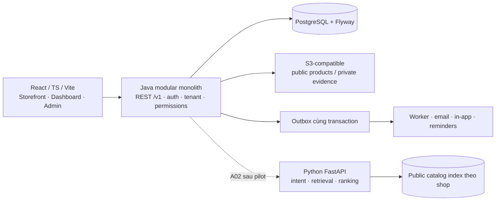
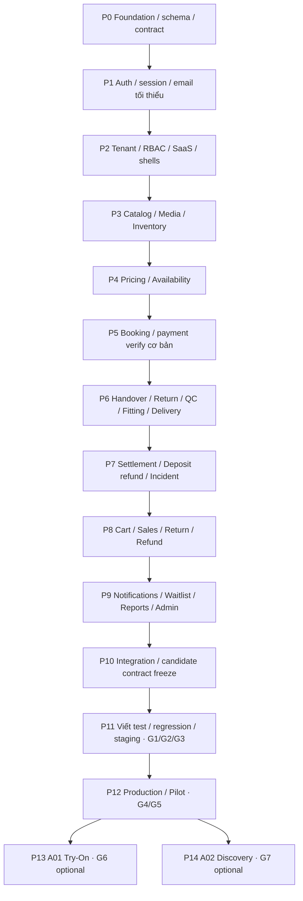

# DịpXinh — Kế hoạch triển khai theo phase cho Backend và Frontend

> Cập nhật **06/11/2026**, theo Discovery Update cùng ngày và source đọc trong lần rà soát này.  
> Đích phát hành: **Core Rental + Sales + SaaS → pilot 1–2 shop**. Sau pilot có hai nhánh độc lập: **A01 AI Try-On** và **A02 AI Smart Outfit Discovery**.  
> Backlog nguồn: **303 task = 282 Core/pilot + 11 A01 + 10 A02**. Giữ nguyên 74 quyết định Core và Task ID gốc.  
> **Yêu cầu người dùng xác nhận trong lần cập nhật này:** không viết thêm automated test ở Phase 0–10; chỉ build/typecheck và demo thủ công. Test mới, test còn thiếu và hồi quy tập trung ở **Phase 11**. Giữ hai test nền hiện có. Không coi demo là `Pass/Verified` hoặc đóng release gate sớm.  
> Markdown hướng dẫn thực hiện; **Excel v3.1 là nơi duy nhất ghi trạng thái, giờ thực tế, test evidence và nghiệm thu**. Kế hoạch không phải báo cáo tính năng đã hoàn thành.

Đi nhanh tới [việc cần làm ngay](#next-actions), [bảng ánh xạ 303 task](#task-map), [Phase 11 và release gates](#phase-11), [A01 Try-On](#phase-13) hoặc [A02 Discovery](#phase-14).

## 1. Cách dùng và nguồn sự thật

### 1.1. Đọc và thực thi

1. Đọc mục 2–4 để hiểu hiện trạng, bất biến và phụ thuộc.
2. Bắt đầu theo mục 9; tái sử dụng source đã có, không dựng lại ứng dụng.
3. Trong từng phase, chọn một slice BE + FE nhỏ; tra Task ID ở handbook, chốt contract trước code.
4. Build, demo qua API thật, đối chiếu PostgreSQL và ghi verification debt/evidence sau mỗi slice.
5. Hoàn tất Phase 11 trước production/pilot; chỉ cân nhắc AI beta sau pilot.

### 1.2. Năm tài liệu nguồn đã đối chiếu

Thư mục: `D:\Project_CaNhan\DipXinh-docs\DipXinh_AI_Discovery_Update_2026-11-06`.

| Nguồn | Vai trò |
|---|---|
| [Đặc tả nghiệp vụ, kiến trúc, roadmap v2.1](../../DipXinh-docs/DipXinh_AI_Discovery_Update_2026-11-06/DipXinh_Dac_ta_nghiep_vu_Kien_truc_Roadmap_v2_1.docx) | Scope, use case, business rules, kiến trúc; Phụ lục C cho A02 |
| [Implementation Handbook v3.1](../../DipXinh-docs/DipXinh_AI_Discovery_Update_2026-11-06/DipXinh_Implementation_Handbook_v3_1.md) | Hướng dẫn Task ID, input/output, edge case, DoD; 74 scope lock; A02-01..10 |
| [Development Tracker v3.1](../../DipXinh-docs/DipXinh_AI_Discovery_Update_2026-11-06/DipXinh_Development_Tracker_v3_1.xlsx) | Tasks, Current Focus, Delivery Slices, Schema Evidence, Test Matrix, Acceptance Gates, Settings, Decisions, Risks |
| [ERD và Mermaid v2.1](../../DipXinh-docs/DipXinh_AI_Discovery_Update_2026-11-06/DipXinh_ERD_Kien_truc_Mermaid_v2_1.md) | Domain boundaries; sequence booking/refund/sales; mục 15 A02; logical model khác schema thật |
| [PostgreSQL Schema Starter v1.2](../../DipXinh-docs/DipXinh_AI_Discovery_Update_2026-11-06/DipXinh_PostgreSQL_Schema_Starter_v1_2.sql) | DDL tham khảo và phụ lục AI được comment; **không chạy nguyên file vào DB hiện tại** |

Đã đối chiếu thêm backend, frontend, infra, workflows, README và kế hoạch cũ. `plans/` trong repo hiện còn handbook v3.0 và đặc tả v2.0; không dùng các bản cũ để ghi đè bổ sung ngày 06/11.

### 1.3. Xử lý khi nguồn khác nhau

1. Yêu cầu mới đã xác nhận của người dùng, gồm hoãn test mới tới P11.
2. 74 quyết định Core và A02 bổ sung, giữ tenant/money/time/privacy invariants.
3. Schema/migration thật quyết định **đã có gì**; yêu cầu nghiệp vụ quyết định delta cần làm bằng migration mới. Không sửa V1–V9 để ép khớp thiết kế.
4. ADR/OpenAPI của slice đã review, nhất quán nghiệp vụ.
5. Kế hoạch này quyết định thứ tự thực thi; handbook cung cấp chi tiết; Excel cung cấp trạng thái.
6. UI demo tham khảo trải nghiệm; giá/tồn/quyền/trạng thái do server quyết định.

### 1.4. Mâu thuẫn trong bộ nguồn và cách áp dụng

| Phát hiện | Cách áp dụng |
|---|---|
| Một số dòng Start Here/Dashboard còn nói FE đợi G2/backend | Theo quy tắc mới: F01 bắt đầu khi B01 scaffold dùng được; G2 chỉ là release gate |
| B01-01..04 được ghi Done nhưng thiếu evidence, Verified vẫn 0 | Giữ phân biệt reported Done và Verified; không tự cộng tiến độ |
| Current Focus còn xem F01 chưa bắt đầu dù source FE đã có | Audit và tái sử dụng source; cập nhật tracker khi có evidence thực thi |
| Reference còn trỏ handbook v3.0/ERD v2.0 | Tra cùng Task ID ở v3.1/v2.1; không tạo task trùng |
| Đoạn tổng quan còn nói SEO/TTL chưa chốt | Theo I1A/ADR-014 và ADR-010: public prerender; JWT 15 phút, idle 7 ngày, absolute 30 ngày là default đã chọn |
| Word/ERD dè dặt về deposit_accounts/refund_requests | Source V7 đã có cả hai; vẫn kiểm DB đang chạy trước khi thêm delta, không tạo bảng trùng |
| Handbook yêu cầu test theo slice nhưng người dùng chọn hoãn test | Code/build/demo trước; test/Verified và release signoff chờ P11 |
| G1 cần concurrency tests, P5 chỉ demo | P5 đạt mốc demo kỹ thuật; **G1 chính thức chờ P11** |
| B08 cần verify tiền nhưng B10 đứng sau operations | Kéo collection/verification và deposit collect tối thiểu sang P5; settlement/refund đầy đủ ở P7 |
| B02/B03 cần email trước B12 | Outbox/email verify/reset/invite tối thiểu làm ở P1/P2; hoàn thiện B12 ở P9 |

Lần sửa này không chỉnh workbook nguồn hoặc tự thay trạng thái task/gate.

## 2. Hiện trạng và khoảng trống

### 2.1. Repository

| Khu vực | Có trong source | Còn phải làm/kiểm chứng |
|---|---|---|
| backend | Java 21, Spring Boot/Modulith, JPA/JDBC, Flyway, Security, JWT library; 12 module packages | Business APIs, authorization, transactions và vận hành |
| identity | User/session/refresh domain/entity/repository; login service/controller; JWT/token hash utility | Rotation/replay, JWT filter/sid, logout, register/verify/reset, me, throttle, CSRF |
| migrations | File V1–V9 | Audit local history/schema, clean/upgrade evidence, migration delta |
| tests | ArchitectureTest và FlywayMigrationTest | Chưa chạy trong lần sửa tài liệu; chưa có suite nghiệp vụ đầy đủ |
| frontend | React/TS/Vite/Tailwind; UI demo rộng; LoginPage fetch API thật | Auth state/session, route shells, typed client, Query/Zod, phần lớn real API integration |
| infra/docker | Development PostgreSQL Compose, host port 5433 | Images BE/FE, Nginx/staging/prod, TLS, backup/restore, monitor |
| workflows | .gitkeep | CI/CD thật |
| plans | Nguồn cũ v3.0/v2.0 | Chốt cách version bộ nguồn mới trong repo |

Dependency version lấy từ manifest/lockfile lúc code; không nâng framework chỉ để khớp số trong tài liệu. README liệt kê một thư viện không có nghĩa thư viện đã được cài.

### 2.2. Những điểm auth cần xử lý sớm

Các nhận xét là quan sát source ngày 06/11, chưa phải kết quả security test:

1. Đã có `POST /v1/auth/login`, access JWT và refresh HttpOnly cookie; không triển khai login lại từ đầu.
2. AuthService đang dùng hạn 7 ngày cho session và refresh; cần tách idle 7 ngày/absolute 30 ngày, dùng Clock/config.
3. JwtTokenService đã ký/parse và có sid; cần iss/aud/jti theo contract, JWT filter, live session/user validation.
4. SecurityConfig disable CSRF toàn cục; cần Origin/CSRF cho auth mutation dựa cookie và CORS theo profile.
5. Có JWT secret fallback development; production phải fail startup nếu thiếu secret hợp lệ.
6. LoginPage đã gọi API qua proxy nhưng chỉ thông báo thành công, chưa AuthProvider/memory token/me/điều hướng.
7. `authenticated()` không thay JWT filter/sid check; phải hoàn thiện trước onboarding shop.

### 2.3. Database và migration

| Migration | Phạm vi source |
|---|---|
| V1 | pgcrypto, btree_gist |
| V2 | app_users, auth_sessions, auth_refresh_tokens |
| V3 | shops, roles, memberships, permissions, settings |
| V4 | categories/products/variants, QR units, sale stock/movements, bundles |
| V5 | customers, rental policies/orders/items, holds/allocations/GiST, unavailability/conflicts, amendments/waitlist |
| V6 | fitting, alteration, delivery, return batches/items, incidents |
| V7 | payment obligations/transactions, deposit accounts/movements/refund requests, audit |
| V8 | plans/subscriptions/SaaS invoices |
| V9 | outbox và notifications |

V5 có GiST exclusion cho HELD/CONFIRMED trên range `[start,end)`. V7 có deposit account/refund request; payment FK đang trỏ rental_orders, **không gắn SaleOrder vào cột rental order**.

Delta có thể cần: invitations/owner transfer/slug alias, media metadata, policy snapshots/version, approvals/reserved refund guards, handover evidence, promotion/cart/SaleOrder/returns/refunds, notification preferences. Kiểm cột/constraint trước; không tạo mọi box trong ERD thành bảng mới nếu snapshot/audit hiện có đáp ứng.

Migration dùng **số kế tiếp thật tại thời điểm merge**. Source hiện kết thúc V9 nên kế tiếp là V10; Sales/AI dùng V(next) sau các delta làm sớm, không mặc định Sales vẫn V10. Không sửa V1–V9, không repair để che checksum lệch, không clean DB có dữ liệu cần giữ.

### 2.4. Giới hạn chứng cứ và công việc dở

Workbook đang có B01-01..04 Done nhưng thiếu evidence, B01-05 In Progress và chưa công nhận Verified pilot task. Đó là snapshot workbook, không phải kết quả xác minh độc lập lần này.

Repo có nhiều thay đổi dở ở identity/auth và file khác. Khi thực thi phải xem diff, chỉ sửa phần liên quan, không reset/discard hoặc ghi đè thay đổi hiện có. Lần này chỉ cập nhật kế hoạch.

## 3. Kiến trúc, contract và bất biến

### 3.1. Kiến trúc đích



Java giữ nguồn sự thật về tenant, visibility, giá, availability, booking, inventory và tiền. Python chỉ xuất hiện ở A02; Core build/chạy/deploy được khi không có Python/AI provider.

Module hiện có: identity, catalog, inventory, pricing, booking, operations, finance, sales, notification, reporting, saas, shared. Tenant/RBAC thuộc identity theo baseline. Mỗi module giữ private internals và export facade/DTO/event tối thiểu; không import private entity/repository module khác.

JPA cho CRUD, SQL/JDBC cho locking/GiST đặc thù. Bất biến xử lý đồng bộ trong transaction; side effect dùng outbox V9. Không tạo thêm event log song song, Java microservices, broker hoặc Kubernetes nếu chưa có nhu cầu/ADR.

### 3.2. Giá trị đã khóa

| Chủ đề | Default/quyết định | Ràng buộc |
|---|---|---|
| Auth | Access 15 phút; idle 7 ngày; absolute 30 ngày | Memory access, opaque refresh cookie/hash DB; successor không vượt absolute |
| Rental | Horizon 180 ngày; hold 15 phút + một lần 15 phút | PENDING_REVIEW không tự giữ QR; expired hold không hồi sinh |
| Rental price | Cheapest eligible 1/3/5 ngày, mùa có ưu tiên | Pickup→due; event date metadata; không bill buffer |
| Advance | Mặc định 30% tiền thuê để confirm | Tách security deposit; balance + deposit verified trước handover |
| Buffer/QC | Buffer hậu thuê 24h; QC SLA 24h từ shop nhận | Hai điều kiện khác nhau; không tự READY |
| Cancel/overdue | ≥48h miễn phí hủy mặc định; overdue ceil 24h theo snapshot | Dịch vụ đã làm xét riêng; hủy muộn theo bảng phí, không tự áp 50% |
| Sales | Cart không reserve; checkout hold giá/tồn 30 phút | Variant price, promotion thấp nhất hợp lệ, không stacking |
| Sale return | 7 ngày từ khách thực nhận mặc định; partial | QC trước restock/refund; exchange = return + order mới |
| Plans | Trial 14d/3 staff/50 QR; Starter 5/200; Growth 15/1000 | Staff active + invite valid; QR mọi unit chưa retired |
| Subscription | Paid grace 3 ngày; upgrade ngay đủ điều kiện; downgrade kỳ sau | Nghĩa vụ cũ tiếp tục; pilot chưa thu phí SaaS |
| Fitting | Default 30 phút, cấu hình 30/45/60; no-show 15 phút | Release capacity, không release QR booking |
| Refund | Xử lý mặc định 48h từ đủ điều kiện quyết toán | Early refund Manager theo ngưỡng Owner; chưa có ngưỡng thì Owner-only |
| Notification | Pickup/return trước 24h, overdue sau 2h; 5 retry sau lần đầu | Dedupe; waitlist notify-only; bỏ cancelled/completed |
| Evidence/backup | Evidence default 12 tháng sau đóng case; DB nightly offsite 7 daily + 4 weekly | Legal hold ưu tiên; restore drill bắt buộc |
| SEO | /shop/{slug}; SPA + prerender public cần indexing | Không prerender private dashboard/admin/order |

Defaults cấu hình theo scope đã chốt và snapshot khi ảnh hưởng hợp đồng; không rải hằng số trong BE/FE.

### 3.3. Bất biến bắt buộc

1. Query shop-scoped luôn kèm shop_id; write kiểm membership/capability/ownership. Composite FK không thay authorization.
2. Customer chỉ tài nguyên mình; browse/availability public, tạo rental/fitting/sale checkout phải login.
3. SystemAdmin không mặc định xem ảnh khách hoặc sửa payment/refund của shop.
4. Tiền BigDecimal/numeric; chốt API decimal string + currency/scale; FE không quyết toán bằng float.
5. UTC/Instant/timestamptz, input offset rõ và hiển thị timezone shop; default Việt Nam dùng Asia/Ho_Chi_Minh.
6. Rental QR từng món vật lý, sale stock aggregate variant; QR opaque không PII.
7. Availability read không là reservation; allocation dùng locks/transaction/GiST half-open.
8. Hỏng/trễ cho phép ghi unavailability chồng confirmed booking rồi tạo conflict; không chặn ghi sự cố thật.
9. QC chỉ rút buffer được phép, không rút quyền thuê còn hiệu lực; late pickup không auto cancel.
10. Verification tiền dựa thực nhận/thực hoàn; screenshot không tự VERIFIED.
11. Deposit là khoản phải hoàn; proposed/disputed incident không tự thành finalized due.
12. Pending refund reserve tiền; REFUND movement sau xác minh; serialize refund/charge/cash settlement.
13. Email/indexing không giữ transaction mở; append outbox cùng business transaction, dispatch sau commit.
14. Product published mới public; customer/evidence private và signed access có authorization.
15. Expired plan/suspend chặn mới nhưng giữ giao/nhận/QC/refund nghĩa vụ cũ theo quyền; security quarantine riêng.

### 3.4. Contract của mỗi slice

Trước code cần actor/capability, tenant nguồn, route, payload/example/error, validation, transitions, DB delta, lock order, idempotency scope, FE states và acceptance cases.

| Quy ước | Yêu cầu |
|---|---|
| Routes | /v1; public /v1/storefront/shops/{slug}; staff /v1/shops/{shopId}; customer /v1/me; platform /v1/platform |
| AI proposal | /v1/shops/{slug}/ai/outfit-search; phân biệt slug/UUID rõ, freeze ở P14 |
| Errors | Problem Details RFC 9457; code/traceId/field errors, không stacktrace/tenant leak |
| Retry | Idempotency theo actor+tenant+action; same key/same payload replay, khác payload conflict; chốt retention |
| Update | Version/If-Match hoặc state guard; stale write 409; FE refetch |
| List | Pagination/max size/filter-sort whitelist/export bounds |
| Cache | Query key có shop/identity; clear khi logout/đổi shop/quyền |
| Delivery | OpenAPI artifact versioned + generated types/client; không sửa generated tay |

Routes chưa có trong source vẫn là contract dự kiến cần review; tên file/class minh họa không ép tạo boilerplate.

### 3.5. Hoãn test có kiểm soát

P0–P10 không tạo unit/integration/concurrency/component/E2E/evaluation test mới. Vẫn compile/package BE, typecheck/build FE, demo API/PostgreSQL thật và lỗi chính có thể tái hiện thủ công.

Giữ hai test hiện có; đọc/chạy test cũ không chứng minh test nợ đã đủ. Mỗi slice ghi verification debt: Task ID, Test ID, fixture, bước, expected result, race/tenant/idempotency và artifact cần tạo P11.

Task code xong nhưng thiếu test bắt buộc giữ trạng thái hợp lệ như In Review, ghi “implementation complete; verification pending P11”; không sửa Verified/formula để vượt gate. WIP 1–2 task đang code; task chờ verification phải ghi dependency rõ.

P11 viết test, sửa defect, chạy gate và lưu evidence. Hoãn lịch kiểm chứng không bỏ bất biến/chuẩn phát hành. A01/A02 có test trong phase P2 riêng, không kéo ngoại lệ hoãn test sang sau P11.

## 4. Đường đi nhanh nhất

### 4.1. Mốc thực thi

| Mốc | Luồng UI thật | Ý nghĩa |
|---|---|---|
| M0 | DB/BE/OpenAPI/FE shell | Có thể bắt đầu feature, không đợi backend freeze |
| M1 | Auth/session → shop → quyền/plan | Nền dùng được |
| M2 | Publish catalog → QR → quote/availability | Giá/tồn server |
| M3 | Request/hold → verify → confirm → handover → return/QC → refund | Rental loop qua P5–P7; G1 vẫn đợi P11 |
| M4 | Cart/checkout → verify → fulfil → partial return/refund | Sales Core đủ scope |
| M5 | SaaS/notification/report/admin/SEO tích hợp | Bắt đầu full verification |
| M6 | P11 G1/G2/G3 → G4 → pilot G5 | Core nghiệm thu có evidence |
| M7 | A01 và/hoặc A02 | P2 độc lập theo giá trị đo được |

### 4.2. Sơ đồ phụ thuộc



Đây là trục hoàn tất scope cho một người, không bắt chờ toàn module mới nối FE. Trong từng phase, endpoint nhỏ chạy được là FE bắt đầu. B12 outbox/email tối thiểu kéo về P0–P2; R01 image/config staging chuẩn bị P0/P10. Mọi phần kéo sớm giữ Task ID gốc và không tính giờ hai lần.

## 5. Kế hoạch chi tiết theo phase

P0–P10 chỉ có **gate implementation** để đi tiếp phát triển, không phải Verified/release. Test IDs bên dưới là việc phải kiểm ở P11; P13/P14 kiểm chứng trong chính phase P2.

### Phase 0 — Nền tảng, schema audit, contract và FE shell

**Task:** B01-01..16; F01-01..04/09..12 phần implementation; B12-01..02 phần outbox contract. Test mới B01/F01 chuyển P11.  
**Đầu vào:** repo hiện tại và bộ nguồn mới. **Đích:** máy dev theo README khởi động DB/BE/FE và dùng chung conventions.

**Thứ tự:** ghi diff/toolchain → audit V1–V9/local schema → shared/contract → FE shell/client → build/startup/browser API.

**Backend**

1. Giữ Java 21/Maven Wrapper và dependency đang khóa; profiles local/test/prod, production fail khi thiếu secret.
2. ddl-auto=validate, Flyway quản schema; seed dev tách production; schema inventory table/column/FK/check/index và delta cần thiết.
3. Problem Details cho 400/401/403/404/409/429; Clock, Money/rounding, UTC và correlation ID thống nhất.
4. Module facade/public contract, xác định transaction ownership booking↔inventory↔finance để tránh dependency vòng.
5. OpenAPI local/API collection; pagination, permission, idempotency và version guard conventions.
6. Dùng outbox V9: append trong transaction, event version/dedupe/payload tối thiểu; chưa cần worker mọi event.
7. Actuator/log redaction/env example; CI compile/package, chưa bật test mới hoặc báo verify pass giả.

**Frontend**

1. Giữ React/Vite/TS/Tailwind; bổ sung Query/Zod/OpenAPI client theo nhu cầu thật.
2. Shell /, /login, /shop/:slug/*, /app/:shopSlug/*, /admin/*, not-found; auth boundary hoàn thiện P1/P2.
3. shared/api, shared/ui, shared/lib, features; error/loading/empty/forbidden/conflict states nhất quán.
4. Query key tenant-aware, proxy/base URL và cookie credentials; không auth giả cho production route.
5. Tách dần ShopDashboardPage/StorefrontPage/demo-store; không port business calculation từ demo.
6. Demo mode chỉ dev/preview chủ đích; production API lỗi không fallback fake data.
7. CI npm ci/typecheck/build theo lockfile; thêm script trước khi coi là lệnh bắt buộc.

**Artifact:** schema inventory, contract conventions/ADR, seed A/B tối thiểu, local run guide và verification debt. Không sinh ORM mọi bảng chưa dùng.

**Gate:** BE startup/PostgreSQL/health/OpenAPI và FE direct route/reload/API call dùng được; có build log. Clean migration/constraint tests chưa được xem Pass.

### Phase 1 — Identity, session và Auth UI thật

**Task:** B02-01..16; F01-05..08/10; F03-13 account/session; kéo tối thiểu B12-03..04 cho email verify/reset. B02-08/regression chờ P11.  
**Đầu vào:** P0. **Đích:** login/refresh/logout/profile/session qua browser thật.

**1A — Hoàn thiện login đang có**

- BE normalise email, active user, password encoder và response chống enumeration; session/refresh hash cùng transaction.
- Access claims sub/sid/iss/aud/iat/exp/jti; Clock/config, tách idle 7d/absolute 30d.
- FE AuthProvider memory token, Bearer client, hydrate me, safe return URL và điều hướng theo membership.
- Bỏ thông điệp implementation “sẽ triển khai B02” trong production login flow.

**1B — Rotation/revoke**

- Opaque CSPRNG ≥256 bit; DB SHA-256 hash; raw refresh chỉ HttpOnly cookie, không JSON/log/browser storage.
- Lock session/token nhất quán; check unused/expiry/revoked; mark used + successor cùng transaction; expiry successor không vượt absolute.
- Replay revoke family/session. Revoke phải commit được, không bị rollback bởi auth exception; ghi transaction boundary rõ.
- JWT filter kiểm signature/iss/aud/exp/sid/user; logout/disable không để JWT tiếp tục dùng tới exp.
- FE single-flight trong tab, phối hợp nhiều tab bằng cơ chế đã chọn như Web Locks/BroadcastChannel, không persistent token. Không có coordination thì UX re-login an toàn, không nới replay guard âm thầm.
- Refresh chỉ lỗi auth phù hợp, tối đa một vòng; mutation retry chỉ theo idempotency contract; 403 không refresh lặp.

**1C — Credential lifecycle và UI**

- Register/verify/forgot/reset/change password, token một lần/hash/expiry; email qua outbox + local sink, không giữ transaction chờ SMTP.
- Logout current/all, list/revoke sessions, GET me; thay/reset password và disable revoke đúng policy.
- Forms Zod, pending/error/success; session page owner-only không trả secret/hash.
- Cookie host-only HttpOnly/Secure prod/SameSite=Lax/Path=/v1/auth; clear cùng attributes; Origin/CSRF/CORS đúng cho cookie auth mutations, gồm login CSRF theo thiết kế.
- Throttle login/reset/refresh; production không JWT secret fallback dev.

**API:** /v1/auth/login, register, refresh, logout, logout-all; verify/reset routes freeze theo OpenAPI; GET/DELETE sessions; GET /v1/me. Profile update chỉ thêm field đã chốt.

**Demo:** login → protected me → reload/refresh → logout → protected API bị từ chối; wrong password/expired cookie và hai session thiết bị.

**Debt P11:** T17–T24; idle/absolute, revoke commit, refresh race/multi-tab, CSRF/Origin và safe retry. Có endpoint không có nghĩa đã Verified.

### Phase 2 — Shop, tenant, RBAC, SaaS và shell theo vai trò

**Task:** B03-01..12/B04-01..10; F02-01..03/17 shop-plan; F03-01; F04-01..06. Test chờ P11.  
**Đầu vào:** auth thật. **Đích:** Owner tạo shop/mời staff/chuyển shop theo đúng quyền/gói.

**2A — Onboarding/tenant**

- Transaction shop + primary Owner + settings + Trial; unique slug và conflict rõ.
- Public slug resolver khác staff membership guard; path/body/header shopId phải đối chiếu resource/user.
- Tenant query cho mọi detail/write; 403/404 không leak shop khác. Customer global identity, profile theo shop.
- FE onboarding/switcher/dashboard/public branding; chuyển shop hủy request cũ/clear scoped cache.

**2B — Staff/Owner/slug**

- Roles Owner/Manager/Staff + capability catalog; menu/route FE không thay server authorization.
- Invitation create/accept/revoke/expire + email; valid invite giữ slot, accept không đếm hai lần.
- Owner-only không cấp vòng; Manager chỉ quản Staff khi được phép, không tự tăng quyền.
- Một primary Owner; transfer re-auth/acceptance/audit/transaction, không mất hoặc nhân đôi Owner.
- Disable staff thu hồi ngay, giữ audit/task reassign queue; đổi slug giữ alias/redirect, cấm shop khác chiếm slug cũ.
- FE staff list/invite/permission/transfer và forbidden/permission changed UX.
- Audit schema delta invite/alias/transfer trước V(next).

**2C — Plan/quota/admin**

- Plans theo defaults mục 3.2; giá cấu hình, pilot không thu phí SaaS.
- Quota staff/QR atomic qua lock phù hợp; expired invite release một lần; giữ dữ liệu khi downgrade quá quota.
- Trial expiry khác paid grace 3d; restricted vẫn giao/nhận/QC/refund/history/upgrade nghĩa vụ cũ.
- Upgrade khi đủ điều kiện áp ngay, downgrade kỳ sau; SaaS invoice tách tiền khách/deposit shop.
- Platform approve/suspend/reactivate có audit; business suspend khác security quarantine.
- FE plan usage/banner/settings/invoice admin; guard dựa capability backend.

**Artifact:** permission matrix actor×action×shop state; entitlement NEW vs EXISTING_OBLIGATION; quota count rules.

**Demo:** user hai shop, ID shop khác bị chặn, Manager không tự cấp Owner-only; restricted chặn tạo mới nhưng màn xử lý đơn cũ còn hoạt động.

**Debt P11:** T04/T14/T22, B03-12/B04-10/F04-08; quota/invite/transfer/slug/permission revoked races.

### Phase 3 — Catalog, media, QR inventory và tồn bán

**Task:** B05-01..12/B06-01..12; F02-04..07/16 phần stock; F03-02..03.  
**Đầu vào:** tenant/quyền/quota. **Đích:** publish hàng thật, browse đúng shop, quản lý từng QR và stock variant.

**3A — Catalog/variant/bundle**

- Category hierarchy chống vòng lặp; product CRUD/publish/archive, variant size/color và hỗ trợ sale/rental rõ.
- Measurement metadata/size guide; order history luôn snapshot, không phụ thuộc tên/giá mutable.
- Bundle/component/quantity/replace policy; preview giá/availability hoàn thiện P4/P5, không điền giá giả để đóng B05-09.
- Public API published-only, admin pagination/filter; import CSV feedback từng dòng, chốt all-or-nothing hay partial.
- FE editor sản phẩm/variant/size/bundle, public list/detail/search với đủ loading/empty/error.

**3B — Media**

- S3-compatible adapter, provider chọn lúc tích hợp; dev storage phải có access behavior tương đương.
- Upload init→upload→complete/validate→attach; tenant/object key/MIME/size/extension guard, không dùng PII làm key.
- Metadata owner/type/visibility/lifecycle, reject asset shop khác; orphan/failed upload cleanup.
- Draft không mặc định public; publish/unpublish xử lý object/cache. Evidence private signed URL ngắn hạn sau authorization.
- FE progress/retry/reorder/remove; không upload evidence vào public folder.

**3C — Rental QR và sale stock**

- QR opaque unique, batch/import/labels/condition/retired, quota mọi unit chưa retired.
- Scan staff đúng shop, không lộ PII qua QR; mobile camera và nhập tay cùng guard.
- SaleStock per shop/variant; adjustment immutable movement/reason/actor/idempotency, không update số trần từ FE.
- Rental→sale chỉ khi không còn allocation hiệu lực/future hoặc nghĩa vụ chưa xong; chuyển trạng thái và movement cùng transaction.
- Physical block/expected-ready/actual-ready read model; chưa QC không auto READY.
- FE QR list/detail/scan/print, stock adjustment/history, calendar trạng thái unit.

**DB:** bổ sung media/stock guards thiếu sau audit; chưa tạo SaleOrder ở đây.

**Demo:** variant→QR/stock→publish→browse; archive giữ history; replay adjustment không tăng stock hai lần; tenant/asset khác bị chặn.

**Debt P11:** B05-12/B06-12; media privacy/upload, conversion/quota/movement races; calendar nối đủ P4/P5.

### Phase 4 — Pricing, snapshot và availability

**Task:** B07-01..10; B06-11; B05-09 preview; F03-04/05 quote; F02-07 calendar.  
**Đầu vào:** catalog/QR và shop policies. **Đích:** giá/availability server-authoritative.

**Backend**

1. Calculator pickup→due, cheapest eligible 1/3/5 ngày, extra days, seasonal priority, rounding; không bill buffer.
2. Validate time/lead time/horizon 180 ngày, event date metadata, timezone nhất quán.
3. Bundle/quantity breakdown, replacement reprice, cọc per QR/variant/combo cap đã công bố.
4. Quote breakdown/currency/policy version/hash/expiresAt/advance condition; quote không giữ QR.
5. Snapshot price/cancel/deposit/extra-day rate lúc chấp nhận; amendment tạo lịch sử mới.
6. Cancel/change calculator dùng snapshot, ≥48h miễn phí mặc định có ngoại lệ dịch vụ; không suy diễn phí 50%.
7. Availability từ active allocations/expired hold handling/physical blocks/readiness/prep-buffer.
8. Giá sale/promotion contract ở đây, schema/checkout snapshot hoàn thiện P8.

**Frontend:** date/time picker timezone shop; breakdown rent/advance/balance/deposit/service tách; đổi variant/qty/ngày quote lại, abort/stale protection; stale quote có UX reprice; availability không hứa giữ hàng. FE không tự chốt multiplier/total/overdue.

**API/artifact:** public quote/availability, staff policy CRUD; items/bundle/time request và per-line/total/policy/expiry response, invalid/stale/unavailable errors trước code.

**Demo:** package/season breakdown giải thích được; đổi policy không đổi snapshot cũ; block/booking hiện đúng; client price bị bỏ qua/từ chối.

**Debt P11:** B07-10; rounding, timezone, 24h/48h/180d boundaries, season priority, stale quote và snapshot.

### Phase 5 — Rental booking và xác minh thanh toán cơ bản

**Task:** B08-01..21; F02-08..09; F03-05..06. Kéo sớm B10-01..04, tối thiểu B10-05..06/15/17 cho collection/deposit; B12-02 cho event persistence. B08-07/21 và test mới chờ P11.  
**Đầu vào:** quote/availability, auth/tenant/quyền. **Đích:** request→hold→verify advance→confirm, thu balance/deposit đủ để P6 bàn giao đúng luật.

**5A — Request/hybrid approval**

- Customer request theo slug, server kiểm user/tenant/entitlement/quote/time; customer profile/contact tối thiểu theo shop.
- PENDING_REVIEW không tự giữ đồ; staff duyệt phải tạo hold/allocate trong transaction hợp lệ.
- AUTO_HOLD chỉ CONFIRMED khi verified advance và QR/approval còn đủ điều kiện.
- Group/multi-item chung pickup/due; mỗi quantity có đúng QR allocation. Không mở per-person settlement ngoài scope.
- FE checkout/customer status/staff board/detail/filter, QR chỉ staff có quyền; customer chỉ đơn mình.

**5B — Transaction hold/confirm/expiry**

1. Resolve tenant/quyền/entitlement; check idempotency key/payload.
2. Lock candidates/holds theo thứ tự cố định; expire stale holds liên quan trước tái sử dụng QR.
3. Validate physical condition/slot/quantity; tạo hold 15 phút và từng QR allocation atomically.
4. GiST chặn cuối; map conflict `409 UNIT_SLOT_CONFLICT`; retry chỉ khi an toàn/có giới hạn.
5. Extend tối đa một lần +15 phút khi còn hiệu lực và đúng policy; lưu count/reason/audit.
6. Confirm lock order/hold/payment condition, check server time và verified advance; cập nhật order/hold/allocation cùng transaction.
7. Expiry job transition/release/outbox một lần, chạy lại không tạo tác dụng trùng.
8. Tiền đến sau expiry vào reconciliation: verify receipt tách quyết định confirm; xét lại QR và tạo reservation hợp lệ mới. Không resurrect expired hold.

**5C — Finance collection tối thiểu**

- Obligation ADVANCE/RENTAL_BALANCE/SECURITY_DEPOSIT và service tách; tổng rent không cộng advance hai lần.
- Record PENDING, staff payment.verify đối soát thực nhận→VERIFIED với reference/actor/time/idempotency.
- Multiple/split payments; outstanding từ verified, không từ screenshot hoặc tổng pending.
- DepositAccount V7: COLLECT movement chỉ sau verified deposit; signed convention/correction contract thống nhất.
- Nút confirm/handover lấy điều kiện server; không dùng paid=true phía browser. P6 gọi finance facade cho balance/deposit.
- Chưa kéo toàn refund/incident engine sang đây; giữ collection facade/ledger đủ để P7 tái sử dụng không ghi thu hai lần.

**5D — Amend/reassign/reschedule/cancel**

- Cùng variant vẫn kiểm QC/slot; khác variant cần khách đồng ý và reprice.
- Lock old/new nhất quán, all-or-nothing: thất bại giữ booking/allocation cũ và lịch sử snapshot.
- Trước handover thêm/bớt/hủy item phải reprice/reallocate/deposit checks; sau handover dùng partial return.
- Cancellation dựa snapshot, tạo adjustment/refund obligation cho P7; không xóa payment.
- Waitlist event notify-only; FE xử lý 409/expiry, countdown local không quyết định quyền giữ QR.

**Demo:** request→hold→thu/verify advance→confirm; một ca review; expired hold bị từ chối confirm; reschedule thiếu QR giữ đơn cũ; user khác không đọc đơn.

**Mốc:** demo kỹ thuật rental slice, **chưa ký G1** vì concurrency suite hoãn P11.

**Debt P11:** T01/T02/T03/T04/T12; confirm-vs-expire, cùng QR, replay, quantity/variant/hold links, late funds và amend rollback; collection guards.

### Phase 6 — Handover, partial return, QC, fitting và delivery

**Task:** B09-01..18; F02-10..13; F03-11.  
**Đầu vào:** booking confirmed và collection facade. **Đích:** vận hành thuê qua dashboard/mobile có audit/readiness đúng.

**6A — Bàn giao/nhận trả**

- Handover chỉ khi đúng trạng thái, verified đủ balance/deposit và điều kiện nghĩa vụ theo policy.
- Scan từng QR khớp allocation/shop/order; actor/time/method/customer acknowledgement; ảnh theo cấu hình/ngoại lệ.
- Nhập tay khi camera lỗi qua cùng guard; duplicate scan không tạo handover item hai lần.
- ReturnBatch từng đợt, QR chỉ nhận hợp lệ một lần; receivedAt/method/staff và inspection riêng.
- Trả 8/10 rồi 2/10 không sửa due hợp đồng, không đóng order/hoàn toàn bộ cọc sau batch đầu.
- FE mobile scan/progress/confirmation; chốt rõ atomic request nhiều QR hay partial result, không bỏ qua lỗi món lẻ.

**6B — QC/physical blocks/conflicts**

- QC per unit pass/cleaning/damaged/lost theo state machine và evidence; proposed incident chuyển P7, chưa tự trừ tiền.
- Block cleaning/alteration/maintenance có expectedReady; actualReady chỉ sau QC pass có actor/audit.
- QC SLA 24h là nhắc deadline; buffer 24h là thời gian chuẩn bị, không job tự READY khi hết giờ.
- Early QC chỉ rút phần hậu thuê được phép, không rút quyền thuê còn hiệu lực kể cả trả sớm.
- Hỏng/trễ được ghi overlap confirmed, tạo impacted conflicts; staff reassign/reschedule/liên hệ, không auto cancel.
- Alteration/restore lưu deadline/cost/measurements tối thiểu-private, complex case approval; không log số đo.
- FE inspection queue/unit timeline/conflict triage/shortcut amendment; server quyết transition.

**6C — Fitting/delivery/jobs**

- Capacity/slot/hours/holidays theo shop; create/change/cancel transaction capacity, không giữ QR.
- No-show 15 phút chỉ release fitting capacity, không rental allocation.
- Pickup/return delivery methods độc lập; local delivery milestones manual, address/contact snapshot/assigned staff.
- DELIVERY_FAILED có reason/evidence; lên lịch lại/nhận tại shop, không tự hủy confirmed.
- Overdue/QC jobs append deduped event/alert; không release quyền thuê hoặc auto READY.
- FE fitting/customer appointment/calendar/delivery dispatch, giới hạn dữ liệu theo actor.

**DB:** audit V5/V6 trước bổ sung handover/evidence/inspection fields; không nhân đôi ReturnBatch.

**Demo:** thiếu tiền không handover→verify→scan giao→partial return→QC→ready đúng; hỏng ảnh hưởng booking sau có conflict; fitting không giữ QR.

**Debt P11:** T05/T06/T07/T13, B09-18; duplicate scan, capacity race, early-return rights, failed delivery/no-show/SLA-vs-buffer.

### Phase 7 — Incident, settlement, finance và hoàn cọc đầy đủ

**Task:** hoàn thiện B10-01..18; F02-14..15; F03-06/13 payment/refund timeline. Collection P5 tái sử dụng, không tính task/receipt hai lần.  
**Đầu vào:** ledger P5, returns/QC/evidence P6. **Đích:** đối soát đúng thực nhận/phải thu/cọc/phải hoàn.

**7A — Charges/settlement**

- Staff proposed fee; Manager/Owner có quyền finalize mới sinh obligation.
- Dispute vào review, proposed/disputed không tự apply deposit; chỉ refund phần không tranh chấp đủ điều kiện.
- Overdue ceil block 24h theo snapshot, job rerun không tạo cùng charge hai lần.
- Cash settlement và apply deposit khóa cùng obligation/account theo thứ tự thống nhất, không vượt outstanding.
- Cancel/amendment adjustment dùng snapshot/consent/reason/audit; không xóa/sửa verified history.

**7B — Reserve/refund lifecycle**

1. Lock DepositAccount; xác định verified ledger balance và khoản reserve còn hiệu lực.
2. Chốt công thức: ledgerBalance = tổng signed movements hợp lệ; availableToRefund = ledgerBalance − activeRefundReservations − otherActiveReservations. Không trừ một reserve hai lần; mô tả state tạo/release.
3. Full refund sau trả đủ/QC/đối soát, default xử lý 48h từ lúc đủ điều kiện, không từ batch đầu.
4. Early partial refund cần reason/quyền/cap Owner; chưa cap chỉ Owner. Manager không chia request để lách giới hạn policy.
5. PENDING/APPROVED/PROCESSING reserve; REJECTED/CANCELLED release một lần. Transfer kết quả chưa rõ giữ reconciliation, không release rồi retry mù.
6. Verify thực hoàn cash/bank→payment/refund movement một lần→VERIFIED_REFUNDED→release reserve theo transaction đã thiết kế.
7. Không giữ DB lock suốt chuyển tiền ngoài hệ thống; PROCESSING/reference/reconciliation chống chuyển hai lần.

**7C — API/UI/report**

- Capabilities riêng cho record/verify/propose/finalize/request/approve/process/refund verify/read/export.
- FE tách pending/verified/proposed/final/applied/refunded/reserved; reason/confirm đúng thao tác, quyền từ BE.
- Daily reconciliation timezone shop/cash-bank; deposit liability tách revenue; link order/payment/movement/incident/audit.
- Customer chỉ dữ liệu phù hợp của mình, không lộ evidence/bank info người khác.
- Append-only ledger, correction có reference/reason/actor; same idempotency key khác payload 409.

**Demo:** proposed 300.000→final 150.000 chỉ nợ 150.000; pending refund giữ tiền chưa ghi REFUND; verify tạo một movement; cash+deposit không vượt due; Manager chưa cap không approve early refund.

**Debt P11:** T08–T11/B10-18; concurrent refund/charge/cash, duplicate verify, crash sau transfer, dispute reserves/caps/reconciliation. Logic guards B10-09/13 code tại đây, không hoãn implementation concurrency tới P11.

### Phase 8 — Full Sales cart, checkout, fulfilment, returns/refunds

**Task:** B11-01..18; B07-09 sale snapshot; F02-16; F03-07..10.  
**Đầu vào:** stock P3, pricing P4, finance conventions P5/P7. **Đích:** SaleOrder riêng RentalOrder, toàn bộ mua/giao/trả/hoàn qua API thật.

**8A — ADR/schema trước code checkout**

- Chốt state machine, payment model và stock consumption moment. Baseline theo ERD sequence: consume reservation + OUT khi verify payment hợp lệ; fulfilment không trừ lần hai.
- V7 payment FK rental-only: chọn mở rộng an toàn hoặc sales payment/link model riêng qua migration. Một nguồn ghi tiền, không duplicate ledger cùng receipt.
- Audit cart/order/items/reservations/promotion/fulfilment/returns/refunds; tenant FKs/positive qty/amount/unique idempotency/movement refs.
- Cart một shop; guest cart giới hạn không giữ hàng, login trước checkout. B11-03 phải chốt merge/TTL/quantity caps, không tự mở guest checkout.

**8B — Cart/quote/checkout transaction**

- Add/update/remove/list cart; validate shop/variant/sale visibility; cart total preview, không giữ giá/tồn.
- Server reprice variant/promotion lowest valid/shipping fee-free threshold; freeze lines/total/policy vào SaleOrder.
- Lock stock theo thứ tự variant cố định; available=on_hand−reserved đủ quantity; order/items/reservations/payment pending atomically.
- Hold 30 phút, price snapshot valid theo hold; buyer+shop+action idempotency/payload hash, double-click một order.
- Online bank manual; pay-at-shop chỉ direct transaction, không mở COD/online pay-later ngoài scope.
- FE cart/checkout/address khi giao/breakdown/expiry/bank instruction; stock/price conflict có UX reprice.

**8C — Verify/expiry/cancel/fulfil**

- payment.verify đối soát thực nhận, lock order/reservation; còn hold hợp lệ mới consume và một OUT.
- Expiry/cancel release một lần; late payment reconciliation→stock check/reservation mới hoặc refund/alternative.
- Khách hủy unpaid; paid trước handover staff approve; sau handover dùng return.
- Paid cancel khi stock đã consume phải compensating movement/restock rule rõ, không chỉ trừ reserved đã bằng 0.
- Prepare/pickup/local delivery/received/completed; actual receivedAt là mốc return window, failed delivery manual/evidence.
- FE staff board/detail/verify/fulfil/cancel; customer history/timeline owner-scoped, không userId arbitrary.

**8D — Partial return/QC/refund**

- Default 7 ngày từ thực nhận, theo item/qty; chống trả vượt đã giao hoặc đã trả.
- QC restock/scrap/reject; nhận hàng chưa tự tăng tồn/hoàn tiền.
- Restock movement/refund idempotent và trạng thái physical/financial tách; exchange return+new order.
- Shipping refund trước giao khi hợp lệ; sau giao theo trách nhiệm/policy, không tự hoàn mọi phí.
- FE customer request/status, staff receive/QC/disposition/approve/verify refund.

**Demo:** cart→checkout 30m→verify→OUT→fulfil/received→partial return/QC→restock/refund; expired không hồi sinh; tampered price/qty bị từ chối.

**Debt P11:** S01–S10/B11-18; oversell, expiry/cancel/verify/fulfil races, duplicate OUT/RESTOCK/REFUND, adjustment-vs-checkout, ownership và paid-cancel compensation.

### Phase 9 — Notification, waitlist, reporting và admin hoàn chỉnh

**Task:** B12-01..15; F02-17 notifications/KPI; F03-12/13; F04-02/07. Hoàn thiện outbox/email đã kéo sớm, không thêm processor song song.  
**Đầu vào:** events thật rental/operations/finance/sales. **Đích:** side effects đáng tin, report đúng quyền và số liệu.

**Backend**

- Worker poll/lease/lock, at-least-once + handler dedupe; không hứa exactly-once email.
- Exponential backoff tối đa 5 retry sau lần đầu; FAILED/dead-letter/reason/metrics/manual retry có guard.
- Templates verify/invite/order/receipt/refund/reminders/waitlist, provider/domain verify/config theo môi trường.
- In-app đúng recipient/shop, read/unread/paging; preference thiết yếu/không thiết yếu và privacy boundary platform.
- Waitlist subscribe/unsubscribe variant/time; unitReady/holdExpired notify đồng thời khách phù hợp, không reserve QR.
- Reminder 24h trước pickup/return, overdue sau 2h; check cancelled/completed trước gửi, dedupe event/time window.
- Customer dashboard rentals/sales/fitting/waitlist theo authenticated subject; shop KPI tách rental/sale/deposit/pending/refund.
- Reports/CSV shop+timezone/range bounds/audit/formula injection escape; EXPLAIN/index nếu query chậm.
- Platform tenant/plan/usage/invoice/system health, không private evidence/customer records ngoài quyền.
- Retention/orphan cleanup theo category, evidence default 12 tháng sau đóng case/legal hold override; không xóa chứng từ bắt buộc.

**Frontend:** inbox/preferences/deep-link đúng tenant; waitlist “đã notify” không “đã giữ”; KPI/export thật và ngày/filter rõ; admin failure/retry summary theo quyền, không dựng dashboard giám sát quá mức pilot.

**Demo:** provider lỗi nhưng order commit giữ nguyên và outbox chờ retry; waitlist không allocation; export shop khác bị chặn; KPI khớp ledger mẫu.

**Debt P11:** T15/B12-15; worker crash/duplicate/retry/cancelled reminder, recipient/privacy/preference, CSV/retention/legal hold.

### Phase 10 — Tích hợp và đóng phạm vi implementation

**Task:** B13 phần review/implementation; F03-14; F05 wiring/manual/accessibility; R01-03..05/07/08 phần chuẩn bị staging. Mọi test/benchmark/signoff bắt buộc chưa đóng trước P11.  
**Đầu vào:** P1–P9 nối API thật. **Đích:** hết khoảng trống BE–FE, candidate contract và môi trường sẵn kiểm chứng.

1. Audit endpoint/screen: actor/permission/API/DB effect/error/empty/loading cho mọi Core use case; production không fake fallback.
2. Manual rehearsal Owner onboarding, Staff rental, Customer sale, tenant/role switch và restricted shop xử lý nghĩa vụ cũ.
3. Review boundaries/transaction/idempotency/lock order; lỗi code rõ sửa ngay, không đợi viết test.
4. OpenAPI/generated client đồng bộ, **candidate** freeze; fix P11 đổi contract phải review/generate lại.
5. Tách FE file lớn theo feature cần thiết, bỏ duplicate state/guards; không rewrite UI cuối dự án.
6. Public prerender shop/product: canonical/metadata/sitemap/robots/structured data theo scope; slug alias redirects, không prerender private/session data.
7. Publish/unpublish/slug invalidation; direct public link/reload đúng qua reverse proxy.
8. Responsive/keyboard/focus/errors, QR camera denied + manual fallback; review thủ công, automated checks ở P11.
9. Images BE/FE, Compose/Nginx staging config/env/health, DB private, dữ liệu staging tách production; chưa tự deploy public.
10. Tổng hợp verification debt theo Task/Test ID; không để acceptance chỉ trong chat.
11. Release notes dự kiến/known issues severity-owner/migration plan/runbooks draft.

**Gate:** package/typecheck/build, manual journeys/seed thật, không screen Core chỉ demo; candidate contract + staging wiring + debt đầy đủ. **G2/G3 chưa Passed**; candidate freeze không signoff chính thức.

<a id="phase-11"></a>

### Phase 11 — Viết toàn bộ test, sửa lỗi, regression và G1/G2/G3

**Task:** phần test hoãn B01..B12/F01..F04; B13-01..15; F02-18/F03-15/F04-08; F05-01..10 và kiểm chứng staging/benchmark liên quan R01.  
**Đầu vào:** P10/debt ledger/Docker test environment. **Đích:** từ implementation complete sang Verified/release candidate.

**Thứ tự ít làm lại:** foundation/migration→auth/tenant→pricing/inventory→booking→operations/finance→sales→outbox/media/report→FE/E2E/failure/performance.

**11A — Foundation/schema**

- Audit/nâng hai test hiện có. FlywayMigrationTest hardcode 9 migrations: đổi strategy kiểm expected set sau V(next), không bỏ constraint asserts cho xanh.
- ArchitectureTest đếm 12 modules: boundary verification là chính; expectation thay khi có module mới phải có lý do.
- Clean PostgreSQL apply/validate/re-run; upgrade từ V9+dữ liệu đại diện lên latest, kiểm data preservation/checksum.
- Tenant composite FK/check/unique/index/GiST overlap-adjacency; không H2 cho hành vi database đặc thù.
- Testcontainers/ephemeral PostgreSQL riêng; không reset/xóa DB development để chạy suite.
- Deterministic seed/Clock, concurrency barrier và transaction độc lập; không dựa sleep may rủi để chứng minh race.

**11B — Auth/tenant/RBAC**

- T17–T24 rotation/replay/concurrent successor/logout sid/disabled/expiry/permission revoked/CSRF/device sessions.
- T04/S06 read/write/export/media tenant+owner; tamper path/body/user IDs, không chỉ kiểm menu.
- Cookie/clear path/Origin/CORS/production secret/rate limit/multi-tab và safe retry.
- Invite/quota/transfer/slug races; Staff/Manager/Owner matrix và SystemAdmin privacy.

**11C — Rental/operations/finance**

- T01/T02 cùng QR một success, confirm-vs-expire; exact item/variant/hold/quantity links.
- T03/T12 reassign/reschedule conflict giữ dữ liệu cũ.
- T05/T06/T07/T13 quyền thuê khi ready sớm, damage conflict, partial return/idempotency, capacity race.
- T08–T11 proposed/final, concurrent refund, pending→verified một movement, cash+deposit không vượt due.
- Price/time 24h/48h/180d, package/season/cap/cancel snapshot; late funds không resurrect hold.
- T14 restricted/suspend vẫn xử lý nghĩa vụ cũ.

**11D — Sales/notification/media/report**

- S01–S10 stock cuối/race/replay/OUT/return qty/QC/restock/refund/tamper/security.
- T15 provider timeout không rollback, retry/dedupe/dead-letter/manual retry/cancelled reminder.
- Signed access/publication lifecycle/tenant assets/retention/legal hold, bounded export/CSV/privacy.

**11E — FE/UAT/resilience**

- Component/integration có giá trị cho refresh/cache switch/forms/permissions/expiry/409. MSW hỗ trợ API states, không thay real API proof.
- Browser E2E staging/ephemeral stack thật rental/sale loops và Owner/Staff/Customer/Admin, expired subscription/unauthorized cases.
- Mobile camera/denied/manual QR, keyboard/focus/accessibility, prerender/SEO/direct links.
- Failure injection provider timeout/worker crash/duplicate mutation/DB conflict, kiểm consistency sau lỗi.
- Benchmark dataset/load policy đại diện; P95/error/query plan/resource usage trên cấu hình mục tiêu hoặc ghi giới hạn môi trường đo, không bịa SLA.
- Static/dependency/security audit, sửa Critical/High. Không tạo test chỉ để tăng coverage mà bỏ race/tenant/money.

**Test Matrix**

| Nhóm | IDs canonical | Điều kiện |
|---|---|---|
| Core BE | T01–T15 và T17–T24 | 23 IDs; T16 thuộc Try-On, không chặn Core |
| Sales | S01–S10 | 10 IDs; tổng Core canonical là **33** |
| Local task cases | TEN-02, price/quota/media/migration và case chưa có canonical ID | Vẫn phải evidence theo DoD, không bỏ vì thiếu dòng matrix |
| FE/UAT | F01-12/F02-18/F03-15/F04-08/F05 | Browser/API/DB proof, role/tenant/error paths |

Tracker có 43 canonical rows: T01–T24 + S01–S10 + AI04–AI12. AI01–AI03 được nhắc trong A01/roadmap nhưng chưa có dòng canonical riêng; đăng ký mapping/case khi làm A01, không tự báo Pass dòng chưa tồn tại.

**Gates**

- G1: booking concurrency và rental FE demo có evidence, B08-21 đủ DoD. Vì hoãn test, ký tại P11.
- G2: B13-15 Verified, 33 Core canonical IDs và task-local tests đạt, migration/tenant/finance/security evidence; OpenAPI freeze chính thức.
- G3: F05-10 Verified, integrated UAT/role/tenant/mobile/accessibility/SEO đủ scope, không blocking defect.
- Gate signoff riêng, không tự Pass từ % task. Thiếu evidence/fail phải sửa và rerun phạm vi ảnh hưởng.

**Gate rời phase:** G1/G2/G3 ký; không Critical/High/blocker pilot; CI chặn release khi suite bắt buộc fail; commit/artifact/contract/client xác định rõ.

### Phase 12 — Production, vận hành và pilot 1–2 shop

**Task:** R01-01..16/R02-01..10; artifact chuẩn bị sớm phải review lại.  
**Đầu vào:** G1/G2/G3, version artifact/migration set rõ. **Đích:** deploy phục hồi được và shop thực hiện/đối soát nghiệp vụ thật.

**12A — Production / G4**

- VPS mục tiêu 300.000–600.000 VND/tháng là ngân sách, không báo giá; tính riêng domain/email/storage/backup/bandwidth.
- BE/FE multi-stage images versioned, non-root phù hợp; private DB network; Nginx cùng origin /v1/public/SPA fallback đúng route.
- DNS/TLS/HSTS/certificate renewal; secrets env/secret store/least privilege, không expose DB Internet.
- Deploy migration có preflight/backup/timeout/stop-on-error, expand-contract khi cần; không rollback DB bằng SQL chưa diễn tập.
- App rollback tương thích schema; nếu không dùng forward fix/restore đã thử. Rollback image không đồng nghĩa rollback data.
- Encrypted offsite nightly DB, 7 daily+4 weekly; restore trên DB tách và reconcile nghiệp vụ, ghi thời gian thực đo, không cam kết RPO/RTO chưa chốt.
- Object backup/retention/private access; restore xét DB-media references/legal hold.
- Monitor health/CPU/RAM/disk/connections, conflict/expiry, failed outbox, refund anomalies/backup freshness.
- Runbooks deploy/rollback/restore/secret rotation/provider outage/stuck refund/stock conflict/incident access.
- Privacy/terms/consent theo dữ liệu dùng và review yêu cầu áp dụng; không coi kế hoạch là kết luận pháp lý.
- Production smoke fixture an toàn, auth/cookie/media/permissions và reconciliation trước mở shop.

G4 sau R01-16 Verified và evidence deploy/restore/rollback/security/monitor; chuẩn bị infra sớm không ký G4 trước G2/G3.

**12B — Pilot / G5**

1. Chọn 1–2 shop đồng ý pilot, contacts/policy/giới hạn rõ, chưa thu SaaS theo T8A.
2. Dữ liệu mẫu trước, thật sau có xác nhận; kiểm QR/stock opening balances và nghĩa vụ tiền đang tồn.
3. Train Owner/Staff từ auth/catalog→thuê/bán→giao/trả/QC→verify/refund; hướng dẫn ngắn/mobile scan fallback.
4. Dry run last QR/late return/late transfer/partial return/dispute/early refund/expired plan.
5. Feedback tuần đầu, severity/owner/evidence; ưu tiên data loss/tenant/money/booking trước UI improvement.
6. Bugfix có regression, pipeline/release notes, không DB fix thủ công không ghi nhận.
7. Đối soát order↔allocation↔stock movement↔payment↔deposit/refund↔report cùng shop.
8. Review vận hành/cost, Owner xác nhận; R02-09 go/no-go và R02-10 maintenance handover.

**G5:** R02-10 Verified, pilot/data reconciliation proof, issue mở có owner/severity. Sau đó mới quyết định bật A01/A02 beta.

<a id="phase-13"></a>

### Phase 13 — A01 AI Try-On, quota và ảnh riêng tư

**Task:** A01-01..11; **G6**. **Đầu vào:** G5/R02-10 và value/provider/privacy/budget review. Không phụ thuộc A02/G7.

| Slice | Task | BE/FE và đầu ra |
|---|---|---|
| Giá trị/provider | A01-01 | Hypothesis/quality/cost, vendor privacy/deletion, không hứa accuracy chưa đo |
| Schema/consent | A01-02..03 | V(next) sau audit, customer login-only, versioned consent, staff không mặc định xem ảnh |
| Upload/jobs | A01-04..05 | Private upload/signed access, async adapter/worker, job states/timeout/retry, authenticated callbacks nếu có |
| Quota/deletion | A01-06..07 | Atomic shop+customer quota, budget guard, deletion storage/provider theo khả năng đã xác minh |
| Suggestions/UI | A01-08..09 | Size/recommendation đúng scope A01 và Try-On sau login; không guest/gallery public |
| Kiểm chứng/beta | A01-10..11 | T16 + mapping AI01–AI03, consent/quota/access/deletion reports, feedback/cost và G6 signoff |

Ảnh gốc ≤24h/kết quả ≤7 ngày là **đề xuất retention cần xác nhận**, không mặc định chính sách đã khóa. Không index ảnh khách sang A02. Feature flag tắt tới G6; rollback tắt feature/stop jobs an toàn và xử lý quota/retention theo policy. P2 viết test ngay trong phase này.

<a id="phase-14"></a>

### Phase 14 — A02 AI Smart Outfit Discovery

**Task:** A02-01..10; 73h baseline; **G7**.  
**Đầu vào:** G5/R02-10, B05/B07/B08/B12/F03 vận hành có evidence; không cần G6/A01.  
**Đích:** tìm trang phục tiếng Việt đúng shop; Java xác minh sản phẩm/giá/availability, AI không giao dịch.

**14A — Use case và scope (A02-01, 4h)**

- Theo UC-A02-01..05 Word Phụ lục C: occasion/category/color/budget/size/rental time→ranked products/reasons/detail links.
- Thiếu ngày chưa kết luận availability/giá thuê theo thời gian; ngày 20/11 thiếu năm phải clarify hoặc nêu giả định để khách xác nhận, không lén suy diễn.
- Không Try-On, personal measurements, auto hold/booking/reassign/refund/price override hoặc index PII.
- Chốt success/clarification/empty/error/fallback và keyword baseline trước model.

**14B — Java/Python contract, auth, flag (A02-02, 6h)**

| API proposal | Input | Output/guard |
|---|---|---|
| POST /v1/shops/{slug}/ai/outfit-search | query, optional filters, pickupAt/returnDueAt, bounded topK | Java-checked cards/optional quote/availability/checkedAt/advisory; public shop bật A02, rate limit |
| POST /internal/ai/outfit-search | Java-resolved shopId, normalized input/allowlisted filters, correlationId | Ranked product IDs/scores/reasons/missing slots; strict schema/service auth/timeout |
| POST /internal/ai/catalog-index | shop/product IDs, source hash/version, upsert/delete, public fields | Index version/status; worker-only/idempotent/retry, không FE access |

- Java resolve slug→shop, check public/feature/limits; không nhận scope từ text AI/client.
- Chốt query length/topK/filter bounds, nullable/unknown fields, timeouts/error mapping/fallback/correlation, typed DTO/OpenAPI.
- Internal network + service token/mTLS theo deployment/rotation; browser không gọi FastAPI trực tiếp.
- Per-shop feature flag off mặc định; provider/model/quota/cost/latency thresholds chưa chọn ghi pending decision.
- AI output không tin cậy; không arbitrary tools/SQL/raw HTML hoặc hành động tài chính.

**14C — FastAPI/CI (A02-03, 8h)**

- Thêm ai-service khi bắt đầu P14, không tạo trước trong Core: app/api, schemas, intent, retrieval, indexing, providers, tests theo nhu cầu.
- uv/venv + lock, Dockerfile/health/config, validation/lint/type/unit; deterministic local adapter không cần provider key.
- Timeout/request limits/log correlation, không raw PII search/secret; Python không quyền ghi DB giao dịch.
- Compose internal AI profile; service dừng không chặn Core keyword catalog/booking.

**14D — Catalog index lifecycle (A02-04, 8h)**

- Chỉ public catalog theo shop, public field allowlist; không customer photos/measurements/evidence.
- Publish/update/unpublish/delete qua existing outbox, hash/version/idempotent upsert/delete.
- Event cũ không làm publish lại dữ liệu; tombstone/version và per-shop reconciliation/reindex.
- ai_catalog_index_state là proposal: unique(shop_id,product_id), composite FK/status/hash/index/timestamps; V(next) sau schema review.
- Model/provider/dimension là ADR sau chọn embedding; không cố định pgvector/dimension trong Core vì thấy starter SQL.
- Python không query allocations để tự kết luận còn QR; index chỉ tạo candidates.

**14E — Intent/retrieval (A02-05, 8h; A02-06, 10h)**

- Structured category/color/occasion/size/maxBudget/time có schema; validate currency/negative budget/date/offset/unknown slots.
- Chặn prompt injection từ query/metadata thành tool/network/SQL/actions; bounded output/filter allowlist.
- Keyword baseline trước, hybrid vector sau; mọi index query/cache key bắt buộc shopId.
- Candidate IDs/scores/reasons ngắn, không fabricated price/stock; topK giới hạn tránh quote hàng trăm item.
- Missing/invalid filters clarify hoặc empty; không invent size/date/budget.

**14F — Java post-filter/React (A02-07, 9h; A02-08, 7h)**

1. Loại candidates sai shop/unpublished/deleted/ID lạ/duplicate; index filter không thay bước Java.
2. Batch gọi Catalog/Pricing/Booking, tránh N+1; cùng policy/time validation Core.
3. Chỉ gắn giá/availability Java tính; thiếu input không gán số giả. checkedAt là lúc check, không cam kết giữ hàng.
4. Bị loại nhiều trả ít/empty hoặc bounded fallback, không lấp bằng shop khác.
5. Timeout/429/5xx/budget guard→keyword fallback cùng tenant/visibility; bounded retries không làm chậm booking.
6. React search/cards/reasons/loading/cancel/empty/clarification/error/fallback, text rendering an toàn và accessibility.
7. CTA detail→Core quote/checkout revalidate; search không sinh hold/booking.

**14G — Evaluation/resilience/beta (A02-09, 8h; A02-10, 5h)**

| Test | Evidence |
|---|---|
| AI04 | Cross-shop query/ID/cache không leak shop B |
| AI05 | Unpublish/delete bị loại dù stale index/cache/out-of-order event |
| AI06 | Java price/stock/QR-time, AI không hold/booking/stock promise |
| AI07 | Vietnamese/missing/invalid filters/adversarial input an toàn |
| AI08 | Timeout/429/5xx fallback, Core còn dùng được |
| AI09 | Labeled queries + keyword baseline + Recall@K/Precision@K report tái lập |
| AI10 | P95/cost per query/error/fallback rate/budget/quota đo thật, threshold signoff sau baseline |
| AI11 | Service auth/secret/PII hygiene/sanitization/private-media exclusion |
| AI12 | Duplicate/out-of-order/retry/reindex/reconciliation đúng tenant/version |

Dataset có câu đủ/thiếu thông tin, không dấu/lỗi gõ/no-match, từng shop/dịp/budget và malicious metadata; tách tuning/evaluation. Vài câu demo không là quality report.

G7 sau R02-10 và A02-10 Verified, AI04–AI12 Pass, measured thresholds/cost/vendor decisions, runbook/reindex/flag-off rollback. G6/G7 độc lập, không chặn Core.

**POC sớm nếu cần portfolio:** fixture tổng hợp/deterministic-keyword adapter, giới hạn riêng; không dữ liệu thật, không bật khách, không Python dependency trong Core CI/deploy. POC chưa đủ dependencies không chuyển A02 Done/Verified.

## 6. Nghiệm thu, verification debt và evidence

### 6.1. Các mức hoàn thành

| Mức | Điều kiện | Release |
|---|---|---|
| Implementation complete P0–P10 | Code/contract/schema/FE thật + build/manual demo + debt | Chưa |
| Verified/release candidate P11 | Task DoD/tests/evidence/dependencies + G1/G2/G3 | Sang production readiness |
| Production/pilot accepted P12 | G4 vận hành + G5 shop/data reconciliation | Core pilot accepted |
| AI beta P13/P14 | G6 hoặc G7 độc lập, privacy/cost/tests/evidence | Tính năng AI tương ứng |

Không dùng “Done implementation” để thay định nghĩa Done tracker. Thiếu test bắt buộc thì ghi Notes/dependency, Verified vẫn 0 theo workbook.

### 6.2. Hồ sơ một slice

```text
Slice: luồng demo được
Task IDs: mã gốc; sub-step không cộng thành task mới trong tổng 303
Actor / tenant / capability:
Preconditions / policy snapshot:
API contract + request / response / error examples:
Schema delta + migration thật hoặc 'không cần':
Transaction boundary / lock order / idempotency scope:
BE implementation / FE screens-client:
Build command / exit code / môi trường / log:
Manual demo: bước / fixture / observed result / DB đối chiếu / thời điểm:
Verification debt: Test ID / Given-When-Then / expected / race / artifact P11:
Limitations / blockers / người xử lý:
Evidence: commit / PR / CI / artifact path khi thực sự có
```

Không secret/PII trong evidence. Build log không thay test report; mock không thay API thật; video UI không thay DB reconciliation.

### 6.3. Cập nhật workbook khi thực thi

| Sheet | Nội dung |
|---|---|
| Tasks | Status danh mục/Actual Hours/Notes/Evidence/Test Status theo quy tắc; không sửa Verified formula |
| Current Focus | 1–2 Task ID đang code, không nhập lại lookup |
| Delivery Slices | Browser/API/DB proof, dependency, pending P11 |
| Test Matrix | Pass chỉ với log ca tương ứng; case thiếu đăng ký/mapping rõ |
| Acceptance Gates | Signoff/evidence riêng G1..G7 |
| Schema Evidence | Source DDL/local reported apply/clean-upgrade CI/proposal khác nhau |
| Decisions/Risks | ADR/cart/payment/provider/threshold; test-deferred risk còn Open tới evidence |
| Weekly Log/Settings | Actual focused hours/bottleneck/re-estimate, capacity không lịch cam kết |

## 7. Ước lượng và tổ chức công việc

### 7.1. Baseline tracker

| Scope | Task | Giờ nguồn | Với buffer 25% |
|---|---:|---:|---:|
| Core tới hết pilot | 282 | 1.337 | 1.671,25 |
| A01 | 11 | 59 | 73,75 |
| A02 | 10 | 73 | 91,25 |
| Tổng | 303 | 1.469 | 1.836,25 |

293 task gốc = 1.396h, A02 cộng 73h. Core đã gồm test/release trong backlog: không cộng toàn bộ P11 lần nữa. Kéo B10/B12/R01 sớm đổi lịch, không nhân đôi effort.

Chưa re-estimate theo source/evidence, chưa trừ code có nhưng chưa Verified. A02 73h có thể lệch khi chọn provider/evaluation/ops; buffer 25% là giả định capacity, không bảo đảm mọi phát sinh.

| Focused capacity | Core 1.337h | Core +25% |
|---|---:|---:|
| 21h/tuần — Settings 6×3,5h | 63,7 tuần | 79,6 tuần |
| 30h/tuần | 44,6 tuần | 55,7 tuần |
| 40h/tuần | 33,4 tuần | 41,8 tuần |

Đây là effort/capacity một người, không ngày phát hành. Chốt ngày sau audit evidence/tốc độ/capacity thực; AI hỗ trợ không tự cho phép giảm estimate theo tỷ lệ chưa đo.

### 7.2. Nhịp thực thi

1. Chọn use case nhỏ và đọc task/contract, không mở nguyên module.
2. Chốt schema/API/quyền/acceptance; chưa sinh class cho bảng chưa dùng.
3. BE endpoint nhỏ→FE thật ngay→build→manual demo→DB reconcile→debt/evidence.
4. Task quá khoảng 0,5–2 ngày tập trung chia sub-step dưới cùng Task ID; không ép finish giả.
5. Cuối phase review contract/debt/scope; giữ capacity P11 cho debug/rework vì toàn test hoãn.
6. Cuối tuần dùng Actual Hours re-estimate, vendor chưa chọn không chặn phần độc lập.

### 7.3. Rút thời gian mà hạn chế làm lại

- Tái sử dụng identity/login/UI primitives, chuyển từng demo feature sang API; không rebuild toàn app.
- Một monolith/PostgreSQL/outbox; chưa thêm broker/Redis/Kubernetes nếu chưa có nhu cầu đo được.
- Collection P5, email tối thiểu P1/P2 để không phải giả bước then chốt.
- Freeze slice contract/generate client/seed A-B dùng chung.
- Rental loop khép kín trước Sales, sau đó làm đủ Sales Core; không chỉ hoàn tất nhiều CRUD rời rạc.
- Chuẩn bị staging config/images sớm, signoff production sau quality gates.
- AI ở P2; POC fixture tách critical path.
- Hoãn trang trí/report nâng cao/custom domain/marketplace/gateway/SMS-Zalo/vận chuyển tự động ngoài scope khóa.

<a id="task-map"></a>

## 8. Ánh xạ đầy đủ 303 Task ID sang phase thực thi

P là Phase của kế hoạch này; B/F/R/A là nhóm task nguồn. Một task có implementation/verification hai thời điểm nhưng chỉ tính một task/estimate/Verified.

| Nhóm | Task / giờ | Implementation | Verification/signoff |
|---|---:|---|---|
| B01-01..16 | 16 / 53h | P0, tái sử dụng scaffold/test có | P11 test mới/migration/boundary/CI evidence |
| B02-01..16 | 16 / 68h | P1 trừ B02-08 test | P11 gồm B02-08/16 |
| B03-01..12 | 12 / 53h | P2 trừ B03-12 suite | P11 |
| B04-01..10 | 10 / 41h | P2 trừ B04-10 tests | P11 |
| B05-01..12 | 12 / 53h | P3, B05-09 preview hoàn thiện P4/P5 | P11 gồm B05-12 tests |
| B06-01..12 | 12 / 54h | P3, B06-11 nối P4/P5; 12 suite P11 | P11 |
| B07-01..10 | 10 / 43h | P4, 09 sale snapshot P8 | P11 gồm 10 |
| B08-01..21 | 21 / 104h | P5, 07/21 test P11 | P11/G1 |
| B09-01..18 | 18 / 87h | P6, concurrency logic 12 code tại đây | P11 gồm 18 |
| B10-01..18 | 18 / 96h | P5 collection; P7 settlement/refund/incident; guards 09/13 code P7 | P11 gồm 18 |
| B11-01..18 | 18 / 91h | P8 trừ 18 suite | P11 |
| B12-01..15 | 15 / 68h | P0 contract; P1/P2 email; P5/P8 emit; P9 hoàn thiện | P11 gồm 15 |
| B13-01..15 | 15 / 74h | P10 review/hardening/contract preparation | P11 đủ DoD/G2 |
| F01-01..12 | 12 / 52h | P0 shell/client/cache/CI build, P1 auth | P11 tests/MSW |
| F02-01..18 | 18 / 105h | 01..03 P2; 04..07 P3/P4; 08..09 P5; 10..13 P6; 14..15 P5/P7; 16 stock P3/Sales P8; 17 P2/P9 | P11 gồm 18 |
| F03-01..15 | 15 / 78h | 01 P2; 02..03 P3; 04 P4; 05..06 P5/P7; 07..10 P8; 11 P6; 12 P9; 13 P1/P9; 14 P10 | P11 gồm 15 |
| F04-01..08 | 8 / 36h | 01/03 P2; 02 P2/P9; 04..06 P2; 07 P9 | P11 gồm 08 |
| F05-01..10 | 10 / 50h | P10 wiring/manual/accessibility preparation | P11 đủ DoD/G3 |
| R01-01..16 | 16 / 81h | Config/images chuẩn bị P0/P10, thực hiện P12 | P11 staging checks, P12 vận hành/G4 |
| R02-01..10 | 10 / 50h | P12 | P12/G5 |
| A01-01..11 | 11 / 59h | P13 sau G5 | Trong P13/G6 |
| A02-01..10 | 10 / 73h | P14 sau G5, độc lập A01 | Trong P14/G7 |

22 nhóm nguồn, 303 Task ID. B00 ngoài backlog; VS00..VS14 là slices, G1..G7 là gates, T/S/AI là tests; không cộng thành task mới.

<a id="next-actions"></a>

## 9. Thứ tự hành động ngay sau kế hoạch

Đây là việc tiếp theo, chưa phải báo cáo đã thực hiện; không triển khai P14 hoặc rewrite UI trước nền dưới đây.

| Bước | Việc | Task | Đầu ra |
|---|---|---|---|
| 1 | Xem diff/source baseline/toolchain/docs version | B01-01..03 | Danh sách công việc dở, giữ thay đổi |
| 2 | Run guide/env, Compose→BE→FE | B01-04/07/15, F01-01 | Lệnh đúng cwd, health/API/browser/log |
| 3 | Audit V1–V9/local history/schema | B01-05/06 | Inventory/delta, clean-upgrade debt P11 |
| 4 | Shared error/Clock/money/time/OpenAPI/outbox convention | B01-08/09/13, B12-01/02 | Contracts/examples và boundaries |
| 5 | Hoàn thiện login: claims/7d-30d/secret/filter/sid | B02-03..05/11 | Protected me hoạt động, không chỉ trả JWT |
| 6 | AuthProvider/client/me nối LoginPage | F01-04..08, B02-15 | Browser session/token memory |
| 7 | Refresh/replay/revoke/CSRF/logout và FE single-flight | B02-06/07/09/10/13, F01-06 | Manual flow + debt T17–T24 |
| 8 | Register/verify/reset/email/throttle | B02-01/02/12/14/16, B12-03/04 tối thiểu | Lifecycle/local sink |
| 9 | Shop/tenant/capability/invite/Trial | B03/B04 và FE | User làm đúng shop/quyền |
| 10 | Catalog/QR→quote→booking/verify→handover/return/refund | B05..B10 và FE | Rental loop trước Sales |

### 9.1. Lệnh tham khảo khi thực thi

Các lệnh dưới là hướng dẫn, không phải kết quả build/test đã chạy trong lần sửa tài liệu. Mỗi terminal bắt đầu tại repository root; kiểm env/toolchain trước, không in secret. Compose đọc POSTGRES_DB/POSTGRES_USER/POSTGRES_PASSWORD từ env; Spring Boot cần DB_URL/DB_USERNAME/DB_PASSWORD tương ứng, không tự nhận toàn bộ biến từ Docker Compose.

```powershell
# Tại D:\Project_CaNhan\DipXinh, tạo env local theo compose/example hiện có
docker compose --env-file infra/docker/.env -f infra/docker/compose.yaml up -d

# Terminal backend
Set-Location backend
.\mvnw.cmd -DskipTests package
.\mvnw.cmd spring-boot:run

# Terminal frontend, bắt đầu lại từ repository root
Set-Location frontend
npm ci
npm run typecheck
npm run build
npm run dev
```

`-DskipTests` chỉ build, không test Pass. Tạo `infra/docker/.env` từ `.env.example` và đặt biến cho terminal BE theo hướng dẫn local đã chốt. Chỉ thêm profile local khi profile đó đã được tạo; source hiện chủ yếu application.yaml. DB/JWT/cookie config khớp môi trường, không commit secret hoặc dùng dev fallback ở production.

P11 sau khi tạo tests/config:

```powershell
# backend, Docker dùng được cho Testcontainers
.\mvnw.cmd verify

# frontend: build checks hiện có; test/E2E scripts phải được thêm ở P11
npm run typecheck
npm run build
```

Nếu đặt tên *IT, cấu hình Failsafe/runner để verify thực sự chạy integration suite; kiểm report/test count, không chỉ exit code. Không báo npm test/Playwright/pytest có sẵn trước khi tạo script/config tương ứng.

## 10. Quyết định cần chốt đúng phase

Không dùng các điểm chưa chọn này để dừng phần độc lập đã có yêu cầu rõ.

| Quyết định | Phase | Artifact |
|---|---|---|
| Docs versioned trong repo/reference tracker cũ | P0 | Một baseline triển khai, không nhân bản tracker tiến độ |
| Cookie/CSRF/multi-tab/same-origin | P1 | ADR/contract/deploy config |
| Media/email providers và phí thật | P1–P9 khi tích hợp | Adapter/config/báo giá/privacy-retention |
| Guest cart merge/TTL/limits, Sales payment linkage | P8 trước migration | ADR B11-01..03/state-stock-payment schema |
| Manager refund cap/shop fee-cancel policy | P2/P4/P7 | Owner settings/snapshot; chưa cap Owner-only |
| VPS/domain/backup capacity/cost | P10–P12 | Budget/deploy/benchmark/restore reports |
| Giá SaaS thương mại | Trước thu phí sau pilot | Config/invoice/terms; pilot chưa thu |
| A01 provider/consent/photo retention/quota | P13 | Due diligence/quality-cost/G6 |
| A02 model/index dimension/eval thresholds/log retention/cost | P14 | ADR/baseline/threshold signoff/G7 |

Core hoàn thành khi G1–G5 có evidence và shop pilot đối soát dữ liệu được. G6/G7 là mốc mở rộng AI được chọn sau đó; thêm A02 vào kế hoạch không thay scope hoặc điều kiện hoàn tất Core.
