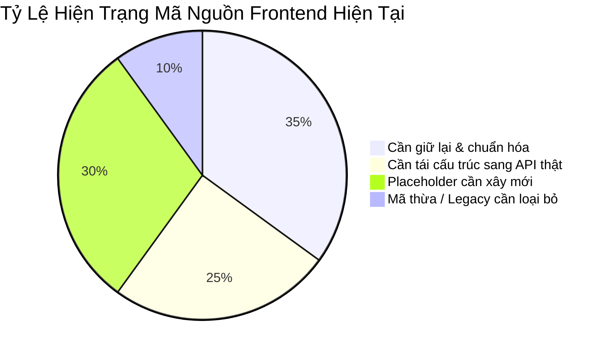

# 01. Báo Cáo Khảo Sát & Đánh Giá Hiện Trạng Frontend (Frontend Audit)
## DịpXinh Atelier SaaS — Nền Tảng Cho Thuê & Bán Lẻ Thời Trang Đa Cửa Hàng

> **Tài liệu tham chiếu:**  
> - [DipXinh_Implementation_Handbook_v3_1.md](file:///D:/Project_CaNhan/DipXinh/plans/DipXinh_Implementation_Handbook_v3_1.md)  
> - [DipXinh_ERD_Kien_truc_Mermaid_v2_1.md](file:///D:/Project_CaNhan/DipXinh/plans/DipXinh_ERD_Kien_truc_Mermaid_v2_1.md)  
> - [DipXinh_Phased_BE_FE_Implementation_Plan.md](file:///D:/Project_CaNhan/DipXinh/Codex-plans/DipXinh_Phased_BE_FE_Implementation_Plan.md)  
> **Phiên bản:** 1.0 · **Ngày lập:** 08/11/2026 · **Trạng thái:** Hoàn tất khảo sát

---

## 1. Khảo Sát Kiến Trúc Công Nghệ Thực Tế (Architecture Audit)

Qua kiểm tra trực tiếp mã nguồn trong `frontend/package.json` và cấu trúc thư mục `frontend/src/`, kiến trúc kỹ thuật thực tế được ghi nhận như sau:

| Thành phần | Công nghệ thực tế | Phiên bản | Đánh giá hiện trạng |
|---|---|---|---|
| **Core Framework** | React + ReactDOM | `19.0.1` | Mới nhất. Cần tuân thủ chặt chẽ React 19 conventions (hạn chế re-render, action states). |
| **Language & Build Tool** | TypeScript + Vite | TS `7.0.2` / Vite `8.3.4` | Tốc độ biên dịch xuất sắc (<1s). Cần duy trì `tsc --noEmit` nghiêm ngặt. |
| **Styling & Design System** | Tailwind CSS v4 + PostCSS | `@tailwindcss/vite: ^4.3.3` | Tailwind v4 mới nhất; hệ thống token CSS biến thể hoạt động tốt. |
| **Component Architecture** | shadcn/ui custom primitives | Local in `@/shared/components/ui` | Tự xây dựng trên Tailwind, không phụ thuộc thư viện UI nặng bên ngoài. |
| **Icons** | Lucide React | `^0.546.0` | Đồng bộ, nhẹ và đầy đủ biểu tượng nghiệp vụ. |
| **Animation Engine** | GSAP + @gsap/react | `gsap: ^3.15.1`, `@gsap/react: ^2.1.2` | Đã cài đặt và tích hợp với plugin `useGSAP`. |
| **Routing** | React Router DOM | `^7.18.4` | Cấu hình trong `AppRouter.tsx` với 3 layout phân tách: Storefront, Dashboard, Platform. |
| **State Management** | Mock Store (`demoStore.ts`) | Custom LocalStorage Class (~1160 dòng) | **Điểm nghẽn kỹ thuật:** Đang chứa toàn bộ tính toán nghiệp vụ giả lập; chưa có TanStack Query. |
| **API Client & Validation** | Chưa cài đặt (`fetch` thủ công) | N/A | **Điểm nghẽn kỹ thuật:** Chưa có TanStack Query (`@tanstack/react-query`), chưa có Zod schema, chưa có OpenAPI generator. |

---

## 2. Kiểm Kê Danh Mục Màn Hình & Phân Loại Trạng Thái (Screen Classification)

Mỗi màn hình được phân loại theo thang chuẩn 6 mức độ:
1. `NOT_IMPLEMENTED`: Chưa có file hoặc chưa có route.
2. `DEMO_ONLY`: Chỉ là placeholder hoặc giao diện tĩnh sơ sài, không có logic.
3. `UI_IMPLEMENTED`: Giao diện đã dựng hoàn chỉnh theo Design System, có tương tác mẫu với `demoStore`.
4. `API_CONNECTED`: Đã nối API mạng thật (REST Spring Boot `/v1/*`).
5. `TESTED`: Đã được kiểm thử tự động (Unit / Component / E2E Playwright trên trình duyệt).
6. `VERIFIED`: Đã có bằng chứng đối soát dữ liệu thật với PostgreSQL và được nghiệm thu chính thức.

### 2.1. Khu Vực 1: Customer Storefront (`/shop/:slug`) — Task F03

| Mã màn hình | Tên màn hình & Route | Trạng thái hiện tại | Đánh giá chi tiết |
|---|---|---|---|
| **SF-01** | Storefront Lookbook Home (`/shop/:slug`) | **UI_IMPLEMENTED / TESTED** | Hero GSAP entrance, bộ sưu tập tiêu biểu, danh mục, kiểm thử responsive 1440/768/390 đạt 60fps. |
| **SF-02** | Garment PDP Detail & Booking Modal | **UI_IMPLEMENTED / TESTED** | Xem chi tiết, chọn size, ngày nhận/trả đồ, tính cọc tạm tính, gửi yêu cầu thuê vào `demoStore`. |
| **SF-03** | Fitting Appointment Dialog | **UI_IMPLEMENTED / TESTED** | Chọn ngày, khung giờ hẹn thử trực tiếp tại showroom, ghi nhận vào `demoStore`. |
| **SF-04** | Túi Đồ Thuê Atelier Drawer | **UI_IMPLEMENTED / TESTED** | GSAP slide-in/out, hiển thị đơn giữ chỗ, mã QR thực thể gán, tổng tiền thuê và cọc. |
| **SF-05** | Shop 404 Not Found Page | **UI_IMPLEMENTED / TESTED** | Hiển thị khi truy cập slug không tồn tại, có nút khôi phục điều hướng. |
| **SF-06** | Catalog Page chuyên sâu (`/shop/:slug/catalog`) | **DEMO_ONLY** | Hiện chỉ là `DashboardSubpagePlaceholder`. Cần bộ lọc đa tiêu chí (dịp tiệc, chất liệu, màu, giá). |
| **SF-07** | Fitting Booking Dedicated (`/shop/:slug/fitting`) | **DEMO_ONLY** | Hiện chỉ là placeholder; đã có dialog popup trên trang chủ nhưng chưa có trang riêng biệt. |
| **SF-08** | About Atelier (`/shop/:slug/about`) | **DEMO_ONLY** | Hiện chỉ là placeholder; chưa có câu chuyện nghệ nhân, quy chuẩn vải lụa và hình ảnh showroom. |
| **SF-09** | Shopping Cart Bán Lẻ (Sale Cart) | **NOT_IMPLEMENTED** | Chưa có giỏ hàng bán riêng biệt cho sản phẩm mua đứt (Task `F03-07`). |
| **SF-10** | Sale Checkout & Payment Instructions | **NOT_IMPLEMENTED** | Chưa có màn hình thanh toán đơn bán lẻ, hướng dẫn chuyển khoản VietQR (Task `F03-08`). |
| **SF-11** | Customer Profile & My Orders (`/shop/:slug/account`) | **NOT_IMPLEMENTED** | Chưa có màn hình khách hàng tra cứu lịch sử thuê/mua, tình trạng hoàn cọc (Task `F03-06`, `F03-13`). |
| **SF-12** | Waitlist Subscribe / Hàng Chờ | **NOT_IMPLEMENTED** | Chưa có luồng đăng ký nhận thông báo khi đồ được trả vào kho (Task `F03-12`). |

### 2.2. Khu Vực 2: Shop Dashboard (`/dashboard/:shopSlug`) — Task F02

| Mã màn hình | Tên màn hình & Route | Trạng thái hiện tại | Đánh giá chi tiết |
|---|---|---|---|
| **DB-01** | Dashboard Overview (`/dashboard/:shopSlug`) | **UI_IMPLEMENTED / TESTED** | Bàn vận hành F02-01 hoàn thiện: Lịch giao/nhận hôm nay, cảnh báo xung đột hấp sấy, duyệt đơn online, KPIs phân quyền Owner vs Staff. |
| **DB-02** | Modal Quét QR Bàn Giao Thực Thể | **UI_IMPLEMENTED / TESTED** | Dialog hỗ trợ nhập mã QR thủ công và chuẩn bị cho camera scanner. |
| **DB-03** | Modal Tạo Đơn Thuê Walk-in | **UI_IMPLEMENTED / TESTED** | Dialog tạo đơn cho khách đến trực tiếp xưởng may, gán mã QR và thời hạn. |
| **DB-04** | Quản Lý Thực Thể QR (`/inventory`) | **DEMO_ONLY** | Hiện chỉ là placeholder; thiếu bảng vòng đời QR (READY, WASHING, RENTED), lịch sử sửa chữa. |
| **DB-05** | Quản Lý Đơn Thuê & Giữ Chỗ (`/orders`) | **DEMO_ONLY** | Hiện chỉ là placeholder; thiếu bảng Kanban/List duyệt đơn hàng loạt, countdown giữ cọc. |
| **DB-06** | Đối Soát Tài Chính & Cọc (`/finance`) | **DEMO_ONLY** | Hiện chỉ là placeholder; thiếu sổ quỹ cọc, đối soát chuyển khoản, trừ tiền sự cố hư hại. |
| **DB-07** | Lịch Hẹn Thử Đồ (`/fittings`) | **DEMO_ONLY** | Hiện chỉ là placeholder; thiếu lịch calendar tiếp khách theo ca stylist. |
| **DB-08** | Nhân Viên & Phân Quyền (`/staff`) | **DEMO_ONLY** | Hiện chỉ là placeholder; thiếu danh sách nhân viên, gán vai trò Manager/Staff. |
| **DB-09** | Cấu Hình Cửa Hàng (`/settings`) | **DEMO_ONLY** | Hiện chỉ là placeholder; thiếu form cấu hình accent color, giờ mở cửa, tài khoản ngân hàng. |
| **DB-10** | Quản Lý Sản Phẩm & Biến Thể (`/catalog`) | **NOT_IMPLEMENTED** | Chưa có form tạo trang phục, kích cỡ số đo may đo, giá thuê theo ngày, giá cọc. |
| **DB-11** | Kiểm Định Hoàn Đồ & Sự Cố QC (`/returns-qc`) | **NOT_IMPLEMENTED** | Chưa có giao diện biên bản kiểm tra vết bẩn, rách vải, trừ tiền cọc theo thỏa thuận. |
| **DB-12** | Điều Phối Giao Hàng Hỏa Tốc (`/delivery`) | **NOT_IMPLEMENTED** | Chưa có view bàn giao cho đơn vị vận chuyển nội thành. |
| **DB-13** | Đơn Hàng Bán Lẻ & Xuất Kho (`/sales`) | **NOT_IMPLEMENTED** | Chưa có màn hình quản lý tồn kho bán độc lập và đơn mua đứt. |

### 2.3. Khu Vực 3: Platform Administration (`/platform`) — Task F04

| Mã màn hình | Tên màn hình & Route | Trạng thái hiện tại | Đánh giá chi tiết |
|---|---|---|---|
| **PA-01** | Platform Overview Console (`/platform`) | **UI_IMPLEMENTED** | Có thẻ thống kê tổng số shops, gói cước SaaS, MRR giả lập, guard phân quyền `PLATFORM_ADMIN`. |
| **PA-02** | Quản Lý Tenants Shop (`/platform/shops`) | **DEMO_ONLY** | Hiện là placeholder; thiếu danh sách shops, nút duyệt/đình chỉ/kích hoạt lại cửa hàng. |
| **PA-03** | Cấu Hình Gói Dịch Vụ SaaS (`/platform/plans`) | **DEMO_ONLY** | Hiện là placeholder; thiếu bảng giá Trial, Starter, Growth, hạn mức staff/QR. |
| **PA-04** | Quản Lý Thuê Bao (`/platform/subscriptions`) | **DEMO_ONLY** | Hiện là placeholder; thiếu giám sát thời gian ân hạn 3 ngày (grace period), gia hạn. |
| **PA-05** | Hóa Đơn SaaS & Đối Soát (`/platform/invoices`) | **DEMO_ONLY** | Hiện là placeholder; thiếu đối soát ủy nhiệm chi thanh toán phí nền tảng từ chủ shop. |
| **PA-06** | Giám Sát Hệ Thống & Outbox (`/platform/system`) | **DEMO_ONLY** | Hiện là placeholder; thiếu theo dõi hàng đợi gửi email/event của worker Spring Boot. |

### 2.4. Khu Vực 4: Shared & Auth Screens

| Mã màn hình | Tên màn hình & Route | Trạng thái hiện tại | Đánh giá chi tiết |
|---|---|---|---|
| **SH-01** | Landing Page Nền Tảng (`/`) | **DEMO_ONLY** | Trang tiếp thị giới thiệu giải pháp DịpXinh Atelier SaaS cho các chủ shop. |
| **SH-02** | Trang Đăng Nhập (`/login`) | **API_CONNECTED** | Đã gọi thử `POST /v1/auth/login`. Chưa lưu access token vào in-memory state, chưa điều hướng. |
| **SH-03** | UI Showcase (`/showcase`) | **UI_IMPLEMENTED / TESTED** | Trang trưng bày toàn bộ component primitives của Design System. |
| **SH-04** | Access Denied (`/access-denied`) | **UI_IMPLEMENTED** | Màn hình từ chối quyền truy cập (403) bảo vệ phân tách giữa Platform Admin và Shop. |
| **SH-05** | 404 Global Not Found (`*`) | **UI_IMPLEMENTED** | Màn hình bắt lỗi đường dẫn không hợp lệ toàn cục. |

---

## 3. Đánh Giá Chất Lượng Kỹ Thuật (Implementation Quality)

### 3.1. Dữ Liệu Cứng & Mock Fixtures
- Toàn bộ tính năng cửa hàng và dashboard hiện tại đang phụ thuộc vào `frontend/src/shared/demo/demo-store.ts`.
- `demoStore` lưu trữ trạng thái trong `localStorage` qua key `dipxinh_business_state_v2`.
- **Rủi ro kiến trúc:** Khách hàng hoặc người dùng có thể nhầm tưởng việc đặt thuê đồ trên UI là đã hoàn tất nghiệp vụ backend. Cần duy trì nhãn `[MOCK FIXTURE]` cho tới khi các endpoint `/v1/*` tương ứng của Spring Boot được kết nối.

### 3.2. Kiểm Soát Phân Quyền & Ranh Giới Tenant
- Phân quyền trên frontend hiện chỉ mang tính chất **điều hướng UX (Visibility Layer)**:
  - `PlatformRoleGuard`: Kiểm tra cờ `currentRole === 'PLATFORM_ADMIN'` ở client.
  - `ShopDashboardLayout`: Ẩn/hiện menu theo `SHOP_OWNER`, `SHOP_MANAGER`, `SHOP_STAFF`.
- **Nguyên tắc bảo mật:** Frontend không thể thay thế phân quyền backend. Mọi request mutation trong tương lai bắt buộc phải gửi access token JWT có `sid` hợp lệ và nhận diện tenant qua header/token backend.

### 3.3. Tồn Đọng Về Quản Lý Trạng Thái & Network Layer
- Chưa có **In-Memory Access Token Storage**: Token nhận được từ login hiện bị bỏ quên trong biến response tạm của `LoginPage.tsx`.
- Chưa có **Single-Flight Axios / Fetch Interceptor**: Nếu access token hết hạn 15 phút, các request đồng thời sẽ bắn liên tiếp `/v1/auth/refresh`, gây lỗi rotation replay tấn công giả định trên backend.
- Chưa có **TanStack Query (React Query)**: Chưa có cơ chế cache, stale time, background refetch, và tự động invalidate khi đơn hàng đổi trạng thái.

---

## 4. Bảng Đề Xuất Xử Lý: Giữ Lại / Cải Thiện / Tái Cấu Trúc / Thay Thế / Bổ Sung

| Phân nhóm | Danh mục thành phần | Đề xuất hành động chi tiết |
|---|---|---|
| **GIỮ LẠI (PRESERVE)** | - Bộ Design Tokens (`tokens.ts`, `globals.css`) - Toàn bộ UI primitives (`Button`, `Badge`, `Dialog`, `Table`, `Input`, `Select`, `Toast`) - Cấu trúc Layout 3 tầng (`StorefrontLayout`, `ShopDashboardLayout`, `PlatformAdminLayout`) - Hoạt họa GSAP lookbook & drawer | Giữ nguyên nền tảng thị giác và trải nghiệm mượt mà đã được kiểm thẩm. |
| **CẢI THIỆN (IMPROVE)** | - `StorefrontHomeView.tsx` - `ShopDashboardHomeView.tsx` - `LoginPage.tsx` | Tách logic hiển thị khỏi `demoStore`, tạo các adapter hooks để sẵn sàng đón nhận dữ liệu từ React Query khi backend hoàn tất. |
| **TÁI CẤU TRÚC (REFACTOR)** | - `App.tsx` (loại bỏ routing kiểu switch-case cũ bằng query param `?view=...`) - Hệ thống xử lý form (chuyển sang React Hook Form + Zod validation) - Quản lý phiên đăng nhập (xây dựng `AuthProvider` với access token in-memory) | Chuẩn hóa theo kiến trúc Production React hiện đại, tách biệt hoàn toàn routing sạch. |
| **THAY THẾ (REPLACE)** | - Toàn bộ tính toán giá, cọc, quota trong `demoStore.ts` - Các nút action gọi trực tiếp mutation local state | Khi backend bàn giao API tương ứng, thay thế toàn bộ logic tính toán bằng API response từ server (Server Authority). |
| **BỔ SUNG (MISSING)** | - 13 màn hình quản lý chi tiết trong Dashboard (Inventory, QC, Finance, Staff, Settings...) - Giỏ hàng bán lẻ, trang Checkout & VietQR - Màn hình tra cứu đơn cá nhân cho khách hàng - 5 màn hình quản trị nền tảng Platform Admin - Bộ test tự động (Vitest, React Testing Library, Playwright E2E) | Triển khai theo lộ trình từng vertical slice phối hợp chặt chẽ với backend. |
