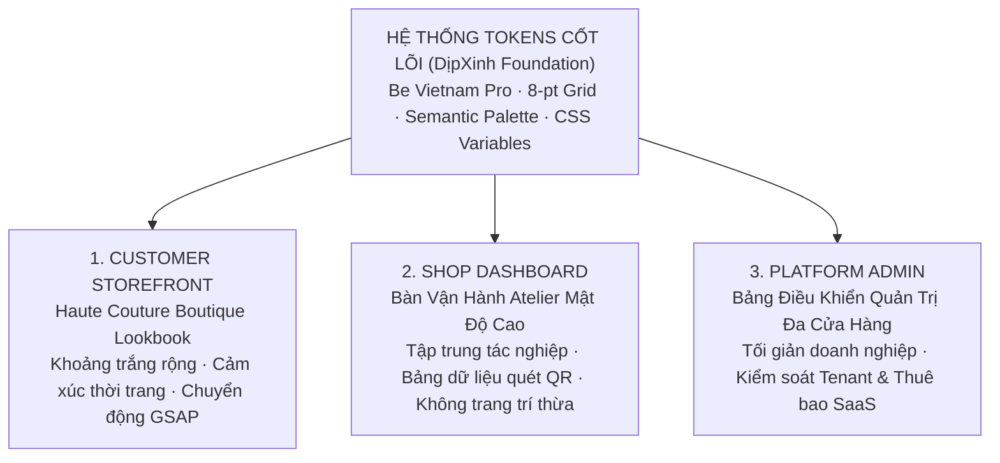

# 02. Kế Hoạch Hệ Thống Thiết Kế Giao Diện (Design System Plan)
## DịpXinh Atelier SaaS — Hệ Thống Thành Phần Dùng Chung & Trải Nghiệm Đa Trải Phổ

> **Tiêu chuẩn áp dụng:** `design-taste-frontend`, `web-design-guidelines`, `vercel-react-best-practices`  
> **Phiên bản:** 1.0 · **Ngày lập:** 08/11/2026 · **Kỹ sư thẩm định:** Senior Product Designer & UI Engineer

---

## 1. Chiến Lược Nhận Diện Thị Giác (Visual Identity Strategy)

DịpXinh giải quyết bài toán giao diện cho một nền tảng SaaS thời trang cao cấp bằng cách thiết lập **một bộ nền tảng quy tắc cốt lõi (Foundational Design Tokens)** nhưng chia tách thành **3 ngôn ngữ trải nghiệm chuyên biệt (3 Distinct Personas)**:

---

## 2. Hệ Thống Màu Sắc & Semantic Tokens

### 2.1. Nền Tảng Màu Trung Tính (Neutral Foundation)
DịpXinh sử dụng các tông màu ấm lấy cảm hứng từ vải lụa tơ tằm thô và giấy in thời trang cao cấp:
- **Canvas (`bg-canvas`):** `#FBFBFB` (Ấm nhẹ, giảm chói mắt so với màu trắng tinh `#FFFFFF`).
- **Surface (`bg-surface`):** `#FFFFFF` (Bề mặt thẻ, bảng dữ liệu, thanh điều hướng).
- **Surface Subtle (`bg-surface-subtle`):** `#F7F4F0` (Nền hàng xen kẽ, container phụ, badge mềm).
- **Border Default (`border-border-default`):** `#E5E5E5` (Đường kẻ phân cách tinh tế 1px).
- **Border Subtle (`border-border-subtle`):** `#EFECE8` (Đường phân cách nội bộ giữa các mục nhỏ).

### 2.2. Kiểu Chữ & Mực In (Ink Typography Tokens)
- **Ink Primary (`text-ink`):** `#1A1A1A` (Độ tương phản tối đa 14.8:1 trên nền canvas trắng, đạt chuẩn AAA).
- **Ink Muted (`text-ink-muted`):** `#666666` (Dành cho đoạn văn miêu tả, nhãn phụ, đạt chuẩn AA 4.5:1).
- **Ink Subtle (`text-ink-subtle`):** `#8E8E93` (Dành cho metadata ngày giờ, đơn vị tính nhỏ).

### 2.3. Tông Màu Trạng Thái Nghiệp Vụ (Status Tokens)
- **Success (Hoàn tất / Sẵn sàng / Đã xác minh):** `#2E7D5F` (Màu xanh ngọc bảo vệ sinh y tế), nền mềm `#EAF5F0`.
- **Warning (Chờ duyệt / Đang giữ chỗ / Sắp hết hạn):** `#D97706` (Màu hổ phách cảnh báo), nền mềm `#FEF3C7`.
- **Danger (Quá hạn / Hư hại / Hủy bỏ):** `#DC2626` (Màu đỏ mận sự cố), nền mềm `#FEE2E2`.
- **Info (Khách đang thuê / Tin tức):** `#2563EB` (Màu xanh lam thông tin), nền mềm `#EFF6FF`.

### 2.4. Cơ Chế Nhận Diện Cửa Hàng Động (Storefront Dynamic Branding)
Tuyệt đối **không gắn cứng (hardcode)** mã màu của một shop cụ thể vào hệ thống lõi.
Hệ thống sử dụng cơ chế CSS Variables được tiêm động qua `<ThemeProvider initialTheme={shopBrandTheme}>`:
- `--primary`: Màu đại diện của cửa hàng (mặc định `#713F4B` — Rượu vang trầm cho Lụa Vàng).
- `--primary-hover`: Màu khi rê chuột (`#5C303B`).
- `--primary-soft`: Màu nền trong suốt (`rgba(accent, 0.1)`).
- `--primary-foreground`: Màu chữ tương phản trên nền accent (`#FFFFFF`).

---

## 3. Hệ Thống Kiểu Chữ (Typography System)

Sau các bài kiểm tra thực tế trên trình duyệt với dấu tiếng Việt phức tạp (ví dụ: *Áo Dài Cung Đình, Thiết Kế Lụa Gấm, Tiệt Trùng*), dự án đã tiêu chuẩn hóa toàn bộ trên phông chữ **`Be Vietnam Pro`**:

| Cấp bậc | Kích thước | Line Height | Font Weight | Letter Spacing | Phạm vi áp dụng |
|---|---|---|---|---|---|
| **Display Hero** | 40px – 48px | 1.15 | Bold (700) | -0.02em | Tiêu đề Lookbook chính trên Storefront |
| **H1 Page Title** | 28px – 32px | 1.25 | Bold (700) | -0.015em | Tiêu đề trang Dashboard & Admin |
| **H2 Section** | 20px – 24px | 1.30 | SemiBold (600) | -0.01em | Tiêu đề cụm tính năng, bảng lịch trình |
| **H3 Card/Item** | 15px – 16px | 1.40 | Medium (500) | 0 | Tên trang phục, tiêu đề đơn hàng |
| **Body Standard** | 13px – 14px | 1.50 | Regular (400) | 0 | Văn bản nội dung, thông tin khách |
| **Caption / Label** | 11px – 12px | 1.40 | Medium / SemiBold | +0.02em | Nhãn trường nhập liệu, thời hạn cọc |
| **Monospace** | 11px – 13px | 1.40 | Medium (500) | 0 | Mã đơn (`ORD-9821`), Mã QR (`DX-EM-01`), Tiền tệ |

---

## 4. Hệ Thống Khoảng Cách & Bố Cục (Spacing & Layout Grid)

- **Hệ thống bước nhảy 8-point (8-pt Grid):**
  - `space-1` = 4px (padding badge, khoảng cách icon nhỏ)
  - `space-2` = 8px (khoảng cách giữa các chip bộ lọc)
  - `space-3` = 12px (padding trong các ô bảng, input compact)
  - `space-4` = 16px (khoảng cách giữa các card thông số)
  - `space-6` = 24px (khoảng cách giữa các khối chức năng)
  - `space-8` = 32px (padding container trang chính)
  - `space-12` = 48px (khoảng cách giữa các section lookbook)

- **Độ phân giải & Điểm ngắt đáp ứng (Responsive Breakpoints):**
  - **Mobile (`< 640px`):** Tối ưu 390px (iPhone 14). Bố cục 1 cột, bottom navigation bám đáy, thanh danh mục vuốt ngang `overflow-x-auto`.
  - **Tablet (`640px – 1023px`):** Tối ưu 768px (iPad). Lưới 2 cột, sidebar dashboard có thể thu gọn, bảng hiển thị các cột trọng yếu.
  - **Desktop (`1024px – 1439px`):** Lưới 3–4 cột, thanh bên sidebar cố định, bảng đầy đủ cột đối soát.
  - **Wide Desktop (`≥ 1440px`):** Giới hạn `max-w-7xl` (1280px) căn giữa màn hình, giữ tỷ lệ thị giác thời trang cân đối.

---

## 5. Mẫu Thiết Kế Các Thành Phần Trọng Tâm (Component Design Patterns)

### 5.1. Thẻ Trang Phục Thời Trang (Fashion Product Card)
- **Tỷ lệ khung hình:** Tỷ lệ ảnh chân dung chuẩn cao cấp `aspect-3/4` (300x400px), hiển thị toàn vẹn phom dáng váy dạ hội và tà áo dài mà không bị cắt cúp méo mó.
- **Lớp thông tin nổi (Overlay Badges):**
  - Góc trên bên trái: Badge phân loại chất liệu (`Áo Dài Cung Đình`) và nhãn nổi bật (`Tiêu biểu`).
  - Góc dưới chân ảnh: Nhãn trạng thái vệ sinh (`Mới 98% · Sẵn sàng`) và nhãn định danh thực thể (`QR Active`).
- **Thanh chân thẻ:** Hiển thị song song giá thuê 3 ngày và số tiền cọc bảo chứng. Tích hợp 2 nút hành động riêng biệt: "Chi Tiết" (mở PDP modal) và "Thuê Đồ" (chuyển thẳng sang luồng đặt lịch giữ chỗ).

### 5.2. Bảng Dữ Liệu Tác Nghiệp (Dense Operational Data Table)
- **Đặc trưng:** Tối ưu hóa cho nhân viên xưởng may kiểm tra mã QR và đối soát tiền cọc liên tục.
- **Hàng dữ liệu:** Chiều cao compact `44px - 48px`, font chữ dạng monospace hiển thị rõ ràng mã đơn và mã QR thực thể vật lý.
- **Trạng thái trực quan:** Sử dụng badge màu có chấm trạng thái (`withDot`):
  - `CONFIRMED`: Xanh ngọc
  - `HELD`: Vàng hổ phách kèm countdown
  - `ACTIVE`: Đang thuê
  - `WASHING`: Đang hấp sấy

### 5.3. Drawer Trượt & Cửa Sổ Modal (Dialog & Sheet Patterns)
- **Túi đồ thuê (Cart Drawer):** Trượt mượt mà từ lề phải vào màn hình với chiều rộng `460px` trên desktop và `100vw` trên mobile, hiển thị tóm tắt chi phí thuê và cọc hoàn trả minh bạch.
- **Modal Quét QR & Đặt lịch:** Căn giữa màn hình, tự động khóa cuộn trang (`body overflow: hidden`), hỗ trợ đóng nhanh bằng phím `Escape` hoặc nhấp vùng ngoài backdrop.

---

## 6. Trạng Thái Phản Hồi & Khả Năng Tiếp Cận (States & Accessibility)

- **Trạng thái Trống (Empty State):** Khi danh sách không có dữ liệu (ví dụ: giỏ đồ trống, không tìm thấy sản phẩm), hiển thị icon stroke mảnh, thông điệp hướng dẫn rõ ràng và nút bấm kêu gọi hành động (Call-to-Action) giúp người dùng khôi phục luồng trải nghiệm.
- **Trạng thái Lỗi (Error State):** Khi slug cửa hàng không tồn tại, hiển thị trang lỗi 404 trang trọng với hai lựa chọn: "Khám Phá Cửa Hàng Mẫu" hoặc "Về Trang Nền Tảng".
- **Khả năng tiếp cận (Accessibility / WCAG 2.1 AA):**
  - Mọi phần tử tương tác (nút bấm, ô nhập liệu, thẻ click) đều đạt kích thước tối thiểu `44x44px`.
  - Hỗ trợ đầy đủ `role="button"`, `tabIndex={0}`, và sự kiện bàn phím `Enter` / `Space`.
  - Tôn trọng chế độ giảm chuyển động của hệ điều hành `prefers-reduced-motion: reduce`.

---

## 7. Quyết Định Về Chế Độ Tối (Dark Mode Decision)

> **Quyết định kiến trúc:**  
> **Giai đoạn Core V1 / Pilot:** Giữ **100% Light Mode (Nền sáng ấm)**.  
> **Lý do:**
> 1. Trưng bày trang phục thời trang và vải lụa tơ tằm đòi hỏi độ chuẩn xác màu sắc vải cao dưới ánh sáng trắng.
> 2. Môi trường tác nghiệp tại showroom và xưởng may có độ sáng mạnh, màn hình nền sáng giúp nhân viên quét mã QR và kiểm tra đường may không bị mỏi mắt.
> 3. Tránh tăng gấp đôi gánh nặng kiểm thử CSS tokens trong giai đoạn hoàn thiện nghiệp vụ Core.
> Chế độ Dark Mode sẽ được xem xét bổ sung sau khi hoàn thành Phase 11.
