# KẾ HOẠCH TỔNG THỂ PHÁT TRIỂN FRONTEND (MASTER ROADMAP)
## Dự án: Dịp Xinh — Nền tảng SaaS Quản lý & Kinh doanh Cho thuê Thời trang Cao cấp
**Tài liệu:** `docs/frontend-planning/03_FRONTEND_MASTER_ROADMAP.md`  
**Phiên bản:** 1.0 | **Ngày lập:** 08/11/2026  
**Tác giả:** Senior Frontend Architect, Senior Product Designer & Technical Project Planner

---

## 1. TỔNG QUAN CHIẾN LƯỢC LỘ TRÌNH (STRATEGIC OVERVIEW)

Lộ trình phát triển Frontend của Dịp Xinh tuân thủ nghiêm ngặt nguyên lý **Vertical Slice Architecture** kết hợp phương pháp luận phát triển theo từng giai đoạn ứng dụng (Candidate Phases 0 đến 10). 

### 1.1 Nguyên lý điều hành
1. **Không phát triển "silo" (Không làm Frontend riêng biệt độc lập khỏi Backend):**  
   Mỗi giai đoạn Frontend phải gắn liền với một hoặc nhiều Vertical Slices (VS00 đến VS13) đã định nghĩa trong *DipXinh Implementation Handbook v3.1*. Khi backend slice hoàn thành các contract API, frontend slice tương ứng lập tức chuyển từ mock data sang integration test.
2. **Không làm tuần tự máy móc (Không đợi xong toàn bộ Storefront mới làm Dashboard):**  
   Frontend phân bổ theo luồng giá trị cốt lõi của doanh nghiệp cho thuê thời trang: **Định danh & Cấu hình Shop (VS00-VS02) -> Kho & Serial QR (VS03) -> Giá & Khả dụng (VS04) -> Storefront & Đặt thuê (VS05-VS07) -> Giao nhận & Thu hồi (VS08-VS09) -> Vận hành & Phân quyền (VS10-VS11) -> Quản trị nền tảng (VS12-VS13)**.
3. **Phân tách ba không gian trải nghiệm (3 Distinct Layout Domains):**  
   - **Customer Storefront (`/shop/:slug`)**: Tinh tế, chuẩn thời trang cao cấp, tối ưu chuyển đổi, chuyển động vi mô tinh tế, hỗ trợ khách vãng lai và thành viên.
   - **Shop Dashboard (`/dashboard/:shopSlug`)**: Mật độ thông tin cao, tập trung công năng, bảng biểu chuẩn thao tác phím, hỗ trợ xử lý nghiệp vụ nhanh (Fast Walk-in, QR Scanner, Handover).
   - **Platform Admin (`/admin`)**: Quản trị đa khách thuê (Multi-tenant), phân quyền nghiêm ngặt, giám sát sức khỏe hệ thống và gói thuê bao SaaS.

---

## 2. MA TRẬN MAPPING: PHASES vs. VERTICAL SLICES vs. TASKS

| Candidate Phase | Tên giai đoạn | Vertical Slice (Handbook) | Trọng tâm phân hệ | Official Tasks & Supplementary Tasks |
| :--- | :--- | :--- | :--- | :--- |
| **Phase 0** | Setup & Design System Foundation | Foundation / Cross-cutting | Foundation Core | `F01-01` -> `F01-08`, `SUP-F01`, `SUP-F02` |
| **Phase 1** | Auth, Tenant Isolation & Onboarding | VS00, VS01, VS02 | Shared Auth & Onboarding | `F01-09` -> `F01-12`, `F04-03`, `SUP-F03` |
| **Phase 2** | Catalog, Serialized Rental Units & QR | VS03 | Shop Dashboard & Ops | `F02-02`, `F02-03`, `F02-04`, `F02-05`, `SUP-F04` |
| **Phase 3** | Rental Policies, Pricing & Availability Engine | VS04 | Shop Dashboard & Engine | `F02-06`, `F02-07`, `SUP-F05` |
| **Phase 4** | Boutique Storefront & Homepage Discovery | VS05 | Customer Storefront & Public Landing | `F03-01` -> `F03-08`, `SUP-F06`, `SUP-F13` |
| **Phase 5** | Rental Booking Engine, Walk-in & Deposits | VS06, VS07 | Storefront & POS Dashboard | `F03-09` -> `F03-12`, `F02-08`, `SUP-F07` |
| **Phase 6** | Fitting Appointments & Shop Calendar | VS07 | Storefront & Dashboard Ops | `F03-13`, `F02-09`, `SUP-F08` |
| **Phase 7** | Fulfillment, Handover, QR Scan & Returns | VS08, VS09 | Shop Dashboard Ops | `F02-10` -> `F02-14`, `SUP-F09` |
| **Phase 8** | Shop Dashboard Home, Analytics & Settings | VS10, VS11 | Shop Dashboard & Management | `F02-01`, `F02-15` -> `F02-18`, `F05-01` -> `F05-05` |
| **Phase 9** | Platform Admin, Tenant Lifecycle & Plans | VS12, VS13 | Platform Administration | `F04-01`, `F04-02`, `F04-04` -> `F04-08`, `SUP-F10` |
| **Phase 10** | Post-Launch AI & Omnichannel Extensions | Post-launch / Milestone 6 | AI & Advanced Features | `F05-06` -> `F05-10`, `A01-01` -> `A01-06`, `A02-01` -> `A02-06`, `SUP-F11`, `SUP-F12` |

---

## 3. CHI TIẾT TỪNG CANDIDATE PHASE (PHASE 0 ĐẾN PHASE 10)

```mermaid
flowchart LR
    P0["Phase 0: DS Foundation"] --> P1["Phase 1: Auth & Tenant"]
    P1 --> P2["Phase 2: Catalog & Serial QR"]
    P2 --> P3["Phase 3: Pricing & Availability"]
    P3 --> P4["Phase 4: Boutique Storefront"]
    P4 --> P5["Phase 5: Booking & Walk-in Order"]
    P5 --> P6["Phase 6: Fitting Room Appointments"]
    P6 --> P7["Phase 7: Fulfillment & Return QC"]
    P7 --> P8["Phase 8: Shop Analytics & Settings"]
    P8 --> P9["Phase 9: Platform Admin & Billing"]
    P9 --> P10["Phase 10: AI Styling & Demand Ops"]
```

---

### GIAI ĐOẠN 0: SETUP & DESIGN SYSTEM FOUNDATION (FOUNDATION)
- **Phase ID:** `PHASE-00`
- **Vertical Slice:** Nền tảng hạ tầng kiến trúc (Foundation).
- **Mục tiêu kinh doanh & UX:**
  - Thiết lập hạ tầng UI nhất quán cho toàn bộ dự án Dịp Xinh, bảo đảm khả năng tái sử dụng (reusability) và mở rộng cho 3 miền giao diện độc lập.
  - Chuẩn hóa CSS Variables cho phép Storefront thay đổi bảng màu (dynamic boutique theming) theo thương hiệu shop mà không ảnh hưởng Dashboard hay Platform Admin.
  - Cung cấp HTTP Client Interceptor xử lý luồng JWT Access Token (in-memory) và HttpOnly Cookie Refresh Token (single-flight refresh logic).
- **Phạm vi Frontend:**
  - Token hệ thống (Màu sắc, Typography, Spacing, Shadow, Radius).
  - Bộ UI primitives chuẩn shadcn/ui: Button, Input, Select, Dialog, Sheet, Dropdown, Table, Badge, Tabs, Tooltip, Calendar.
  - Cấu hình Axios / Fetch client với request/response interceptors, xử lý mã lỗi chuẩn Spring Boot (`ErrorResponse`: timestamp, status, error, message, path, fieldErrors).
  - Mock Service Worker (MSW) / Isolated Fixtures infrastructure phục vụ phát triển frontend độc lập.
- **Danh sách Tasks:**
  - `F01-01`: Cấu hình Tailwind CSS, CSS Custom Properties & Dynamic Theming Engine.
  - `F01-02`: Tích hợp Font chữ Tiếng Việt (Be Vietnam Pro) và hệ thống phân cấp Typography.
  - `F01-03`: Xây dựng Base Component Library (Buttons, Inputs, Badges, Cards).
  - `F01-04`: Xây dựng Feedback & Overlay Components (Modal, Drawer, Toast, AlertDialog).
  - `F01-05`: Xây dựng Data Display Primitives (DataTable, Pagination, EmptyState, SkeletonLoaders).
  - `F01-06`: Xây dựng Shell & Layout Containers (Storefront Shell, Dashboard Shell, Admin Shell).
  - `F01-07`: Thiết lập HTTP Client, Base API Layer & Interceptors.
  - `F01-08`: Xây dựng Error Boundary toàn cục & Màn hình Fallback (404, 403, 500).
  - `SUP-F01`: Cấu hình Mock Service Worker (MSW) cho Contract Mocking theo Spring Boot Specs.
  - `SUP-F02`: Thiết lập Motion Utility Registry (GSAP Helpers, prefers-reduced-motion check).
- **Phụ thuộc Backend API:** Không có. Sử dụng mock contracts chuẩn RFC-7807 / Spring Boot ErrorResponse.
- **Deliverables:**
  - Design System Showcase tại `/ui-showcase`.
  - Shell layouts tại `/shop/:slug`, `/dashboard/:shopSlug`, `/admin`.
  - Base HTTP client tại `src/shared/api/client.ts`.
- **Tiêu chí nghiệm thu (Acceptance Criteria):**
  - [x] Đạt 100% Typecheck không có lỗi (`tsc --noEmit`).
  - [x] Không còn inline hardcoded hex colors trong các component dùng chung.
  - [x] Thay đổi biến CSS thương hiệu cập nhật tức thì màu chủ đạo trên Storefront.
  - [x] Giao diện hiển thị hoàn hảo và không vỡ layout trên 3 mốc: 390px, 768px, 1440px.
- **Ước lượng Effort:** 13 Story Points (Large).
- **Exit Gate:** UI Showcase được kiểm duyệt; Shell layouts đã phân tách định tuyến sạch sẽ; typecheck & build thành công.

---

### GIAI ĐOẠN 1: AUTHENTICATION, MULTI-TENANT ISOLATION & ONBOARDING
- **Phase ID:** `PHASE-01`
- **Vertical Slice:** `VS00` (Tenant Resolution), `VS01` (Identity & JWT Auth), `VS02` (Shop Onboarding).
- **Mục tiêu kinh doanh & UX:**
  - Cho phép người dùng xác thực an toàn, bảo vệ tài khoản chủ shop và khách hàng.
  - Tách biệt ngữ cảnh đa khách thuê (Multi-tenant context isolation): Chủ shop chỉ nhìn thấy dữ liệu shop của mình; Khách hàng Storefront đăng nhập trong phạm vi shop tương ứng.
  - Luồng Onboarding trực quan cho chủ shop mới tạo thương hiệu, cấu hình thông tin boutique trong 3 bước.
- **Phạm vi Frontend:**
  - Màn hình: Đăng nhập (`/auth/login`), Đăng ký Shop Owner (`/auth/register`), Quên/Đặt lại mật khẩu (`/auth/forgot-password`, `/auth/reset-password`).
  - Màn hình chọn Shop (dành cho người dùng quản lý nhiều shop): `/dashboard/select-shop`.
  - Luồng Shop Onboarding Wizard 3 bước: Thông tin pháp lý & Tên miền -> Cấu hình nhận diện thương hiệu -> Thiết lập ca làm việc & Chính sách mẫu.
  - Auth Store (Zustand) quản lý user in-memory, roles (`ROLE_PLATFORM_ADMIN`, `ROLE_SHOP_OWNER`, `ROLE_SHOP_STAFF`, `ROLE_CUSTOMER`), và trạng thái xác thực.
- **Danh sách Tasks:**
  - `F01-09`: Authentication Form Screens (Login, Register, Forgot Password, Reset Password).
  - `F01-10`: Auth Store & Token Lifecycle (In-memory Access Token, Single-flight Refresh).
  - `F01-11`: Route Guards & Role-based Access Control (RBAC Protected Route).
  - `F01-12`: Multi-tenant Shop Selector & Tenant Context Provider.
  - `F04-03`: Shop Onboarding Wizard (Multi-step Creation Form).
  - `SUP-F03`: Customer Social Login & OTP Verification Component (Storefront Scope).
- **Phụ thuộc Backend API:**
  - `POST /api/v1/auth/login` (Spring Boot AuthController - Hiện đã có sẵn).
  - `POST /api/v1/auth/refresh` (Xoay vòng Refresh Token qua HttpOnly Cookie).
  - `POST /api/v1/auth/register-owner` & `GET /api/v1/me` (Đã có sẵn).
  - `POST /api/v1/shops` (Shop Onboarding API).
- **Deliverables:**
  - Màn hình đăng nhập/đăng ký hoàn chỉnh với validation Zod.
  - Bộ Route Guard chặn người dùng chưa xác thực hoặc không đủ quyền.
  - Cơ chế tự động gia hạn token ngầm không làm gián đoạn trải nghiệm người dùng.
- **Tiêu chí nghiệm thu (Acceptance Criteria):**
  - Không lưu trữ Access Token trong `localStorage` (chống lỗ hổng XSS token theft).
  - Khi token hết hạn, request đầu tiên gặp 401 tự động kích hoạt refresh token và gọi lại request cũ thành công.
  - Khi người dùng đăng nhập quyền Staff vào URL của Shop khác, hiển thị Access Denied kèm nút chuyển về đúng shop được cấp quyền.
- **Ước lượng Effort:** 13 Story Points (Large).
- **Exit Gate:** Kiểm thử end-to-end luồng Đăng nhập -> Lưu token in-memory -> Refresh token thành công -> Chuyển hướng đúng vai trò.

---

### GIAI ĐOẠN 2: CATALOG, SERIALIZED RENTAL UNITS & PHYSICAL QR
- **Phase ID:** `PHASE-02`
- **Vertical Slice:** `VS03` (Catalog, Serialized Inventory & QR Code Generation).
- **Mục tiêu kinh doanh & UX:**
  - Giúp chủ shop và nhân viên quản lý danh mục sản phẩm thời trang, các biến thể (Màu, Size) và đặc biệt là **từng sản phẩm vật lý cho thuê được gán mã định danh Serialized QR riêng biệt**.
  - Kiểm soát chính xác vị trí lưu kho, tình trạng vật lý (Mới, Đang thuê, Cần giặt hấp, Hư hỏng) của từng chiếc váy/bộ đồ.
- **Phạm vi Frontend:**
  - Màn hình Danh sách sản phẩm (`/dashboard/:shopSlug/products`): Bộ lọc danh mục, bộ sưu tập, trạng thái kinh doanh (Bán lẻ / Cho thuê / Cả hai).
  - Màn hình Tạo/Sửa sản phẩm: Tải ảnh đa góc chụp, nhập mô tả, bảng ma trận biến thể (Size x Color).
  - Màn hình Quản lý kho Serialized Units (`/dashboard/:shopSlug/inventory/units`): Danh sách từng đơn vị sản phẩm gán mã serial (ví dụ: `DX-DAM-001-S-01`), tình trạng hao mòn, lịch sử sử dụng.
  - Modal / Màn hình In nhãn QR Code hàng loạt: Xem trước tem nhãn chuẩn máy in mã vạch (khổ tem 50x30mm hoặc A4).
- **Danh sách Tasks:**
  - `F02-02`: Product Catalog Management Screen (List, Filters, Actions).
  - `F02-03`: Product Create/Edit Form (Media Upload, Pricing, Variant Matrix).
  - `F02-04`: Serialized Rental Units Management & Lifecycle Status.
  - `F02-05`: QR Code Label Generation & Batch Print Modal.
  - `SUP-F04`: Image Crop & Compression Utility (Tối ưu hóa ảnh tải lên trước khi gửi S3/MinIO).
- **Phụ thuộc Backend API:**
  - `GET/POST /api/v1/shops/:shopId/products`
  - `GET/PUT /api/v1/shops/:shopId/products/:productId`
  - `GET/POST /api/v1/shops/:shopId/rental-units`
  - `POST /api/v1/shops/:shopId/rental-units/batch-qr-pdf`
- **Deliverables:**
  - Giao diện quản lý danh mục với Virtualized Table hỗ trợ hàng ngàn SKU.
  - Form tạo ma trận biến thể linh hoạt.
  - Chức năng in mã QR trực tiếp từ trình duyệt chuẩn kích thước tem vật lý.
- **Tiêu chí nghiệm thu (Acceptance Criteria):**
  - Tạo thành công 1 sản phẩm có 2 màu và 3 size, tự động sinh 6 SKU tương ứng.
  - Với mỗi SKU cho thuê, sinh được số lượng Serialized Units mong muốn, mỗi đơn vị có mã định danh duy nhất.
  - Nút "In mã QR" mở giao diện xem trước tem in chuẩn CSS `@media print` không bị lệch trang.
- **Ước lượng Effort:** 21 Story Points (X-Large).
- **Exit Gate:** Quản lý kho có thể thêm trang phục, sinh mã QR, in tem dán lên trang phục mẫu.

---

### GIAI ĐOẠN 3: RENTAL POLICIES, DYNAMIC PRICING & AVAILABILITY ENGINE
- **Phase ID:** `PHASE-03`
- **Vertical Slice:** `VS04` (Rental Policies, Pricing Matrix & Real-time Availability).
- **Mục tiêu kinh doanh & UX:**
  - Cung cấp công cụ cấu hình chính sách cho thuê: Số ngày thuê chuẩn (3 ngày, 5 ngày), tiền cọc thế chân (Cọc theo % giá trị đồ hoặc cọc cố định), phí trễ hạn mỗi ngày.
  - Hiển thị trực quan lịch khả dụng (Availability Calendar): Tránh xung đột trùng lịch thuê (Overbooking), tính toán thời gian dự phòng giặt ủi/phục hồi (Buffer turnaround time: 24h - 48h).
- **Phạm vi Frontend:**
  - Màn hình Cấu hình chính sách cho thuê (`/dashboard/:shopSlug/settings/rental-policies`).
  - Ma trận giá động theo thời gian: Cấu hình phụ thu mùa cao điểm (Mùa cưới, Tết, Kỷ yếu).
  - Component Kiểm tra lịch khả dụng trực quan (Interactive Availability Calendar Widget) tích hợp được cả trên Dashboard lẫn Trang chi tiết sản phẩm Storefront.
- **Danh sách Tasks:**
  - `F02-06`: Rental Policies & Deposit Rules Configuration Screen.
  - `F02-07`: Product Availability Calendar & Timeline Inspector.
  - `SUP-F05`: Date Range Picker with Blocked-out Dates & Turnaround Buffer Calculation.
- **Phụ thuộc Backend API:**
  - `GET/PUT /api/v1/shops/:shopId/policies/rental`
  - `GET /api/v1/shops/:shopId/products/:productId/availability?startDate=...&endDate=...`
  - `POST /api/v1/shops/:shopId/pricing-rules/calculate`
- **Deliverables:**
  - Form cấu hình chính sách cho thuê trực quan với xem trước minh họa chi phí.
  - Lịch chọn ngày thuê hiển thị rõ các ngày đã kín lịch, ngày phục hồi kỹ thuật và ngày có thể đặt.
- **Tiêu chí nghiệm thu (Acceptance Criteria):**
  - Chặn người dùng chọn ngày nhận/trả đồ trùng với các lịch đã xác nhận hoặc trong khoảng buffer 24h phục hồi trang phục.
  - Tính toán chuẩn xác giá thuê cơ sở + tiền cọc + phụ thu ngày phát sinh ngay trên UI.
- **Ước lượng Effort:** 13 Story Points (Large).
- **Exit Gate:** Lịch khả dụng phản ánh đúng dữ liệu khóa lịch và tính đúng chi phí theo chính sách của shop.

---

### GIAI ĐOẠN 4: PUBLIC BOUTIQUE STOREFRONT EXPERIENCE
- **Phase ID:** `PHASE-04`
- **Vertical Slice:** `VS05` (Public Storefront & Product Browsing).
- **Mục tiêu kinh doanh & UX:**
  - Tạo dựng không gian mua sắm và thuê đồ thời trang cao cấp, thanh lịch, đậm chất thẩm mỹ boutique cho từng thương hiệu shop (`/shop/:slug`).
  - Tối ưu hóa trải nghiệm xem sản phẩm, phân cấp hình ảnh sắc nét, thao tác lọc nhanh chóng theo dịp mặc (Đám cưới, Dạ hội, Sự kiện, Du lịch).
  - Hỗ trợ xem sản phẩm mà không bắt buộc đăng nhập; chỉ yêu cầu đăng nhập khi tiến hành đặt thuê/thử đồ.
- **Phạm vi Frontend:**
  - Trang chủ Nền tảng Dịp Xinh (`/`): Trình diễn các boutique thời trang nổi bật, dải ảnh lookbook lướt vô tận (infinite marquee), băng chuyền tương tác vuốt kéo (interactive boutique carousel) và bộ lọc nhanh theo dịp sự kiện.
  - Trang chủ Boutique riêng (`/shop/:slug`): Hero banner, Bộ sưu tập nổi bật, Tuyên ngôn thương hiệu, Sản phẩm gợi ý.
  - Trang Bộ sưu tập / Catalog (`/shop/:slug/catalog`): Bộ lọc đa tiêu chí (Dịp, Màu sắc, Kích cỡ, Tầm giá, Khả dụng theo ngày).
  - Trang Chi tiết sản phẩm (`/shop/:slug/products/:productId`): Thư viện ảnh zoom chi tiết, lựa chọn chế độ "Thuê trang phục" hoặc "Mua sở hữu", chọn size & bảng hướng dẫn kích thước chi tiết (Size Guide).
  - Giỏ hàng trượt (Cart Drawer) & Trang giỏ hàng đầy đủ (`/shop/:slug/cart`).
- **Danh sách Tasks:**
  - `F03-01`: Storefront Layout Shell & Boutique Navigation.
  - `F03-02`: Boutique Hero Section & Curated Collections Display.
  - `F03-03`: Product Catalog Grid with Multi-facet Filters.
  - `F03-04`: Product Card Component (Rental vs. Buy Badges, Hover Actions).
  - `F03-05`: Product Detail Page (PDP) Layout & Editorial Gallery.
  - `F03-06`: Rental Configuration Selector on PDP (Date picker, Size, Deposit notice).
  - `F03-07`: Slide-over Cart Drawer with Split Items (Rental vs. Retail).
  - `F03-08`: Shop Information, Lookbook & Footer.
  - `SUP-F06`: Quick View Modal for Instant Product Inspection without leaving catalog.
  - `SUP-F13`: Tái thiết kế Platform Homepage & Trình diễn Shop nổi bật với GSAP Carousel / Infinite Parallax Ribbon.
- **Phụ thuộc Backend API:**
  - `GET /api/v1/public/featured-shops` (Danh sách các Boutique nổi bật & Top trang phục thuê)
  - `GET /api/v1/public/shops/:slug`
  - `GET /api/v1/public/shops/:slug/products`
  - `GET /api/v1/public/shops/:slug/products/:id`
  - `GET /api/v1/public/shops/:slug/collections`
- **Deliverables:**
  - Bộ giao diện Storefront công khai đạt chuẩn thẩm mỹ cao, mượt mà trên mobile và desktop.
  - Cart Drawer hiển thị phân biệt rõ ràng giữa sản phẩm thuê (kèm ngày thuê, tiền cọc) và sản phẩm mua đứt.
- **Tiêu chí nghiệm thu (Acceptance Criteria):**
  - Điểm số Web Vitals trên Mobile đạt LCP < 2.5s, CLS < 0.05.
  - Khách hàng có thể tìm kiếm, lọc theo ngày cần mặc đồ và thêm sản phẩm vào giỏ hàng mà không cần đăng nhập.
  - Đổi biến thương hiệu CSS của Shop phản ánh trung thực lên giao diện Storefront.
- **Ước lượng Effort:** 21 Story Points (X-Large).
- **Exit Gate:** Trải nghiệm Storefront hoàn tất thẩm định UI Review, Responsive hoàn hảo 390px, 768px, 1440px.

---

### GIAI ĐOẠN 5: RENTAL BOOKING ENGINE, WALK-IN ORDERS & DEPOSIT LIFECYCLE
- **Phase ID:** `PHASE-05`
- **Vertical Slice:** `VS06` (Rental Checkout & Deposit Management), `VS07` (Walk-in Fast Order & Point of Sale).
- **Mục tiêu kinh doanh & UX:**
  - Cung cấp luồng thanh toán đặt thuê trực tuyến minh bạch cho khách hàng trên Storefront (Tiền thuê + Tiền cọc bảo đảm + Phương thức nhận hàng).
  - Cung cấp giao diện tạo đơn tại quầy siêu tốc (Fast Walk-in Order / POS) cho nhân viên cửa hàng khi khách đến trực tiếp thử và thuê đồ ngay.
  - Quản lý vòng đời tiền cọc (Deposit Lifecycle): Tạm giữ, khấu trừ hư hại, hoàn trả sau kiểm định.
- **Phạm vi Frontend:**
  - Storefront Checkout Flow (`/shop/:slug/checkout`): 
    - Bước 1: Thông tin khách hàng & Địa chỉ nhận đồ / Nhận tại cửa hàng.
    - Bước 2: Xác nhận hợp đồng thuê điện tử & Điều khoản giữ gìn trang phục.
    - Bước 3: Thanh toán trực tuyến (Cổng thanh toán MoMo / VNPAY / Chuyển khoản VietQR kèm mã nội dung tự động).
  - Trang xác nhận đơn hàng (`/shop/:slug/orders/:orderId/confirmation`).
  - Giao diện POS Đơn tại quầy (`/dashboard/:shopSlug/pos`): Tìm kiếm sản phẩm nhanh qua mã vạch / SKU, chọn ngày nhận trả, nhập tiền cọc, in phiếu biên nhận tức thì.
- **Danh sách Tasks:**
  - `F03-09`: Storefront Checkout Stepper (Customer Info, Delivery, Agreement).
  - `F03-10`: Deposit & Payment Summary Breakdown Component.
  - `F03-11`: Digital Rental Agreement Viewer & Signature Checkbox.
  - `F03-12`: Order Confirmation Screen with Live QR Payment Status.
  - `F02-08`: Walk-in Fast Order Creation Modal / POS Screen for Staff.
  - `SUP-F07`: VietQR Dynamic Payment Modal with Auto-check Polling.
- **Phụ thuộc Backend API:**
  - `POST /api/v1/public/shops/:slug/orders/rental-checkout`
  - `POST /api/v1/shops/:shopId/orders/walk-in`
  - `GET /api/v1/orders/:orderId/payment-status`
  - `POST /api/v1/payments/create-intent`
- **Deliverables:**
  - Luồng Checkout 3 bước mượt mà, minh bạch chi phí thuê và cọc.
  - Modal tạo đơn tại quầy thao tác dưới 60 giây cho nhân viên.
- **Tiêu chí nghiệm thu (Acceptance Criteria):**
  - Không thể thanh toán nếu chưa tích đồng ý Điều khoản Hợp đồng thuê.
  - Hiển thị VietQR chính xác số tiền và mã chuyển khoản; tự động cập nhật khi webhook ngân hàng báo thành công.
  - Đơn tại quầy lập tức khóa lịch trên Availability Engine, ngăn ngừa đơn online trùng giờ.
- **Ước lượng Effort:** 21 Story Points (X-Large).
- **Exit Gate:** Tạo thành công cả đơn thuê trực tuyến lẫn đơn tại quầy, tiền cọc và lịch khả dụng được cập nhật chính xác.

---

### GIAI ĐOẠN 6: FITTING ROOM APPOINTMENTS & SHOP OPERATIONAL CALENDAR
- **Phase ID:** `PHASE-06`
- **Vertical Slice:** `VS07` (Fitting Room Appointments & Store Operations).
- **Mục tiêu kinh doanh & UX:**
  - Giải quyết bài toán khách hàng muốn đến showroom thử đồ trước khi thuê: Đặt lịch thử trang phục trực tuyến, chọn trước danh sách váy muốn thử.
  - Shop kiểm soát sức chứa phòng thử (Fitting Room Capacity), tránh tình trạng quá tải vào khung giờ cao điểm cuối tuần.
- **Phạm vi Frontend:**
  - Storefront: Form đặt lịch thử đồ (`/shop/:slug/fitting-appointment`): Chọn danh sách mẫu muốn thử, chọn ngày & khung giờ trống (Time slot), nhập số đo cơ thể cơ bản (tuỳ chọn).
  - Dashboard: Lịch vận hành phòng thử đồ (`/dashboard/:shopSlug/appointments`): Dạng xem Lịch tuần/Lịch ngày (Day/Week Calendar View), kéo thả đổi lịch, xác nhận có mặt (Check-in).
- **Danh sách Tasks:**
  - `F03-13`: Storefront Fitting Appointment Booking Widget & Slot Selector.
  - `F02-09`: Shop Dashboard Appointment Calendar & Slot Management.
  - `SUP-F08`: Fitting Room Capacity & Staff Assignment Drawer.
- **Phụ thuộc Backend API:**
  - `GET /api/v1/public/shops/:slug/fitting-slots?date=...`
  - `POST /api/v1/public/shops/:slug/fitting-appointments`
  - `GET /api/v1/shops/:shopId/appointments`
  - `PUT /api/v1/shops/:shopId/appointments/:id/status`
- **Deliverables:**
  - Giao diện đặt lịch hẹn thử đồ êm ái, gợi ý khung giờ vắng khách.
  - Bảng lịch hẹn dành cho nhân viên điều phối phòng thử đồ.
- **Tiêu chí nghiệm thu (Acceptance Criteria):**
  - Khung giờ đã đầy chỗ (hết phòng thử) tự động mờ và không cho bấm chọn.
  - Nhân viên có thể chuyển trạng thái hẹn từ "Đã xác nhận" -> "Khách đã đến" -> "Hoàn tất/Hủy".
- **Ước lượng Effort:** 13 Story Points (Large).
- **Exit Gate:** Đặt lịch thử đồ từ Storefront hiển thị ngay lập tức trên Lịch điều hành của Shop.

---

### GIAI ĐOẠN 7: FULFILLMENT, HANDOVER, QR SCAN & RETURNS WORKFLOW
- **Phase ID:** `PHASE-07`
- **Vertical Slice:** `VS08` (Order Fulfillment & Handover), `VS09` (Return Inspection, Late Fees & Deposit Release).
- **Mục tiêu kinh doanh & UX:**
  - Trọng tâm nghiệp vụ vận hành hàng ngày: Bàn giao trang phục cho khách (Handover) và Nhận trả đồ (Return QC).
  - Tích hợp quét mã QR Serialized Unit bằng Camera thiết bị hoặc máy quét cầm tay: Khớp đúng chiếc váy đã xuất kho.
  - Biên bản kiểm định tình trạng (Inspection Checklist): Ghi nhận vết bẩn, rách, hỏng phụ kiện, chụp ảnh lưu bằng chứng và tính toán tự động khoản phạt khấu trừ tiền cọc.
- **Phạm vi Frontend:**
  - Màn hình Vận hành Đơn hàng (`/dashboard/:shopSlug/orders`): Danh sách đơn lọc theo trạng thái: Chờ chuẩn bị, Chờ giao, Đang thuê, Chờ thu hồi, Quá hạn.
  - Luồng Bàn giao (Handover Modal): Quét mã QR sản phẩm vật lý, xác nhận chữ ký khách nhận.
  - Luồng Thu hồi & Giám định (Return QC Screen): Quét mã QR, checklist tình trạng (Bình thường / Cần giặt đặc biệt / Hỏng hóc), tính phụ thu trễ hạn, xác nhận số tiền cọc hoàn lại.
- **Danh sách Tasks:**
  - `F02-10`: Order Fulfillment List & Operational Status Pipeline.
  - `F02-11`: Handover Workflow Modal with Physical Serial QR Verification.
  - `F02-12`: Return Inspection & Damage Checklist Interface.
  - `F02-13`: Late Fee & Damage Penalty Calculation Dialog.
  - `F02-14`: Deposit Refund / Forfeit Settlement Confirmation.
  - `SUP-F09`: Hardware / Camera QR Scanner Component with Audio Feedback.
- **Phụ thuộc Backend API:**
  - `GET /api/v1/shops/:shopId/orders/operational`
  - `POST /api/v1/shops/:shopId/orders/:orderId/handover`
  - `POST /api/v1/shops/:shopId/orders/:orderId/returns`
  - `POST /api/v1/shops/:shopId/orders/:orderId/settle-deposit`
- **Deliverables:**
  - Giao diện quy trình giao nhận chuẩn hóa, thao tác quét QR chỉ trong 1 thao tác.
  - Biên bản bàn giao và biên bản giám định hoàn cọc điện tử.
- **Tiêu chí nghiệm thu (Acceptance Criteria):**
  - Quét sai mã QR của sản phẩm khác sẽ cảnh báo đỏ và ngăn không cho bàn giao.
  - Tính đúng số ngày quá hạn theo cấu hình chính sách và cộng dồn phí đền bù hư hại.
  - Sau khi hoàn cọc, trạng thái Serialized Unit tự động chuyển sang "Cần giặt hấp" hoặc "Sẵn sàng cho thuê".
- **Ước lượng Effort:** 21 Story Points (X-Large).
- **Exit Gate:** Thao tác hoàn tất một chu kỳ trọn vẹn: Bàn giao -> Quét QR xuất kho -> Thu hồi -> Giám định hư tổn -> Quyết toán cọc.

---

### GIAI ĐOẠN 8: SHOP DASHBOARD HOME, ANALYTICS & STAFF PERMISSIONS
- **Phase ID:** `PHASE-08`
- **Vertical Slice:** `VS10` (Shop Operations Dashboard & Analytics), `VS11` (Staff Roles & Shop Settings).
- **Mục tiêu kinh doanh & UX:**
  - Nâng cấp màn hình chính Shop Dashboard (`/dashboard/:shopSlug`) từ UI tĩnh thành trung tâm chỉ huy vận hành thời gian thực.
  - Cung cấp báo cáo tài chính trực quan: Doanh thu thuê vs Doanh thu bán lẻ, Tổng tiền cọc đang giữ, Tỷ lệ lấp đầy trang phục (Utilization Rate).
  - Quản lý danh sách nhân viên và phân quyền chi tiết (Shop Owner vs Shop Staff).
- **Phạm vi Frontend:**
  - Màn hình Tổng quan Dashboard: Thẻ chỉ số KPI thời gian thực, Danh sách việc cần làm hôm nay (Cần giao hôm nay, Cần thu hôm nay, Đơn trễ hạn, Lịch hẹn thử đồ sắp tới).
  - Màn hình Báo cáo & Phân tích (`/dashboard/:shopSlug/analytics`): Biểu đồ doanh thu, top trang phục được thuê nhiều nhất, báo cáo tỷ lệ hư hao.
  - Màn hình Quản lý nhân viên (`/dashboard/:shopSlug/settings/staff`): Mời nhân viên, phân quyền hạn chế (Ẩn doanh thu với nhân viên part-time).
  - Cấu hình Shop & Tùy biến thương hiệu (`/dashboard/:shopSlug/settings/branding`): Đổi logo, banner, màu nhấn thương hiệu cho Storefront.
- **Danh sách Tasks:**
  - `F02-01`: Shop Dashboard Home & Real-time Operations Widget (Hiện thực hóa toàn bộ API).
  - `F02-15`: Shop Operations Analytics & Revenue Reporting Screens.
  - `F02-16`: Rental Utilization & High-demand Item Analytics.
  - `F02-17`: Staff Management & Role Delegation Screen.
  - `F02-18`: Boutique Branding & Storefront Customizer.
  - `F05-01`: Customer Profile & Rental History Portal.
  - `F05-02`: Customer Deposit Balance & Refund Tracking.
  - `F05-03`: Customer Fitting Appointment Management.
  - `F05-04`: Shop Notification Center & Operational Alerts.
  - `F05-05`: Mobile-optimized Responsive Dashboard Views.
- **Phụ thuộc Backend API:**
  - `GET /api/v1/shops/:shopId/dashboard/metrics`
  - `GET /api/v1/shops/:shopId/analytics/revenue`
  - `GET/POST /api/v1/shops/:shopId/staff`
  - `PUT /api/v1/shops/:shopId/branding`
- **Deliverables:**
  - Bảng điều khiển vận hành sống động với kết nối API thực tế, loại bỏ hoàn toàn mock fixture.
  - Trình tùy biến giao diện Storefront trực quan với xem trước thời gian thực.
- **Tiêu chí nghiệm thu (Acceptance Criteria):**
  - Tài khoản Staff đăng nhập không hiển thị số liệu doanh thu tổng và tab cài đặt tài chính.
  - Tải trang Dashboard dưới 1.2s; chỉ số hôm nay cập nhật đồng bộ với danh sách đơn hàng.
- **Ước lượng Effort:** 21 Story Points (X-Large).
- **Exit Gate:** Chủ shop đánh giá được toàn bộ hiệu suất kinh doanh và quản lý nhân sự an toàn.

---

### GIAI ĐOẠN 9: PLATFORM ADMIN, TENANT LIFECYCLE & PLATFORM MONITORING
- **Phase ID:** `PHASE-09`
- **Vertical Slice:** `VS12` (Platform Administration & Tenant Lifecycle), `VS13` (Subscription Plans, Billing & Auditing).
- **Mục tiêu kinh doanh & UX:**
  - Khu vực quản trị tối cao của đội ngũ vận hành Dịp Xinh (`/admin`), hoàn toàn tách biệt khỏi các shop.
  - Quản lý danh sách các cửa hàng tham gia nền tảng (Tenant Management): Phê duyệt shop mới, khóa shop vi phạm, nâng cấp gói SaaS.
  - Quản lý gói thuê bao phần mềm (Subscription Tiers): Free Trial, Basic, Pro Boutique, Enterprise.
  - Nhật ký kiểm toán (Audit Logs) giám sát hoạt động hệ thống và bảo mật dữ liệu.
- **Phạm vi Frontend:**
  - Admin Overview (`/admin`): Tổng số shop, số hợp đồng thuê trên toàn hệ thống, doanh thu phí nền tảng MRR/ARR.
  - Quản lý Tenants (`/admin/shops`): Danh sách shop, chi tiết hồ sơ, trạng thái hoạt động (Active, Suspended, Pending Approval).
  - Quản lý Gói dịch vụ (`/admin/subscriptions`): Cấu hình giới hạn số sản phẩm, số tài khoản nhân viên theo từng gói.
  - Quản lý Người dùng toàn sàn (`/admin/users`).
  - Màn hình Audit Logs & System Health (`/admin/system/audit-logs`).
- **Danh sách Tasks:**
  - `F04-01`: Platform Admin Layout Shell & System Navigation.
  - `F04-02`: Platform Overview Dashboard & Cross-tenant Metrics.
  - `F04-04`: Tenant / Shop Management & Lifecycle Control (Approve, Suspend).
  - `F04-05`: Platform Subscription Plans & Feature Matrix Editor.
  - `F04-06`: Global User Administration & Platform RBAC.
  - `F04-07`: Platform Audit Log Viewer with Advanced Filtering.
  - `F04-08`: Platform System Health & Integration Status Monitor.
  - `SUP-F10`: Tenant Impersonation Banner & Safe Switch Mechanism (Dành cho hỗ trợ kỹ thuật).
- **Phụ thuộc Backend API:**
  - `GET /api/v1/admin/overview`
  - `GET/PUT /api/v1/admin/shops`
  - `GET/POST /api/v1/admin/plans`
  - `GET /api/v1/admin/audit-logs`
- **Deliverables:**
  - Bộ giao diện Platform Admin bảo mật cao, kiểm tra nghiêm ngặt `ROLE_PLATFORM_ADMIN`.
  - Bộ công cụ quản lý tenant và gói cước hoàn chỉnh.
- **Tiêu chí nghiệm thu (Acceptance Criteria):**
  - Mọi request trong layout `/admin` đều được kiểm tra quyền ở cả Route Guard lẫn Backend.
  - Thao tác khóa shop hiển thị cảnh báo đỏ và lập tức thu hồi quyền truy cập của shop đó.
- **Ước lượng Effort:** 13 Story Points (Large).
- **Exit Gate:** Đội ngũ Platform Admin có thể kiểm soát toàn bộ vòng đời của các shop trên Dịp Xinh.

---

### GIAI ĐOẠN 10: POST-LAUNCH AI & OMNICHANNEL EXTENSIONS
- **Phase ID:** `PHASE-10`
- **Vertical Slice:** Hậu phát hành (Post-launch / Post-Core V1) & Tích hợp AI.
- **Mục tiêu kinh doanh & UX:**
  - Nâng tầm Dịp Xinh thành nền tảng thời trang thông minh hàng đầu:
    - **A01 - AI Styling Advisor**: Trợ lý tư vấn phối đồ cho khách hàng dựa trên dịp sự kiện, thời tiết, phong cách cá nhân và số đo cơ thể.
    - **A02 - Demand & Pricing Optimization Engine**: Thuật toán AI gợi ý chủ shop điều chỉnh giá thuê theo mùa vụ và nhu cầu thị trường.
  - Mở rộng trải nghiệm Omnichannel: Kết nối máy in tem nhãn nhiệt Bluetooth/LAN, máy quét mã vạch chuyên dụng và thiết bị thanh toán POS tại quầy.
- **Phạm vi Frontend:**
  - Trợ lý AI Styling trên Storefront: Chat widget tương tác, tạo bảng phối đồ gợi ý (Lookbook collage), bấm thuê cả set đồ trong 1 click.
  - Bảng đề xuất giá thông minh trên Dashboard: Biểu đồ dự báo nhu cầu, nút "Áp dụng giá đề xuất".
  - Mô-đun tích hợp phần cứng POS: Cấu hình cổng kết nối máy in hóa đơn ESC/POS và máy in mã vạch.
- **Danh sách Tasks:**
  - `F05-06`: AI Styling Assistant Floating Widget & Chat Interface.
  - `F05-07`: AI Style Recommendations & Outfit Mix-and-match Canvas.
  - `F05-08`: AI Demand Forecast & Dynamic Pricing Advisor Screen.
  - `F05-09`: Hardware Integration Settings (Barcode Scanner, Thermal Receipt Printer).
  - `F05-10`: Offline-first Resilience & Local Data Sync for Walk-in POS.
  - `A01-01` -> `A01-06`: AI Styling & Body Profile Integration Tasks.
  - `A02-01` -> `A02-06`: Dynamic Pricing Engine UI Tasks.
  - `SUP-F11`: Canvas Outfit Builder with Drag-and-Drop Primitives.
  - `SUP-F12`: Web Serial / Web Bluetooth Driver Interface for ESC/POS Printers.
- **Phụ thuộc Backend API:**
  - `POST /api/v1/ai/styling-recommendations`
  - `GET /api/v1/ai/pricing-suggestions`
  - AI Service Orchestrator (Gemini / Anthropic Integration).
- **Deliverables:**
  - Trợ lý AI Styling độc đáo nâng cao tỷ lệ chuyển đổi cho các boutique thời trang.
  - Bảng gợi ý định giá tối ưu hóa doanh thu cho chủ shop.
- **Tiêu chí nghiệm thu (Acceptance Criteria):**
  - Trợ lý AI phản hồi câu hỏi phối đồ dưới 3 giây kèm danh sách sản phẩm thực tế còn lịch trống tại shop.
  - Không gây crash khi thiết bị ngoại vi ngắt kết nối đột ngột.
- **Ước lượng Effort:** 21 Story Points (X-Large).
- **Exit Gate:** Hoàn tất thử nghiệm thực tế tính năng AI tại ít nhất 3 shop đối tác điểm.

---

## 4. BẢNG TỔNG KẾT TIẾN ĐỘ & DỰ TOÁN NGUỒN LỰC

| Giai đoạn | Số Task Official | Số Task SUP | Tổng Tasks | Story Points Ước tính | Mức độ ưu tiên | Trạng thái hiện tại |
| :--- | :---: | :---: | :---: | :---: | :---: | :---: |
| **Phase 0: DS Foundation** | 8 | 2 | 10 | 13 SP | P0 (Critical) | **Đã hoàn thành 100% (Sẵn sàng Phase 1)** |
| **Phase 1: Auth & Tenant** | 5 | 1 | 6 | 13 SP | P0 (Critical) | **Đã hoàn thành 100% (Sẵn sàng Phase 2)** |
| **Phase 2: Catalog & QR** | 4 | 1 | 5 | 21 SP | P0 (Critical) | **Đã hoàn thành 100% (Sẵn sàng Phase 3)** |
| **Phase 3: Pricing & Engine** | 2 | 1 | 3 | 13 SP | P1 (High) | **Đã hoàn thành 100% (Sẵn sàng Phase 4)** |
| **Phase 4: Storefront & Discovery**| 8 | 2 | 10 | 21 SP | P0 (Critical) | **Đã hoàn thành 100% (Sẵn sàng Phase 5)** |
| **Phase 5: Booking & POS** | 5 | 1 | 6 | 21 SP | P1 (High) | Chờ Phase 3 & 4 |
| **Phase 6: Appointments** | 2 | 1 | 3 | 13 SP | P2 (Medium) | Chờ Phase 5 |
| **Phase 7: Fulfillment & QC** | 5 | 1 | 6 | 21 SP | P0 (Critical) | Chờ Phase 2 & 5 |
| **Phase 8: Analytics & Settings**| 10 | 0 | 10 | 21 SP | P1 (High) | **Đã có Mock Shell F02-01** |
| **Phase 9: Platform Admin** | 7 | 1 | 8 | 13 SP | P2 (Medium) | **Đã có Shell cơ bản** |
| **Phase 10: AI & Omnichannel** | 17 | 2 | 19 | 21 SP | P3 (Future) | Kế hoạch hậu Core V1 |
| **TỔNG CỘNG** | **73** | **13** | **86** | **191 SP** | | |

---

## 5. NGUYÊN TẮC CHUYỂN PHA (GATE TRANSITION RULES)

1. **Gate Quality Check:** Không chuyển sang giai đoạn tiếp theo nếu giai đoạn hiện tại chưa vượt qua kiểm tra Lint, Typecheck và ít nhất 1 bài test tích hợp luồng nghiệp vụ.
2. **Contract Freeze:** Trước khi bước vào phát triển Frontend cho bất kỳ Vertical Slice nào, Contract API (`swagger.json` hoặc mock specification) giữa Backend và Frontend phải được khóa (Freeze) để tránh việc viết lại giao diện.
3. **No Mock Leaks:** Toàn bộ Mock Data sử dụng trong quá trình làm UI độc lập phải được cô lập trong thư mục `src/shared/fixtures/` hoặc tầng MSW, có cờ báo hiệu rõ ràng, tuyệt đối không lẫn vào code production.
