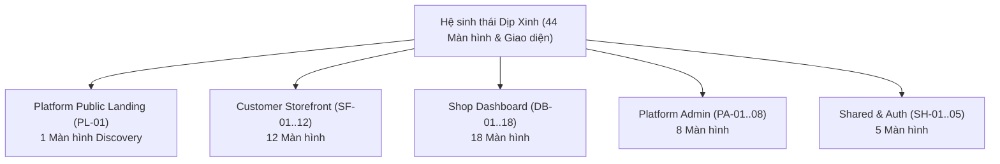
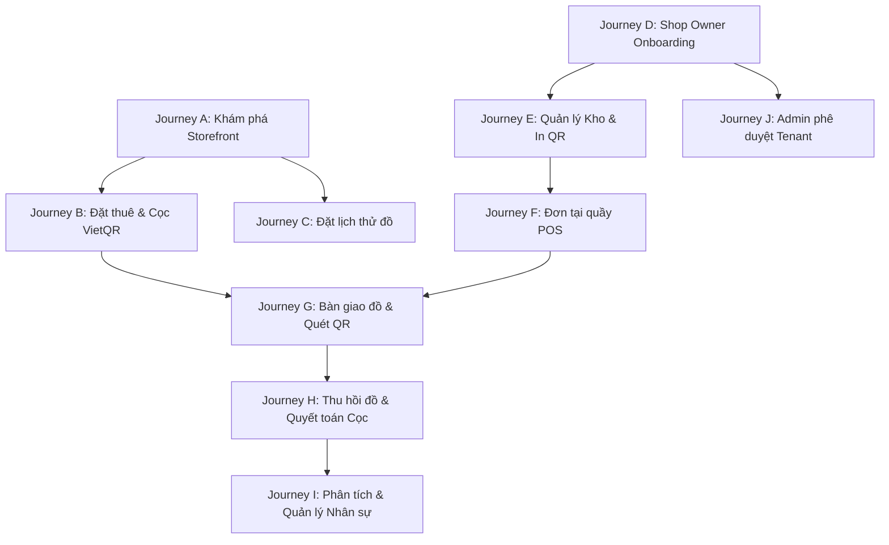

# MA TRẬN MÀN HÌNH VÀ HÀNH TRÌNH NGƯỜI DÙNG (SCREEN & USER JOURNEY MATRIX)
## Dự án: Dịp Xinh — Nền tảng SaaS Quản lý & Cho thuê Thời trang
**Tài liệu:** `docs/frontend-planning/05_SCREEN_AND_USER_JOURNEY_MATRIX.md`  
**Phiên bản:** 1.0 | **Ngày lập:** 08/11/2026  
**Tác giả:** Senior Product Designer & UX Engineer

---

## 1. DANH MỤC MÀN HÌNH CHUẨN TOÀN HỆ THỐNG (SCREEN INVENTORY)

Toàn bộ hệ sinh thái Dịp Xinh bao gồm **43 màn hình và giao diện tương tác chuyên biệt**, được phân bổ vào 4 không gian trải nghiệm:

---

### 1.0 Phân hệ Platform Landing & Khám phá Boutique (`PL-01`)
Môi trường công khai đón tiếp khách hàng toàn sàn Dịp Xinh, giới thiệu nền tảng và trình diễn các boutique thời trang nổi bật (`/`).

| Screen ID | Tên màn hình / Giao diện | Route URL | Vai trò truy cập | Trạng thái hiện tại |
| :--- | :--- | :--- | :--- | :--- |
| `PL-01` | Platform Homepage & Featured Boutiques GSAP Showcase | `/` | Public / Toàn bộ khách hàng | Cần nâng cấp GSAP (`SUP-F13`) |

---

### 1.1 Phân hệ Customer Storefront (12 Màn hình: `SF-01` -> `SF-12`)
Môi trường công khai phục vụ khách hàng khám phá và thuê đồ thời trang cao cấp (`/shop/:slug`).

| Screen ID | Tên màn hình / Giao diện | Route URL | Vai trò truy cập | Trạng thái hiện tại |
| :--- | :--- | :--- | :--- | :--- |
| `SF-01` | Boutique Storefront Home | `/shop/:slug` | Public / Khách vãng lai | **Prototype Hoàn chỉnh** |
| `SF-02` | Curated Catalog & Facet Filter | `/shop/:slug/catalog` | Public / Khách vãng lai | **Prototype Hoàn chỉnh** |
| `SF-03` | Product Detail Page (PDP) | `/shop/:slug/products/:productId` | Public / Khách vãng lai | **Prototype Hoàn chỉnh** |
| `SF-04` | Quick View & Rental Config Modal | Modal overlay tại Catalog | Public / Khách vãng lai | **Prototype Hoàn chỉnh** |
| `SF-05` | Slide-over Cart Drawer | Drawer overlay toàn trang | Public / Khách vãng lai | **Prototype Hoàn chỉnh** |
| `SF-06` | Checkout Stepper & Delivery Form | `/shop/:slug/checkout` | Customer đã nhập info | Kế hoạch Phase 5 |
| `SF-07` | Digital Rental Agreement Viewer | Modal/Step trong Checkout | Customer đặt thuê | Kế hoạch Phase 5 |
| `SF-08` | Dynamic VietQR Live Payment | Step 3 Checkout | Customer thanh toán | Kế hoạch Phase 5 |
| `SF-09` | Order Booking Confirmation | `/shop/:slug/orders/:id/success` | Customer đặt đơn | Kế hoạch Phase 5 |
| `SF-10` | Fitting Appointment Booking Screen | `/shop/:slug/fitting-appointment` | Khách đặt lịch thử | Kế hoạch Phase 6 |
| `SF-11` | Customer Rental Portal & History | `/shop/:slug/account/rentals` | Authenticated Customer | Kế hoạch Phase 8 |
| `SF-12` | Deposit Balance & Refund Tracking | `/shop/:slug/account/deposits` | Authenticated Customer | Kế hoạch Phase 8 |

---

### 1.2 Phân hệ Shop Dashboard (18 Màn hình: `DB-01` -> `DB-18`)
Môi trường vận hành nội bộ bảo mật dành cho Chủ shop và Nhân viên (`/dashboard/:shopSlug`).

| Screen ID | Tên màn hình / Giao diện | Route URL | Quyền hạn tối thiểu | Trạng thái hiện tại |
| :--- | :--- | :--- | :--- | :--- |
| `DB-01` | Dashboard Home & Real-time Ops | `/dashboard/:shopSlug` | Staff / Owner | **Mock Complete** |
| `DB-02` | Product Catalog Management Table | `/dashboard/:shopSlug/products` | Staff / Owner | Kế hoạch Phase 2 |
| `DB-03` | Product Create/Edit & Variant Matrix | `/dashboard/:shopSlug/products/new` | Owner / Senior Staff | Kế hoạch Phase 2 |
| `DB-04` | Serialized Rental Units Management | `/dashboard/:shopSlug/inventory/units`| Staff / Owner | Kế hoạch Phase 2 |
| `DB-05` | Batch QR Code Label Print Screen | `/dashboard/:shopSlug/inventory/print`| Staff / Owner | Kế hoạch Phase 2 |
| `DB-06` | Rental Policies & Deposit Setup | `/dashboard/:shopSlug/settings/policies`| Shop Owner | Kế hoạch Phase 3 |
| `DB-07` | Interactive Availability Inspector | `/dashboard/:shopSlug/inventory/calendar`| Staff / Owner | Kế hoạch Phase 3 |
| `DB-08` | Fast Walk-in Order Modal (POS) | Action overlay trên Dashboard | Staff / Owner | **Mock Complete** |
| `DB-09` | Fitting Room Appointments Schedule | `/dashboard/:shopSlug/appointments` | Staff / Owner | Kế hoạch Phase 6 |
| `DB-10` | Order Fulfillment Operational Board | `/dashboard/:shopSlug/orders` | Staff / Owner | Kế hoạch Phase 7 |
| `DB-11` | Handover Workflow & QR Verify Modal| Action Modal trên Order Board | Staff / Owner | Kế hoạch Phase 7 |
| `DB-12` | Return Inspection & Damage Checklist| `/dashboard/:shopSlug/orders/:id/qc`| Staff / Owner | Kế hoạch Phase 7 |
| `DB-13` | Late Fee & Damage Penalty Dialog | Modal overlay tại QC | Staff / Owner | Kế hoạch Phase 7 |
| `DB-14` | Deposit Settlement Confirmation | Modal overlay tại QC | Owner / Senior Staff | Kế hoạch Phase 7 |
| `DB-15` | Revenue & Rental Analytics Report | `/dashboard/:shopSlug/analytics` | Shop Owner | Kế hoạch Phase 8 |
| `DB-16` | Inventory Utilization & Demand Heatmap| `/dashboard/:shopSlug/analytics/usage`| Shop Owner | Kế hoạch Phase 8 |
| `DB-17` | Staff Management & RBAC Setup | `/dashboard/:shopSlug/settings/staff`| Shop Owner | Kế hoạch Phase 8 |
| `DB-18` | Boutique Customizer & Branding Live | `/dashboard/:shopSlug/settings/branding`| Shop Owner | Kế hoạch Phase 8 |

---

### 1.3 Phân hệ Platform Admin (8 Màn hình: `PA-01` -> `PA-08`)
Khu vực quản trị cấp cao nhất của đội ngũ nền tảng Dịp Xinh (`/admin`).

| Screen ID | Tên màn hình / Giao diện | Route URL | Quyền hạn tối thiểu | Trạng thái hiện tại |
| :--- | :--- | :--- | :--- | :--- |
| `PA-01` | Platform Overview Dashboard | `/admin` | `ROLE_PLATFORM_ADMIN` | Shell có sẵn |
| `PA-02` | Tenant / Shop Lifecycle Management | `/admin/shops` | `ROLE_PLATFORM_ADMIN` | Kế hoạch Phase 9 |
| `PA-03` | Shop Onboarding Wizard (Multi-step) | `/admin/shops/onboard` | `ROLE_PLATFORM_ADMIN` / Owner | Kế hoạch Phase 1 |
| `PA-04` | SaaS Subscription Plans Editor | `/admin/subscriptions` | `ROLE_PLATFORM_ADMIN` | Kế hoạch Phase 9 |
| `PA-05` | Global User Administration & RBAC | `/admin/users` | `ROLE_PLATFORM_ADMIN` | Kế hoạch Phase 9 |
| `PA-06` | System Audit Log Inspector | `/admin/system/audit-logs` | `ROLE_PLATFORM_ADMIN` | Kế hoạch Phase 9 |
| `PA-07` | Platform Health & API Status Monitor| `/admin/system/health` | `ROLE_PLATFORM_ADMIN` | Kế hoạch Phase 9 |
| `PA-08` | Tenant Impersonation Safe View | Banner toàn màn hình | `ROLE_PLATFORM_ADMIN` | Kế hoạch Phase 9 |

---

### 1.4 Phân hệ Shared & Auth (5 Màn hình: `SH-01` -> `SH-05`)

| Screen ID | Tên màn hình / Giao diện | Route URL | Vai trò | Trạng thái hiện tại |
| :--- | :--- | :--- | :--- | :--- |
| `SH-01` | Unified Login Screen | `/auth/login` | Mọi đối tượng | Đang kết nối BE |
| `SH-02` | Shop Owner Registration | `/auth/register` | Khách đăng ký kinh doanh | Đang kết nối BE |
| `SH-03` | Forgot / Reset Password Flow | `/auth/forgot-password` | Khách quên mật khẩu | Kế hoạch Phase 1 |
| `SH-04` | Multi-tenant Shop Selector Screen | `/dashboard/select-shop` | User quản lý nhiều shop | Kế hoạch Phase 1 |
| `SH-05` | Error Boundary Fallbacks (403,404,500)| `/403`, `/404`, `/500` | Toàn bộ hệ thống | **Hoàn chỉnh** |

---

## 2. 10 HÀNH TRÌNH NGƯỜI DÙNG CỐT LÕI (10 CORE USER JOURNEYS)

---

### HÀNH TRÌNH A: KHÁCH VÃNG LAI KHÁM PHÁ BOUTIQUE NỔI BẬT & TÌM ĐỒ THUÊ THEO DỊP (PLATFORM TO STOREFRONT DISCOVERY)
- **Persona:** Khách hàng nữ (24-35 tuổi), cần tìm váy dạ hội đi tiệc cưới vào cuối tuần.
- **Điểm bắt đầu:** Truy cập Trang chủ Nền tảng `https://dipxinh.vn` (`PL-01`) hoặc trực tiếp liên kết shop `https://dipxinh.vn/shop/aurora-boutique` (`SF-01`).
- **Điểm kết thúc:** Chọn được sản phẩm ưng ý, kiểm tra còn lịch trống và mở Cart Drawer.
- **Màn hình tham gia:** `PL-01` (Platform Homepage) -> `SF-01` (Boutique Home) -> `SF-02` (Catalog) -> `SF-03` / `SF-04` (PDP / Quick View) -> `SF-05` (Cart Drawer).
- **Các bước thao tác:**
  1. Khách vào Trang chủ `PL-01`, ngắm nhìn dải ruy-băng ảnh các Shop nổi bật (Featured Boutiques Parallax Ribbon) đang lướt ngang vô tận êm ái.
  2. Rê chuột vào thẻ của tiệm "Aurora Atelier", dải ảnh tự động giảm tốc nhẹ nhàng, ảnh phóng to tinh tế hiển thị huy hiệu "98% Đánh giá 5 sao" kèm 3 mẫu váy dạ hội hot nhất.
  3. Khách bấm "Ghé thăm Boutique", hệ thống chuyển mượt mà vào Storefront riêng của shop tại `/shop/aurora-boutique` (`SF-01`).
  4. Bấm vào nút "Xem bộ sưu tập" chuyển sang trang Catalog (`SF-02`).
  5. Chọn bộ lọc: Dịp "Dạ tiệc", Màu "Đỏ rượu", Size "M", Khoảng ngày thuê "14/11 - 16/11/2026".
  6. Lưới sản phẩm cập nhật hiển thị chiếc váy dạ hội nhung cúp ngực kèm huy hiệu "Có sẵn cho ngày bạn chọn".
  7. Bấm vào ảnh mở Quick View Modal (`SF-04`): Xem ảnh chi tiết chất vải, bảng số đo, giá thuê 3 ngày (850.000đ) và tiền cọc (1.500.000đ).
  8. Bấm "Thêm vào giỏ thuê". Giỏ hàng trượt ra (`SF-05`) hiển thị tóm tắt chi phí và giữ chỗ tạm thời trong 15 phút.
- **Xử lý ngoại lệ:** Nếu khách chọn khoảng ngày mà váy đã có người đặt, hệ thống hiển thị badge màu hổ phách "Đã kín lịch ngày 15/11" và gợi ý 3 mẫu váy tương đồng còn trống.
- **Tiêu chuẩn E2E:** Tốc độ tải ảnh dưới 1 giây; bộ lọc phản hồi tức thì không giật lag layout.

---

### HÀNH TRÌNH B: ĐẶT THUÊ TRỰC TUYẾN, KÝ HỢP ĐỒNG & CỌC VIETQR (ONLINE RENTAL BOOKING & DEPOSIT)
- **Persona:** Khách hàng đã chọn đồ từ Giỏ hàng (`SF-05`).
- **Điểm bắt đầu:** Bấm nút "Tiến hành Đặt thuê" từ Cart Drawer.
- **Điểm kết thúc:** Nhận màn hình xác nhận đơn hàng thành công kèm mã tra cứu đơn.
- **Màn hình tham gia:** `SF-05` -> `SF-06` (Checkout Stepper) -> `SF-07` (Digital Agreement) -> `SF-08` (VietQR) -> `SF-09` (Success).
- **Các bước thao tác:**
  1. Khách nhập họ tên, số điện thoại, chọn hình thức "Nhận tại showroom Aurora Boutique" hoặc "Giao tận nơi".
  2. Hệ thống chuyển sang Bước 2: Hiển thị Hợp đồng cho thuê điện tử (`SF-07`) nêu rõ điều khoản bảo quản đồ, mức phạt nếu làm cháy/rách không phục hồi được.
  3. Khách tick chọn "Tôi đã đọc và đồng ý với Hợp đồng cho thuê Dịp Xinh".
  4. Bước 3: Hiển thị mã VietQR động (`SF-08`) kèm nội dung chuyển khoản tự động (Ví dụ: `DX AURORA 8921`). Tổng số tiền = 850.000đ (Tiền thuê) + 1.500.000đ (Tiền cọc) = 2.350.000đ.
  5. Khách mở App ngân hàng quét mã chuyển tiền.
  6. Backend nhận Webhook biến động số dư, Webhook phát tín hiệu tới Frontend qua SSE/Polling.
  7. Màn hình tự động chuyển sang `SF-09`: "Đặt thuê thành công! Đơn hàng #DX-8921 đã được xác nhận".
- **Xử lý ngoại lệ:** Quá 15 phút không thanh toán, mã QR hết hiệu lực, đơn hàng tự hủy và giải phóng lịch trống cho khách hàng khác.

---

### HÀNH TRÌNH C: ĐẶT LỊCH HẸN THỬ ĐỒ TẠI SHOWROOM (FITTING ROOM APPOINTMENT)
- **Persona:** Khách muốn đến thử trực tiếp trang phục trước khi quyết định thuê.
- **Điểm bắt đầu:** Bấm nút "Đặt lịch thử đồ" trên thanh điều hướng Storefront.
- **Điểm kết thúc:** Nhận SMS/Email thông báo mã lịch hẹn và khung giờ đã giữ chỗ.
- **Màn hình tham gia:** `SF-10` (Fitting Appointment Form) -> `DB-09` (Đồng bộ vào Dashboard Shop).
- **Các bước thao tác:**
  1. Khách chọn ngày mong muốn (ví dụ: Chiều thứ 7, ngày 15/11).
  2. Hệ thống hiển thị các khung giờ trống (14:00 - 15:00, 15:00 - 16:00). Các khung giờ đã đầy phòng thử (Capacity = Max) sẽ bị vô hiệu hóa màu xám.
  3. Khách chọn tối đa 3 mẫu trang phục trong catalog muốn mặc thử khi tới nơi.
  4. Nhập thông tin liên hệ và bấm "Xác nhận lịch hẹn".
  5. Lịch hẹn lập tức xuất hiện trên màn hình vận hành `DB-09` của nhân viên để chuẩn bị sẵn đồ trước giờ khách đến.

---

### HÀNH TRÌNH D: CHỦ SHOP MỚI ONBOARDING VÀ KHỞI TẠO CỬA HÀNG (SHOP OWNER ONBOARDING)
- **Persona:** Chủ shop thời trang thiết kế đăng ký mở gian hàng trên SaaS Dịp Xinh.
- **Điểm bắt đầu:** Bấm "Đăng ký mở Shop" tại trang chủ nền tảng hoặc `/auth/register`.
- **Điểm kết thúc:** Hoàn thành thiết lập, chuyển thẳng vào Dashboard vận hành cửa hàng.
- **Màn hình tham gia:** `SH-02` (Register) -> `PA-03` (Shop Onboarding Wizard) -> `DB-01` (Dashboard Home).
- **Các bước thao tác:**
  1. Nhập email, mật khẩu, họ tên chủ sở hữu.
  2. Wizard Bước 1: Nhập Tên cửa hàng ("Tiệm Váy Công Chúa"), Slug định danh (`tiem-vay-cong-chua`), Số điện thoại, Địa chỉ showroom.
  3. Wizard Bước 2: Tải lên Logo, chọn màu sắc nhận diện thương hiệu (Tự động sinh bảng CSS Theme).
  4. Wizard Bước 3: Chọn gói chính sách cho thuê mặc định (Thuê 3 ngày, cọc 70% giá trị đồ).
  5. Bấm "Hoàn tất khởi tạo". Hệ thống tạo Tenant, gán quyền `ROLE_SHOP_OWNER` và đưa thẳng vào `DB-01`.

---

### HÀNH TRÌNH E: QUẢN LÝ KHO TẠO SẢN PHẨM, BIẾN THỂ & IN MÃ QR SERIAL (INVENTORY & QR LABELING)
- **Persona:** Quản lý kho thời trang tại cửa hàng.
- **Điểm bắt đầu:** Truy cập menu "Quản lý sản phẩm" trên Shop Dashboard.
- **Điểm kết thúc:** Dán tem nhãn QR vật lý lên tag áo của từng chiếc váy.
- **Màn hình tham gia:** `DB-02` (Catalog) -> `DB-03` (Product Form) -> `DB-04` (Serialized Units) -> `DB-05` (Batch QR Print).
- **Các bước thao tác:**
  1. Bấm "Thêm sản phẩm mới" (`DB-03`): Tải 4 ảnh chất lượng cao của mẫu Đầm dạ hội kim tuyến.
  2. Cấu hình biến thể: Màu (Vàng Gold, Xanh Navy), Size (S, M). Hệ thống sinh 4 SKU.
  3. Với SKU Màu Vàng - Size S: Nhập số lượng vật lý nhập kho là 3 chiếc.
  4. Hệ thống tự động sinh 3 Serialized Units: `DX-DAM01-GLD-S-01`, `...02`, `...03` (`DB-04`).
  5. Chọn cả 3 đơn vị và bấm "In nhãn QR Code" (`DB-05`).
  6. Cửa sổ in chuẩn tem 50x30mm mở ra, bấm Print để máy in tem vạch in ra tem nhãn sắc nét.

---

### HÀNH TRÌNH F: NHÂN VIÊN TẠO ĐƠN TẠI QUẦY SIÊU TỐC (WALK-IN FAST RENTAL POS)
- **Persona:** Nhân viên bán hàng trực tiếp tại showroom.
- **Điểm bắt đầu:** Khách chọn được váy tại quầy và muốn làm thủ tục thuê mang về ngay.
- **Điểm kết thúc:** In phiếu biên nhận giao đồ và nhận tiền trong dưới 60 giây.
- **Màn hình tham gia:** `DB-01` (Dashboard Home) -> `DB-08` (Walk-in Modal).
- **Các bước thao tác:**
  1. Nhân viên bấm phím tắt hoặc nút "Tạo đơn tại quầy" trên Dashboard.
  2. Quét mã QR dán trên tag váy hoặc gõ mã SKU. Thông tin váy lập tức hiện lên.
  3. Chọn số ngày thuê (Mặc định 3 ngày: từ hôm nay đến 11/11/2026).
  4. Nhập SĐT khách hàng (tự động gợi ý nếu là khách quen).
  5. Hệ thống tính toán: Tiền thuê 600.000đ + Cọc thẻ CCCD hoặc Cọc tiền mặt 1.000.000đ.
  6. Nhân viên thu tiền mặt/chuyển khoản -> Bấm "Xác nhận & In biên nhận".
  7. Trạng thái chiếc váy lập tức chuyển thành `RENTED` (Đang cho thuê).

---

### HÀNH TRÌNH G: NHÂN VIÊN QUÉT MÃ QR BÀN GIAO ĐỒ CHO KHÁCH (ORDER HANDOVER & DISPATCH)
- **Persona:** Nhân viên phụ trách xuất kho bàn giao đồ.
- **Điểm bắt đầu:** Đơn hàng đến ngày giao (`DB-10`).
- **Điểm kết thúc:** Trang phục rời kho an toàn, khách ký nhận.
- **Màn hình tham gia:** `DB-10` (Order Pipeline) -> `DB-11` (Handover Modal).
- **Các bước thao tác:**
  1. Trên bảng Kanban đơn hàng hôm nay, nhân viên chọn đơn #DX-8921 (Chờ bàn giao).
  2. Bấm "Thực hiện Bàn giao" mở Modal `DB-11`.
  3. Cầm máy quét/camera quét mã QR trên chiếc váy chuẩn bị giao.
  4. Hệ thống đối soát: Mã QR trùng khớp 100% với Serial Unit đã giữ chỗ cho đơn này (Đèn xanh báo Ting!).
  5. Đưa khách kiểm tra tình trạng váy trước khi rời cửa hàng.
  6. Khách ký tên xác nhận điện tử -> Bấm "Hoàn tất bàn giao".

---

### HÀNH TRÌNH H: NHÂN VIÊN THU HỒI ĐỒ, KIỂM ĐỊNH HƯ HẠI & QUYẾT TOÁN CỌC (RETURN QC & DEPOSIT SETTLEMENT)
- **Persona:** Nhân viên kiểm định chất lượng khi khách mang đồ đến trả.
- **Điểm bắt đầu:** Khách mang váy đến quầy trả đồ hoặc shipper mang kiện đồ về.
- **Điểm kết thúc:** Hoàn trả tiền cọc còn lại cho khách, cập nhật váy sang trạng thái Giặt ủi.
- **Màn hình tham gia:** `DB-10` -> `DB-12` (Return QC) -> `DB-13` (Late Fee) -> `DB-14` (Deposit Settlement).
- **Các bước thao tác:**
  1. Quét mã QR trên váy trả để mở đúng hồ sơ thuê (`DB-12`).
  2. Kiểm tra ngày trả: Nếu trả trễ 1 ngày so với hợp đồng, hệ thống tự cộng phí phạt trễ hạn 200.000đ (`DB-13`).
  3. Kiểm tra ngoại quan theo Checklist:
     - Thân váy: Bình thường.
     - Chân váy: Có vết ố rượu vang nhẹ (Chọn "Ố bẩn tẩy được" -> Phí giặt hấp chuyên sâu 100.000đ).
     - Phụ kiện nơ: Đầy đủ.
  4. Màn hình quyết toán cọc (`DB-14`):
     - Tiền cọc gốc: 1.500.000đ
     - Khấu trừ phạt trễ: -200.000đ
     - Khấu trừ phí giặt ố: -100.000đ
     - **Số tiền cọc thực hoàn lại:** 1.200.000đ.
  5. Bấm "Xác nhận Hoàn cọc qua VietQR". Khách nhận lại 1.200.000đ tức thì vào tài khoản.
  6. Trang phục chuyển trạng thái thành `MAINTENANCE` (Chờ giặt hấp 24h).

---

### HÀNH TRÌNH I: CHỦ SHOP THEO DÕI DOANH THU & PHÂN QUYỀN NHÂN VIÊN (OPERATIONAL ANALYTICS & STAFF ACCESS)
- **Persona:** Chủ shop thời trang Aurora Boutique.
- **Điểm bắt đầu:** Đăng nhập vào tài khoản Owner cuối tháng.
- **Điểm kết thúc:** Nắm bắt hiệu quả kinh doanh và cấu hình tài khoản nhân viên mới.
- **Màn hình tham gia:** `DB-15` (Revenue Analytics) -> `DB-16` (Utilization) -> `DB-17` (Staff RBAC).
- **Các bước thao tác:**
  1. Mở báo cáo doanh thu (`DB-15`): Xem biểu đồ doanh thu thuê đồ chiếm 78%, bán đứt chiếm 22%.
  2. Xem tỷ lệ sử dụng kho (`DB-16`): Top 5 mẫu đầm dạ hội có tỷ lệ lấp đầy lịch thuê đạt 92% (Cần nhập thêm hàng).
  3. Vào Cài đặt nhân viên (`DB-17`): Bấm "Mời nhân viên mới", nhập email và phân vai trò `SHOP_STAFF` (Chỉ được xem đơn hàng, không được xem biểu đồ doanh thu tổng).

---

### HÀNH TRÌNH J: PLATFORM ADMIN PHÊ DUYỆT SHOP MỚI & GIÁM SÁT THUÊ BAO (PLATFORM TENANT MANAGEMENT)
- **Persona:** Quản trị viên cấp cao của Nền tảng Dịp Xinh.
- **Điểm bắt đầu:** Đăng nhập vào giao diện `/admin`.
- **Điểm kết thúc:** Phê duyệt shop mới và nâng cấp gói SaaS Pro.
- **Màn hình tham gia:** `PA-01` (Admin Home) -> `PA-02` (Tenants) -> `PA-04` (Subscriptions) -> `PA-06` (Audit Logs).
- **Các bước thao tác:**
  1. Kiểm tra danh sách Shop đăng ký mới đang ở trạng thái `PENDING_REVIEW` (`PA-02`).
  2. Xem hồ sơ kinh doanh và mẫu hợp đồng của shop "Bella Bridal". Bấm "Phê duyệt kích hoạt".
  3. Gán gói thuê bao "Boutique Pro - 12 tháng" (`PA-04`).
  4. Hệ thống tự động ghi nhật ký kiểm toán vào Audit Log (`PA-06`): `ADMIN_JOHN approved tenant BELLA_BRIDAL`.

---

## 3. TIÊU CHÍ KIỂM THỬ E2E CHUẨN CHO TỪNG HÀNH TRÌNH

| Journey ID | Trọng tâm kiểm thử | Tiêu chuẩn vượt qua (Pass Criteria) |
| :--- | :--- | :--- |
| **Journey A** | Tốc độ lọc Catalog & Xem ảnh | Thời gian phản hồi bộ lọc < 100ms; không rò rỉ layout shift (CLS = 0). |
| **Journey B** | Luồng Checkout & VietQR | Bắt buộc tick hợp đồng mới cho thanh toán; QR hiển thị đúng số tiền gồm cả cọc. |
| **Journey C** | Tránh trùng phòng thử | Slot đã đầy không thể bấm chọn; nhận thông báo xác nhận lịch hẹn tức thì. |
| **Journey D** | Onboarding Shop mới | Tạo đầy đủ Tenant, gán đúng role Owner, chuyển hướng mượt mà về Dashboard. |
| **Journey E** | Sinh biến thể & In nhãn QR | In tem chuẩn tỷ lệ 50x30mm, máy quét đọc được mã QR ngay sau khi in. |
| **Journey F** | POS Đơn tại quầy | Thao tác chọn sản phẩm, tính cọc và xuất hóa đơn dưới 60 giây. |
| **Journey G** | Bàn giao & Quét đối soát | Báo lỗi đỏ nếu quét nhầm váy khác; chỉ cho phép bàn giao khi quét đúng Serial QR. |
| **Journey H** | Kiểm định & Quyết toán cọc | Tính đúng tiền phạt trễ và hư hao; hoàn trả cọc chính xác tới từng đồng. |
| **Journey I** | Bảo mật phân quyền Staff | Nhân viên không thể xem doanh thu tổng hay xuất báo cáo tài chính. |
| **Journey J** | Bảo mật Quản trị Nền tảng | Chặn hoàn toàn mọi request từ người dùng không có role `ROLE_PLATFORM_ADMIN`. |
