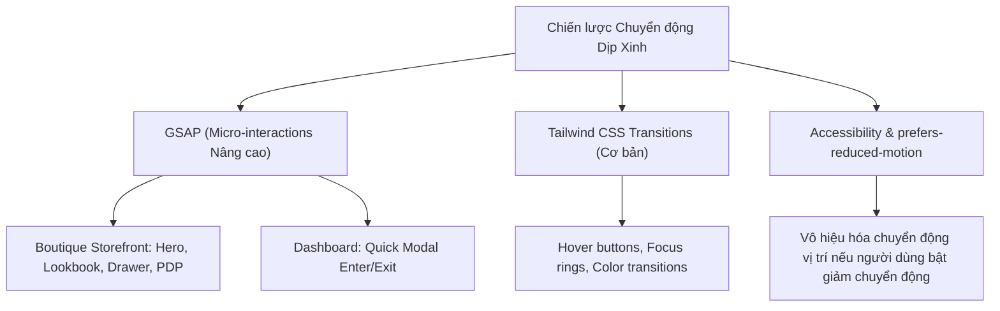
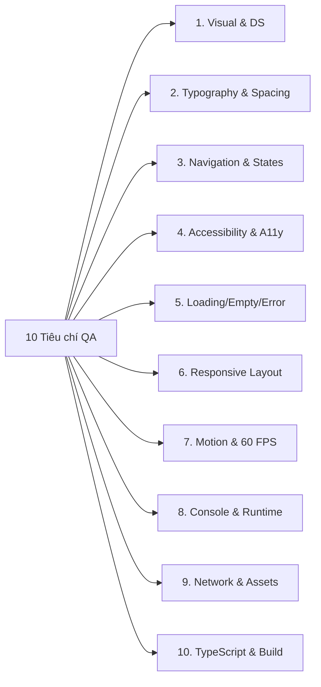
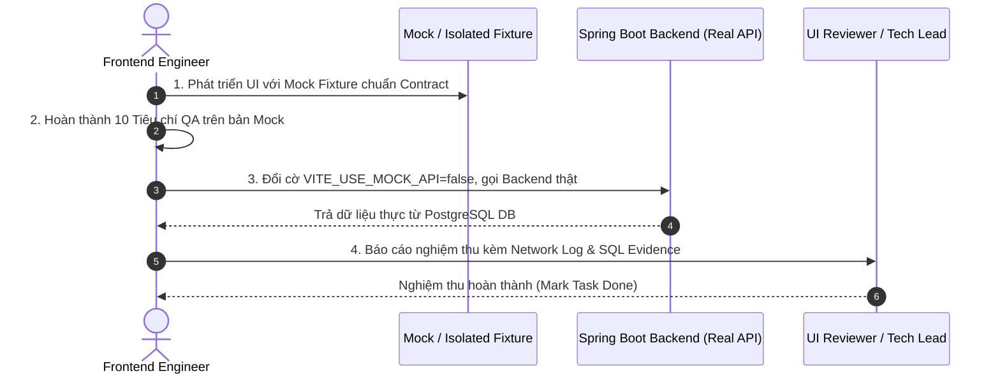

# KẾ HOẠCH CHUYỂN ĐỘNG VÀ ĐẢM BẢO CHẤT LƯỢNG GIAO DIỆN (MOTION & UI QA PLAN)
## Dự án: Dịp Xinh — Nền tảng SaaS Quản lý & Cho thuê Thời trang
**Tài liệu:** `docs/frontend-planning/06_MOTION_AND_UI_QA_PLAN.md`  
**Phiên bản:** 1.0 | **Ngày lập:** 08/11/2026  
**Quy chuẩn áp dụng:** `gsap-core`, `gsap-react`, `gsap-timeline`, `gsap-performance`, `web-design-guidelines`, `vercel-react-best-practices`

---

## 1. CHIẾN LƯỢC CHUYỂN ĐỘNG TỔNG THỂ (MOTION STRATEGY)

Chuyển động trong Dịp Xinh phục vụ một mục đích duy nhất: **Tôn vinh vẻ đẹp thanh lịch của sản phẩm thời trang cao cấp và tăng cường độ phản hồi trực giác của thao tác nghiệp vụ**. Chúng tôi áp dụng quy tắc chuyển động có chủ đích (Purposeful Motion), tuyệt đối không lạm dụng hiệu ứng gây xao nhãng hoặc làm chậm thao tác người dùng.



---

### 1.1 Phân định rõ ràng: Khi nào dùng GSAP vs. Khi nào dùng CSS Transitions

| Tiêu chí | Sử dụng GSAP (`@gsap/react`) | Sử dụng Tailwind CSS Transitions |
| :--- | :--- | :--- |
| **Bản chất chuyển động** | Chuỗi hiệu ứng nối tiếp phức tạp (Stagger), Timeline đa thuộc tính, Drawer trượt có lò xo vật lý. | Tương tác đơn lẻ: Đổi màu nút khi hover, viền input khi focus, đổi màu nền badge. |
| **Thời lượng (Duration)** | 0.3s - 0.6s với ease mượt mà (`power2.out`, `power3.out`). | 0.15s - 0.2s với ease tiêu chuẩn (`ease-out`). |
| **Phạm vi áp dụng** | - **Homepage**: Dải ruy-băng lướt vô tận (Infinite Marquee) & Băng chuyền các Shop nổi bật (Interactive Carousel).<br>- Hero entrance xuất hiện so le.<br>- Lưới sản phẩm xuất hiện mượt.<br>- Cart Drawer mở từ mép phải.<br>- PDP Modal phóng to từ tâm.<br>- Bàn giao / Thu hồi đơn hàng thành công (Confetti/Checkmark). | - Nút bấm (`button hover/active`).<br>- Menu dropdown đóng mở nhanh.<br>- Tooltip gợi ý.<br>- Chuyển tab dữ liệu đơn giản. |

---

### 1.2 VÙNG CẤM HOẠT HỌA (CRITICAL RESTRICTION ZONES)
Nhằm bảo vệ tuyệt đối tính toàn vẹn dữ liệu, hiệu năng và tâm lý người dùng, **NGHIÊM CẤM** sử dụng GSAP hoặc bất kỳ chuyển động trễ nào trong các khu vực sau:
1. **Luồng Thanh toán & Đặt cọc (Checkout & Payment):**  
   - Tuyệt đối không tạo animation trên nút "Xác nhận Đặt cọc & Thanh toán" hoặc mã VietQR.
   - Khi người dùng bấm thanh toán, giao diện phải phản hồi ngay lập tức với trạng thái `loading spinner` tĩnh, không được có hiệu ứng fade/slide làm tăng độ trễ.
2. **Bảng dữ liệu vận hành mật độ cao (Operational Data Tables):**  
   - Bảng đơn hàng (`DB-10`), bảng kho Serialized Units (`DB-04`), bảng sản phẩm (`DB-02`) **không dùng** animation xuất hiện từng hàng (row-by-row stagger). Nhân viên cần nhìn thấy toàn bộ dữ liệu lập tức để thao tác phím.
3. **Vòng lặp Quét mã QR (Barcode / QR Scanner Loop):**  
   - Khi camera hoặc máy quét đọc mã, giao diện chỉ phản hồi âm thanh Ting nhẹ và đổi màu viền xanh trong 200ms, không dùng hiệu ứng phóng to/thu nhỏ làm lag khung hình camera.
4. **Form nhập liệu nghiệp vụ (Walk-in Order & Product Form):**  
   - Không làm hiệu ứng trượt cho từng ô input khi gõ phím.

---

### 1.3 Quy chuẩn Kỹ thuật GSAP Chuẩn (`gsap-react` & `gsap-performance`)

1. **Sử dụng `useGSAP()` Hook và Scope Refs:**  
   Mọi hiệu ứng GSAP phải được bao bọc trong hook `useGSAP()` của `@gsap/react` kèm theo `scope: containerRef` để tự động dọn dẹp bộ nhớ (cleanup) khi unmount component:
   ```tsx
   import { useRef } from 'react';
   import { useGSAP } from '@gsap/react';
   import gsap from 'gsap';

   export const BoutiqueHero = () => {
     const heroRef = useRef<HTMLDivElement>(null);

     useGSAP(() => {
       // Kiểm tra thiết lập giảm chuyển động của hệ điều hành
       if (window.matchMedia('(prefers-reduced-motion: reduce)').matches) return;

       gsap.from('.hero-stagger', {
         opacity: 0,
         y: 24,
         duration: 0.6,
         stagger: 0.12,
         ease: 'power2.out',
       });
     }, { scope: heroRef });

     return (
       <div ref={heroRef} className="relative overflow-hidden">
         <h1 className="hero-stagger ...">Dịp Xinh</h1>
         <p className="hero-stagger ...">Boutique Thời trang Cao cấp</p>
       </div>
     );
   };
   ```

2. **Chỉ tác động lên các thuộc tính GPU-accelerated:**  
   - **Được phép:** `transform` (`x`, `y`, `scale`, `rotation`) và `opacity`.
   - **Tuyệt đối cấm:** `width`, `height`, `top`, `left`, `margin`, `padding` (vì gây reflow/relayout toàn bộ DOM tree làm tụt FPS).

3. **Chỉ số Hiệu năng Chuyển động (Performance Budget):**  
   - Tốc độ khung hình: Duy trì **ổn định 60 FPS** trên cả màn hình di động cấu hình trung bình.
   - Layout Shift (CLS): **CLS < 0.02** trong toàn bộ quá trình chạy animation.
   - GPU Memory: Giải phóng toàn bộ tween context ngay khi unmount.

---

### 1.4 KIẾN TRÚC GSAP CHO KHU VỰC SHOP NỔI BẬT TRÊN TRANG CHỦ (TASK `SUP-F13`)

Khu vực trình diễn hình ảnh các Boutique nổi bật trên Trang chủ (`/`) được áp dụng giải pháp kết hợp 2 tầng hiệu ứng chuẩn tạp chí thời trang (Editorial Fashion Showcase):

#### A. Dải Ruy-băng Lookbook Chạy Vô Tận Đa Chiều (Dual-direction Infinite Parallax Ribbon)
- **Cơ chế GSAP:**
  - Sử dụng 2 luồng ảnh chạy ngược chiều nhau (Hàng 1: Trái sang Phải, Hàng 2: Phải sang Trái).
  - Sử dụng hàm lặp vô tận trơn tru: `gsap.to('.marquee-track', { xPercent: -50, ease: 'none', duration: 25, repeat: -1 })`.
  - Áp dụng `gsap.quickTo()` để khi người dùng hover chuột vào bất kỳ thẻ Shop nào: Tốc độ trượt giảm dần mượt mà từ `timeScale: 1` xuống `timeScale: 0.15` (không dừng khựng đột ngột), ảnh trang phục mở rộng nhẹ (`scale: 1.04`, `duration: 0.4s`).
- **Tối ưu hiệu năng:**
  - Thêm thuộc tính CSS `will-change: transform` và `translate3d(0,0,0)` để ép card render trên GPU layer độc lập.
  - Tự động tạm dừng animation (`tween.pause()`) khi cửa sổ trình duyệt mất focus (`document.hidden / visibilitychange`) để tiết kiệm pin và RAM thiết bị.

#### B. Băng Chuyền Tương Tác Lướt Shop Nổi Bật (Interactive Drag & Momentum Carousel)
- **Cơ chế tương tác:**
  - Hỗ trợ vuốt chạm bằng ngón tay (Touch Swipe) trên điện thoại và kéo chuột (Mouse Drag) trên máy tính.
  - Tích hợp hiệu ứng quán tính (Inertia/Momentum): Khi thả tay, băng chuyền tiếp tục trượt nhẹ theo lực đẩy rồi hít êm ái (snap) vào thẻ Shop gần nhất.
  - Mỗi thẻ Shop hiển thị:
    - Ảnh bìa Lookbook thời trang kích thước lớn (tỷ lệ 3:4).
    - 3 thumbnail trang phục tiêu biểu có sẵn lịch thuê.
    - Huy hiệu phân loại (Váy cưới / Dạ tiệc / Áo dài thiết kế) và điểm đánh giá.
    - Nút CTA chuyển thẳng vào `/shop/:slug` của boutique đó.

#### C. Chế độ Tiếp cận Khuyết tật (Accessibility Fallback):
- Khi hệ điều hành bật `prefers-reduced-motion: reduce`:
  - Toàn bộ dải chạy marquee vô tận tự động chuyển thành Lưới sản phẩm tĩnh (Static Grid) hoặc Thanh cuộn ngang tiêu chuẩn (CSS scroll-snap) kèm nút điều hướng "Trang trước / Trang sau".

---

## 2. KẾ HOẠCH ĐẢM BẢO CHẤT LƯỢNG GIAO DIỆN (UI QUALITY ASSURANCE)

### 2.1 3 Mốc Breakpoints Kiểm thử Tiêu chuẩn
Mọi màn hình trên Dịp Xinh bắt buộc phải vượt qua kiểm thử trực quan trên trình duyệt thật tại 3 kích thước:
- **Desktop Chuẩn (1440px x 900px):** Đánh giá bố cục đa cột, thanh bên Dashboard cố định, lưới catalog 3-4 cột, trải nghiệm chuột và bàn phím.
- **Tablet / iPad (768px x 1024px):** Đánh giá thanh bên chuyển thành ngăn xếp hoặc drawer, bảng biểu cuộn ngang mượt mà, menu điều hướng co gọn.
- **Mobile Chuẩn (390px x 844px - iPhone 12/13/14 Pro):** Đánh giá thao tác một tay bằng ngón cái, menu hamburger, thanh điều hướng đáy di động (Bottom Bar), drawer trượt mượt mà.

---

### 2.2 10 TIÊU CHÍ KIỂM TRA CHẤT LƯỢNG CHUYÊN SÂU (10-POINT INSPECTION CHECKLIST)



#### Tiêu chí 1: Tính nhất quán Thẩm mỹ & Design System (Visual Consistency)
- [ ] Tuân thủ đúng bảng màu token ngữ nghĩa: Neutral Slate làm nền, Rose Gold cho Storefront, Brand Navy cho Dashboard, Crimson Red cho Admin.
- [ ] Không có màu hex hoặc rgb hardcoded tự do trong mã nguồn.
- [ ] Radius bo góc nhất quán: `rounded-lg` cho card, `rounded-md` cho nút/input, `rounded-full` cho badge/avatar.

#### Tiêu chí 2: Phân cấp Kiểu chữ & Khoảng cách (Typography & Spacing)
- [ ] Sử dụng duy nhất font `Be Vietnam Pro`, hiển thị đầy đủ dấu tiếng Việt sắc nét, không bị lỗi gãy font (FOUT/FOIT).
- [ ] Tỷ lệ kiểu chữ phân cấp rõ rệt: Heading 1 (Display), Heading 2 (Page Title), Heading 3 (Section), Body Text (14px - 15px), Caption (12px).
- [ ] Khoảng cách tuân thủ hệ lưới 8-pt (`p-2`, `p-4`, `p-6`, `gap-4`, `gap-6`).

#### Tiêu chí 3: Điều hướng & Trạng thái Tương tác (Navigation & States)
- [ ] Mọi nút bấm và liên kết đều có phản hồi hover, focus-visible và active rõ ràng.
- [ ] Trạng thái Menu đang chọn (Active link) có chỉ báo trực quan sắc nét.
- [ ] Thao tác Back/Forward trên trình duyệt hoạt động chính xác với URL và query params (lọc, tìm kiếm, phân trang).

#### Tiêu chí 4: Khả năng Tiếp cận & Điều hướng Bàn phím (Accessibility & Keyboard A11y)
- [ ] Toàn bộ form và nút bấm thao tác được 100% bằng bàn phím (`Tab`, `Shift+Tab`, `Enter`, `Space`, `Escape`).
- [ ] Vòng viền Focus (`ring-2 ring-primary ring-offset-2`) hiển thị rõ ràng khi điều hướng bằng phím, không bị ẩn bằng `outline-none` cẩu thả.
- [ ] Đạt chuẩn độ tương phản màu WCAG 2.1 AA (tỷ lệ tương phản tối thiểu 4.5:1 đối với văn bản thông thường và 3.0:1 đối với văn bản lớn).
- [ ] Các ảnh đều có thuộc tính `alt` mô tả ngữ nghĩa; các icon đơn lẻ có `aria-label`.

#### Tiêu chí 5: Trạng thái Tải dữ liệu, Rỗng và Báo lỗi (Loading, Empty & Error States)
- [ ] Khi chờ API, hiển thị Skeleton Loader có kích thước tương đồng khối dữ liệu thật, không để màn hình trắng trơn.
- [ ] Khi không có dữ liệu (Ví dụ: Giỏ hàng trống, Tìm kiếm không có kết quả), hiển thị Empty State tao nhã kèm nút hành động gợi ý tiếp theo.
- [ ] Khi API trả về mã lỗi 4xx/5xx, hiển thị thông báo lỗi rõ ràng, có nút "Thử lại" (Retry action).

#### Tiêu chí 6: Bố cục Đáp ứng Đa thiết bị (Responsive Layout)
- [ ] Không có hiện tượng thanh cuộn ngang ngoài ý muốn (Horizontal scroll overflow) trên màn hình 390px.
- [ ] Bảng dữ liệu lớn trên mobile có cơ chế chuyển đổi thành dạng thẻ danh sách (Card list view) hoặc cho phép cuộn ngang an toàn trong khung chứa.
- [ ] Các phần tử chạm (Touch targets) trên di động đạt kích thước tối thiểu 44px x 44px.

#### Tiêu chí 7: Độ mượt mà của Chuyển động (Animation Smoothness & FPS)
- [ ] Mọi chuyển động đạt 60 FPS, không có hiện tượng giật cục (jank) hoặc dropped frames.
- [ ] Không gây dịch chuyển bố cục đột ngột (CLS = 0).
- [ ] Tuân thủ triệt để chế độ `prefers-reduced-motion` của người dùng.

#### Tiêu chí 8: Cảnh báo Console & Lỗi Runtime (Runtime Cleanliness)
- [ ] Tab Console của trình duyệt hoàn toàn sạch sẽ, không có bất kỳ dòng chữ đỏ nào (`Uncaught Error`, `404 Not Found`).
- [ ] Không có cảnh báo vàng của React (Ví dụ: `Each child in a list should have a unique 'key' prop`, `Controlled vs Uncontrolled component`).

#### Tiêu chí 9: Yêu cầu Mạng & Tối ưu Tài nguyên (Network & Asset Health)
- [ ] Không có request nào bị lỗi 404 hình ảnh, font chữ hoặc icon.
- [ ] Ảnh sản phẩm được tối ưu kích thước, áp dụng `loading="lazy"` cho các ảnh nằm dưới nếp gấp màn hình (below the fold).
- [ ] Tổng dung lượng JS ban đầu (Initial Bundle Size) không vượt quá 350KB gzipped.

#### Tiêu chí 10: Quy chuẩn TypeScript, Linter & Build
- [ ] `npm run typecheck` (`tsc --noEmit`) đạt **0 errors**.
- [ ] `npm run lint` đạt **0 warnings/errors**.
- [ ] `npm run build` hoàn tất đóng gói thành công không có cảnh báo nghiêm trọng.

---

## 3. QUY TRÌNH XÁC THỰC KẾT NỐI API THỰC TẾ (REAL API VERIFICATION PROTOCOL)

Nhằm ngăn chặn việc nhầm lẫn giữa "Giao diện hiển thị tốt với Mock Data" và "Tính năng đã hoàn thành trên hệ thống thực", toàn bộ quá trình nghiệm thu Frontend phải tuân thủ giao thức 4 bước sau:



1. **Bước 1 - Phát triển UI Độc lập:**  
   Frontend engineer sử dụng Mock Fixture nằm trong `src/shared/fixtures/` tuân thủ 100% Swagger/OpenAPI spec của Backend.
2. **Bước 2 - Đánh giá Nội bộ UI:**  
   Thực hiện đầy đủ 10 tiêu chí kiểm tra trực quan tại 3 mốc responsive 390px, 768px, 1440px.
3. **Bước 3 - Cắm rút API Thật:**  
   Chuyển cờ `VITE_USE_MOCK_API=false`, kích hoạt backend Spring Boot chạy local hoặc staging. Kiểm thử các trường hợp dữ liệu rỗng, dữ liệu dài, lỗi xác thực 400 và lỗi máy chủ 500.
4. **Bước 4 - Báo cáo Nghiệm thu:**  
   Cung cấp bằng chứng cụ thể:
   - Ảnh chụp Network tab hiển thị Status 200/201 từ API Spring Boot.
   - Ảnh chụp giao diện hiển thị dữ liệu thực tế từ cơ sở dữ liệu PostgreSQL.
   - Chỉ khi đủ bằng chứng trên, task mới được chuyển trạng thái sang `Done`.
