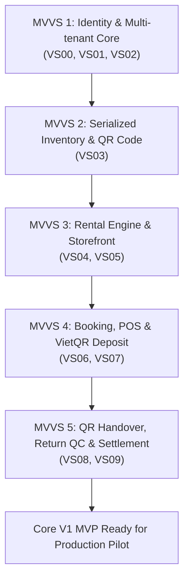
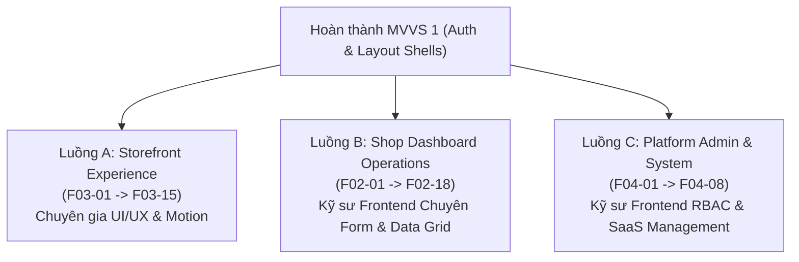

# THỨ TỰ THỰC THI VÀ PHÂN BỔ NHIỆM VỤ CHI TIẾT (FRONTEND EXECUTION ORDER)
## Dự án: Dịp Xinh — Nền tảng SaaS Quản lý & Cho thuê Thời trang
**Tài liệu:** `docs/frontend-planning/07_EXECUTION_ORDER.md`  
**Phiên bản:** 1.0 | **Ngày lập:** 08/11/2026  
**Tác giả:** Senior Frontend Architect & Technical Project Planner

---

## 1. NGUYÊN TẮC THỰC THI CỐT LÕI (EXECUTION PRINCIPLES)

1. **Tuyệt đối không phát triển dàn trải bề ngang (No Horizontal Sprawl):**  
   Không dựng toàn bộ giao diện HTML/CSS của hàng chục màn hình rồi mới quay lại nối API. Thay vào đó, thực thi dứt điểm từng **Minimum Viable Vertical Slice (MVVS)** từ UI -> Client API -> Backend Spring Boot -> DB PostgreSQL.
2. **Ưu tiên giá trị cốt lõi của bài toán Cho thuê Thời trang (Rental Core First):**  
   Hệ thống khác biệt với E-commerce truyền thống ở 3 khâu: **Serialized Inventory QR vật lý -> Kiểm tra lịch khả dụng thời gian thực -> Giao nhận đối soát & Hoàn cọc**. Đây là các lát cắt phải được ưu tiên hoàn thiện trước các tính năng phụ trợ như blog hay mạng xã hội.
3. **Mỗi bước đi đều có thể kiểm thử độc lập (Independent Verification):**  
   Mỗi task khi hoàn thành đều phải chứng minh được bằng: Code sạch không lỗi typecheck, hình ảnh đối chiếu UI tại 3 mốc (390px, 768px, 1440px), và log kiểm thử tương tác thành công.

---

## 2. LỘ TRÌNH 5 LÁT CẮT TỐI THIỂU KHẢ DỤNG (5 MINIMUM VIABLE VERTICAL SLICES)

---

### LÁT CẮT 1 (MVVS 1): ĐỊNH DANH, CƠ CHẾ ĐA KHÁCH THUÊ & ONBOARDING
- **Vertical Slices:** `VS00` (Tenant Resolution), `VS01` (Identity & JWT Auth), `VS02` (Shop Onboarding).
- **Mục tiêu:** Xây dựng xong "cánh cổng" an toàn cho toàn bộ hệ thống: Đăng nhập an toàn, phân định rõ ràng ranh giới giữa Khách hàng, Nhân viên, Chủ shop và Quản trị viên sàn.
- **Danh sách Tasks thực thi:**
  - `F01-07`: HTTP Client Interceptor, xử lý xoay vòng Refresh Token (in-memory + HttpOnly cookie).
  - `F01-09`: Giao diện Form Đăng nhập & Đăng ký Shop Owner.
  - `F01-10`: Auth Store (Zustand) và quản trị vòng đời Token.
  - `F01-11`: Route Guards (RBAC Protected Routes) và Tenant Guard.
  - `F01-12`: Multi-tenant Shop Selector (`/dashboard/select-shop`).
  - `F04-03`: Wizard khởi tạo cửa hàng mới 3 bước.
- **Tiêu chí nghiệm thu Lát cắt 1 (Gate 1):**
  - Người dùng có thể đăng ký tài khoản Owner, tạo Shop "Boutique Ánh Trăng", đăng nhập lấy Access Token in-memory, và được chuyển hướng chính xác vào `/dashboard/boutique-anh-trang`.
  - Cố tình truy cập shop của người khác sẽ bị từ chối quyền truy cập (403 Access Denied).

---

### LÁT CẮT 2 (MVVS 2): SẢN PHẨM, BIẾN THỂ VÀ KHO SERIALIZED UNITS GÁN MÃ QR
- **Vertical Slices:** `VS03` (Catalog, Variants, Serialized Units & Physical QR Codes).
- **Mục tiêu:** Cung cấp công cụ số hóa toàn bộ tài sản trang phục của cửa hàng thành các mã định danh vật lý riêng biệt.
- **Danh sách Tasks thực thi:**
  - `F02-02`: Bảng danh sách sản phẩm cửa hàng (`/dashboard/:shopSlug/products`).
  - `F02-03`: Form tạo sản phẩm mới, upload ảnh và sinh ma trận biến thể (Size x Màu).
  - `F02-04`: Màn hình quản lý từng chiếc váy vật lý (Serialized Units) và trạng thái hao mòn.
  - `F02-05`: Modal và màn hình in mã QR chuẩn kích thước tem vật lý (50x30mm).
  - `SUP-F04`: Tiện ích tối ưu ảnh trước khi tải lên.
- **Tiêu chí nghiệm thu Lát cắt 2 (Gate 2):**
  - Tạo thành công 1 sản phẩm có 2 màu, 3 size (6 SKU).
  - Nhập kho 10 đơn vị cho thuê vật lý, hệ thống sinh ra đúng 10 mã QR không trùng lặp.
  - In ra giấy tem nhãn sắc nét, máy quét đọc được chính xác chuỗi mã định danh.

---

### LÁT CẮT 3 (MVVS 3): CHÍNH SÁCH GIÁ, CÔNG CỤ KHÁ KHẢ DỤNG & BOUTIQUE STOREFRONT
- **Vertical Slices:** `VS04` (Pricing & Availability Engine), `VS05` (Public Storefront Discovery).
- **Mục tiêu:** Đưa sản phẩm lên không gian số công khai cho khách hàng chiêm ngưỡng và chọn thuê mà không sợ bị trùng lịch.
- **Danh sách Tasks thực thi:**
  - `F02-06`: Cấu hình chính sách cho thuê (Số ngày gói thuê, tỷ lệ cọc, buffer bảo dưỡng 24h).
  - `F02-07`: Bảng lịch kiểm tra khả dụng trực quan (Availability Calendar).
  - `F03-01` -> `F03-05`: Hoàn thiện Storefront từ bản Prototype sang kết nối dữ liệu Catalog động.
  - `F03-06`: Widget chọn ngày thuê trên trang chi tiết sản phẩm Storefront, tự động khóa ngày bận.
  - `F03-07` & `F03-08`: Cart Drawer tách bạch sản phẩm thuê (kèm cọc) và sản phẩm mua.
  - `SUP-F13`: Nâng cấp Trang chủ nền tảng (`/`) với dải ảnh Boutique nổi bật lướt vô tận (GSAP Marquee) & Băng chuyền kéo thả có quán tính.
- **Tiêu chí nghiệm thu Lát cắt 3 (Gate 3):**
  - Khách hàng lướt Storefront `/shop/:slug`, chọn ngày thuê từ 20/11 đến 22/11/2026. Nếu chiếc váy đó đã được người khác đặt trước trong ngày 21/11, lịch hiển thị trạng thái đỏ và không cho thêm vào giỏ.

---

### LÁT CẮT 4 (MVVS 4): ĐẶT THUÊ ONLINE, HỢP ĐỒNG ĐIỆN TỬ, CỌC VIETQR & ĐƠN TẠI QUẦY POS
- **Vertical Slices:** `VS06` (Rental Checkout & Digital Contract), `VS07` (Walk-in Fast POS & Deposits).
- **Mục tiêu:** Kích hoạt dòng tiền cho cửa hàng: Nhận thanh toán tiền thuê và tiền cọc bảo đảm, cả trên kênh trực tuyến lẫn tại quầy showroom.
- **Danh sách Tasks thực thi:**
  - `F03-09`: Luồng Checkout Stepper 3 bước trên Storefront.
  - `F03-10`: Bảng kê chi phí minh bạch (Giá thuê + Tiền cọc).
  - `F03-11`: Màn hình ký cam kết hợp đồng cho thuê điện tử.
  - `F03-12`: Màn hình thanh toán VietQR động có đếm ngược và lắng nghe thanh toán tự động.
  - `F02-08`: Chuyển đổi Walk-in POS Modal từ mock data sang kết nối API tạo đơn thật.
- **Tiêu chí nghiệm thu Lát cắt 4 (Gate 4):**
  - Thực hiện thành công cả 2 luồng: Khách online đặt đơn cọc qua VietQR và Khách đến showroom thuê mang đồ về ngay qua POS.
  - Ngay khi đơn hoàn tất, lịch khả dụng của chiếc váy lập tức chuyển sang trạng thái "Đã giữ chỗ".

---

### LÁT CẮT 5 (MVVS 5): BÀN GIAO QUÉT QR, THU HỒI KIỂM ĐỊNH & QUYẾT TOÁN CỌC
- **Vertical Slices:** `VS08` (Fulfillment & Handover), `VS09` (Return Inspection, Damage & Deposit Settlement).
- **Mục tiêu:** Hoàn thiện vòng tròn khép kín của dịch vụ cho thuê thời trang cao cấp.
- **Danh sách Tasks thực thi:**
  - `F02-10`: Bảng phân loại đơn hàng vận hành theo trạng thái ngày hôm nay.
  - `F02-11`: Modal bàn giao trang phục, tích hợp quét mã QR để xác nhận đúng chiếc váy xuất kho.
  - `F02-12`: Giao diện thu hồi và biên bản kiểm định tình trạng trang phục (6 tiêu chí hư hại).
  - `F02-13`: Hộp thoại tự động tính phụ phí trễ hạn và tiền bồi thường vết bẩn.
  - `F02-14`: Màn hình quyết toán và hoàn cọc điện tử về tài khoản khách hàng.
  - `SUP-F09`: Module máy quét mã vạch / camera QR scanner.
- **Tiêu chí nghiệm thu Lát cắt 5 (Gate 5):**
  - Quét đúng mã QR trên váy -> Giao đồ cho khách -> Khách mang trả -> Kiểm tra có vết bẩn nhẹ -> Khấu trừ 100.000đ từ tiền cọc -> Hoàn trả phần cọc còn lại -> Chiếc váy chuyển sang trạng thái Giặt hấp chuẩn bị cho lượt thuê tiếp theo.

---

## 3. CÁC NHÁNH CÓ THỂ TRIỂN KHAI SONG SONG (PARALLEL WORKSTREAMS)

Nhằm tối ưu hóa tiến độ và tận dụng năng lực của đội ngũ frontend, sau khi Lát cắt 1 hoàn thành, dự án có thể chia thành 3 luồng công việc song song độc lập mà không gây xung đột mã nguồn:

- **Luồng A (Customer Experience & Discovery):** Tập trung vào trải nghiệm thị giác thời trang cao cấp trên Trang chủ nền tảng (`SUP-F13`: Dải ảnh Shop nổi bật lướt vô tận & Băng chuyền GSAP), tối ưu hóa Web Vitals, Responsive mobile, GSAP micro-interactions và luồng Checkout Storefront (`F03-01` -> `F03-15`, `SUP-F06`, `SUP-F13`).
- **Luồng B (Shop Operations):** Tập trung vào nghiệp vụ quản lý kho, bảng ma trận biến thể, máy in mã QR, điều phối giao nhận và kiểm định cọc (`F02-01` -> `F02-18`).
- **Luồng C (Platform & Infrastructure):** Tập trung vào phân quyền RBAC, quản trị các Shop trên sàn, quản lý gói thuê bao SaaS và kiểm tra Audit Logs (`F04-01` -> `F04-08`).

---

## 4. TOP 5 TÁC VỤ CẦN THỰC HIỆN TIẾP THEO NGAY LẬP TỨC (TOP 5 IMMEDIATE NEXT TASKS)

Đây là 5 nhiệm vụ có độ ưu tiên cao nhất (`P0`), thuộc tuyến đường găng (Critical Path) cần được đội ngũ bắt tay vào thực hiện ngay:

### 1. Nhiệm vụ 1: `F01-07` — Hoàn thiện HTTP Client, Interceptors & Single-flight Refresh Token
- **Lý do cấp thiết:** Đây là "xương sống" kết nối của toàn bộ ứng dụng Frontend. Nếu không có cơ chế chặn lỗi 401 và tự động refresh token ngầm, người dùng sẽ liên tục bị văng đăng xuất khi đang thao tác.
- **Mục tiêu cụ thể:** Xây dựng `src/shared/api/client.ts` và `interceptors.ts`, lưu Access Token trong Zustand in-memory, kết nối API `POST /api/v1/auth/refresh` bằng HttpOnly Cookie.
- **Thời gian ước tính:** 2 ngày làm việc.

### 2. Nhiệm vụ 2: `F01-09` — Hoàn thiện Form Đăng nhập & Đăng ký Shop Owner
- **Lý do cấp thiết:** Backend Spring Boot đã có sẵn `AuthController` và `MeController` hoàn chỉnh trong cơ sở mã nguồn. Cần kết nối ngay để chấm dứt việc đăng nhập giả định.
- **Mục tiêu cụ thể:** Thay thế mock authentication tại `LoginForm.tsx` và `RegisterForm.tsx` bằng lời gọi API thật; xử lý hiển thị lỗi form validation từ Spring Boot DTO.
- **Thời gian ước tính:** 2 ngày làm việc.

### 3. Nhiệm vụ 3: `F01-11` & `F01-12` — Thiết lập Route Guards, RBAC & Multi-tenant Shop Selector
- **Lý do cấp thiết:** Bảo vệ tính toàn vẹn dữ liệu đa khách thuê (Multi-tenant isolation). Đảm bảo một nhân viên của Shop A không bao giờ mở được Dashboard của Shop B hay truy cập trái phép vào `/admin`.
- **Mục tiêu cụ thể:** Tạo component `ProtectedRoute`, `TenantGuard`, và màn hình `/dashboard/select-shop`.
- **Thời gian ước tính:** 2 ngày làm việc.

### 4. Nhiệm vụ 4: `F02-02` & `F02-03` — Bảng Sản phẩm & Ma trận Biến thể (Size x Màu)
- **Lý do cấp thiết:** Cửa hàng không thể hoạt động nếu không có dữ liệu trang phục trong kho. Đây là điều kiện tiên quyết cho toàn bộ luồng Storefront và POS.
- **Mục tiêu cụ thể:** Xây dựng giao diện nhập sản phẩm thời trang cao cấp, tạo tổ hợp biến thể tự động, tích hợp tải nhiều góc ảnh sản phẩm.
- **Thời gian ước tính:** 3 ngày làm việc.

### 5. Nhiệm vụ 5: `F02-04` & `F02-05` — Quản lý Serialized Rental Units & In Tem Nhãn QR Code
- **Lý do cấp thiết:** Điểm phân biệt then chốt của Dịp Xinh so với các phần mềm bán hàng thông thường: Quản lý từng chiếc váy vật lý gán mã QR serial độc nhất để xuất kho và thu hồi.
- **Mục tiêu cụ thể:** Xây dựng danh sách đơn vị vật lý, gắn nhãn trạng thái (Mới, Đang thuê, Cần bảo dưỡng) và xây dựng màn hình in mã QR xem trước chuẩn máy in tem nhãn.
- **Thời gian ước tính:** 3 ngày làm việc.

---

## 5. CỔNG KIỂM SOÁT VÀ ĐIỀU KIỆN NGHIỆM THU (VERIFICATION GATES)

Trước khi đóng bất kỳ nhiệm vụ nào hoặc bàn giao lát cắt cho khách hàng thử nghiệm, phải vượt qua bảng kiểm soát 4 cổng sau:

| Cổng kiểm soát | Nội dung kiểm tra bắt buộc | Người phê duyệt |
| :--- | :--- | :--- |
| **Gate 1: Code Quality** | `npm run typecheck` đạt 0 lỗi; `npm run lint` đạt 0 cảnh báo. Không có `any` cẩu thả. | Frontend Lead |
| **Gate 2: Design & A11y** | Kiểm tra trực quan trên trình duyệt thật ở 390px, 768px, 1440px. Đạt chuẩn màu, font, và WCAG 2.1 AA. | Product Designer / UX Engineer |
| **Gate 3: Motion & Perf** | GSAP mượt 60 FPS, không gây giật lag (CLS = 0). Không có animation trên các bước thanh toán nhạy cảm. | Motion Specialist |
| **Gate 4: Real API Contract** | Chuyển đổi từ Mock sang API thật của Spring Boot; cung cấp log HTTP 200/201 và dữ liệu hiển thị thật từ DB. | Fullstack / Backend Lead |
